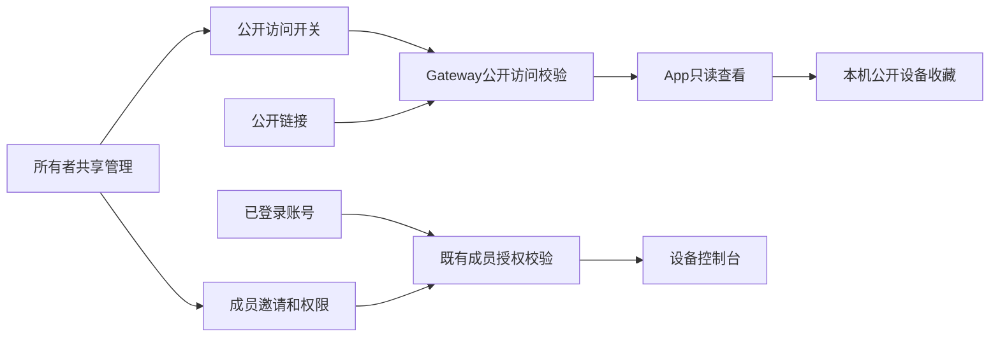
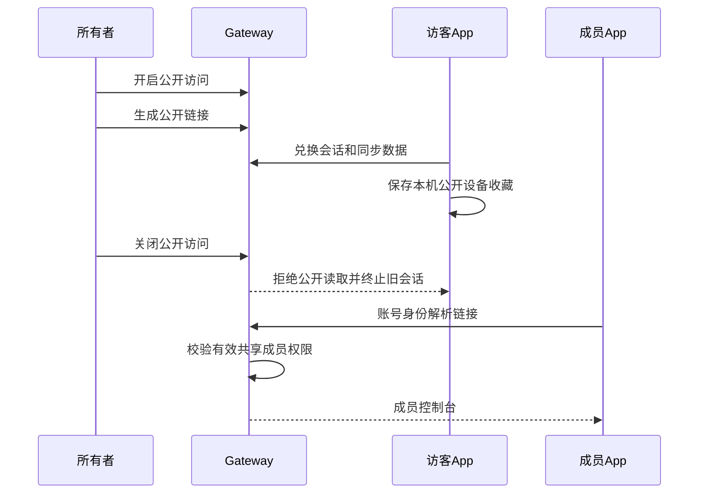

# 公开访问与共享管理简化计划

## Intent：最终目标

修复共享管理读取状态不刷新；增加明确的“公开访问”开关。公开开启时才能生成公开链接，访客可不登录查看并保存为本机公开设备收藏。关闭后，匿名和非成员停止获取配置、同步数据；登录且有效共享成员继续使用已有权限。共享管理页面改为极简，只显示有意义的信息和操作。

## Data：可用证据

- 用户反馈“开启分享”按钮灰色、左侧一直显示正在读取。
- Angular 22.1.1 默认 OnPush；共享管理异步赋值没有通知视图。已补 markForCheck 并通过本地构建。
- 用户确认未登录加入列表采用本机公开设备收藏，不能自动创建账号 grant。
- 用户提供当前页面截图：设备大卡、宣传句、说明段落、大块空状态和重复权限提示占用大量空间。
- 当前已实现观看链接、10 分钟会话、SSE 周期权限复核、成员共享和独立编辑权限。
- 当前公开页面先兑换匿名会话再判断成员，公开关闭时必须修正登录成员的入口顺序。

## Edges：边界与限制

- 不增加普通设备控制台模式 Tab。
- 不增加匿名写操作或将公开收藏当成成员授权。
- 公开开关由所有者管理，独立于成员控制/编辑权限。
- 不更改 aily-blockly，不托管前端页面。
- 不生成新测试用例、不调用浏览器 UI 确认；使用给定截图、现有代码、构建与已有相关验证。
- 本地已执行迁移 041，新增数据库变化使用新迁移。

## Answer：交付格式与成功标准

交付最小范围的 App/Gateway 实现、数据库迁移、简洁共享页、可用本机收藏列表和验证记录。公开关闭必须在服务端拒绝读取并终止旧观看会话；账号成员通过真实授权继续访问。文档遵循 IDEA。

## 架构图

## 数据流图

## 执行顺序

1. 收敛公开开关的数据模型、链接生命周期、成员入口和本机收藏边界。
2. 实现服务端开关与读取约束，兼容已有公开链接。
3. 实现 App 开关、本机收藏、关闭后的成员访问及登录入口。
4. 简化共享管理主页面和弹层文案，保留现有主题体系。
5. 构建和相关现有检查；记录实际覆盖、限制及自我批判。

## 执行记录

- 已修复共享管理异步状态更新遗漏，构建通过。
- 两个子代理仅分析服务端生命周期与 App 接入，主执行统一修改。

## 完成记录

- 已完成设备级公开开关、所有者管理接口、成员链接解析接口和迁移 042。
- 开关关闭使链接版本递增，保留链接标识但使旧匿名会话失效；重新开启不会复活旧会话。
- 已完成本机公开设备收藏、未登录共享列表入口、成员优先解析和关闭后的登录入口。
- 共享页移除设备大卡、宣传文案、权限重复提示、大块空状态及固定双按钮页脚；保留设备名、公开开关、按需链接操作、成员列表和邀请入口。
- 已完成 App/Gateway 构建，前端 76 项现有检查与 Gateway 20 项现有相关检查通过。未创建新测试用例，未调用浏览器。
- 详细验证与自我审查见《公开访问与共享管理执行记录》。
