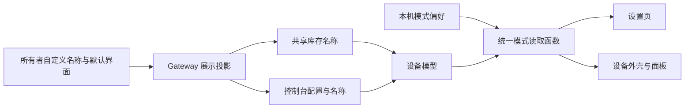
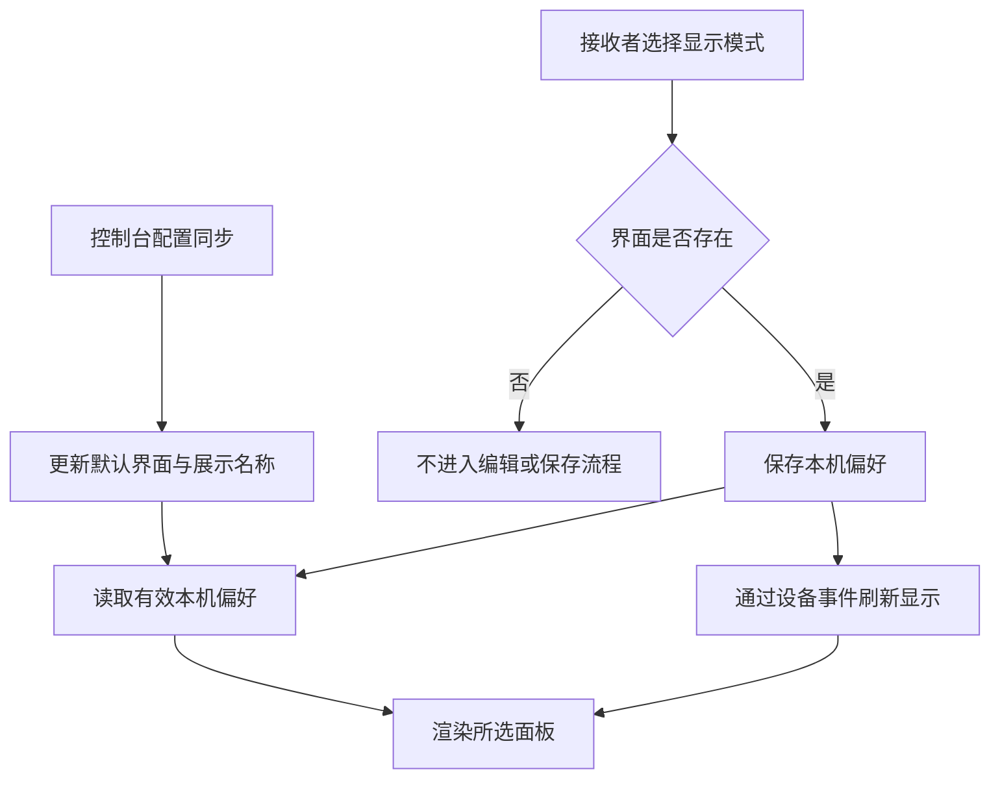

# 共享设备名称与显示模式修复执行记录

## Intent：最终目标

共享接收者能切换设备已有的显示模式，设备名称显示所有者设置的名称。

## Data：可用证据

### 根因

- 设置页在按钮和处理函数两处直接禁止共享设备切换模式，把查看偏好与所有者配置写权限混为一谈。
- 控制台会周期性安装服务端配置。如果只修改内存中的 panelMode，本机选择会被后续同步覆盖。
- 后端 listReceivedAccess 返回底层 name，没有读取 ui_config.customName。
- App 库存安装优先保留旧 customName，导致旧名称跨刷新保留。
- 控制台已返回正确的 name，但 installConsole 没有安装这个展示字段。
- 共享名称校验上限是 128 字节，所有者自定义名称允许最多 256 字节，较长中文名存在不兼容。

### 实施结果

| 位置 | 调整 |
| --- | --- |
| device/device-panel-mode.ts | 用小型函数读取和保存共享设备本机模式偏好，按服务地址与设备区分 |
| device-settings.ts / html | 开放共享设备模式选择；保存本机偏好并刷新设备界面；没有自定义界面时禁用对应选项 |
| device.page.ts、device-v2.page.ts、legacy-panel.component.ts | 使用同一模式读取函数，保证设置页、外壳与实际面板一致 |
| Gateway access-grants.js | 共享列表仅投影自定义展示名称，不返回完整私有配置 |
| data.service.ts | 共享设备名称优先使用本次服务端结果；所有者沿用现有逻辑 |
| device-console.service.ts | 控制台配置安装时同步共享设备的展示名称 |
| device-v2-sharing.service.ts | 共享列表、邀请预览及收件箱的名称字节上限统一为 256 |

### 验证

- App 本地配置构建通过，Gateway 构建通过。
- 13 个现有前端测试文件、87 项检查通过；另运行库存与共享服务两个现有测试文件，13 项检查通过，共 100 项。
- Gateway 现有跨分片共享检查 10 项通过，使用隔离的 PostgreSQL 测试 schema。
- 现有 access-grants 脚本的非数据库检查通过；它的数据库分支未配置测试连接而跳过，不计入上述 10 项。
- 前端与 Gateway 健康接口均返回 HTTP 200，Gateway 容器状态 healthy。
- 两个仓库 git diff --check 通过。
- 本地 Gateway 已重建并重建容器；此前启用的跨分片配置保留。

测试命令最初缺少与临时 TypeScript 配置对应的 include 参数，导致 Angular 尝试编译未列入配置的其他测试页面。已停止该次运行，补齐筛选参数后运行通过；未修改测试用例来规避问题。

## Edges：边界与限制

- 接收者的显示模式保存在当前浏览器或 App 的本机存储，不同步到其他终端；同一服务和设备共用该本机偏好。
- 共享接收者切换模式不调用所有者配置写接口，不改变设备控制与界面编辑权限。
- 所有者未提供自定义界面时，接收者只能使用组件模式；已有自定义界面被移除后，读取函数回到组件模式。
- 本机存储不可用时，保存报告失败，读取继续使用有效的服务端默认模式。
- 没有调用浏览器确认 UI，没有新增测试用例；现有测试没有覆盖本次新偏好的全部组合，因此不宣称完成真实点击链路验证。
- 修改仅在本地应用与本地网关生效，未提交或发布到远程环境。

## Answer：交付与成功标准

- 共享设备的组件模式和已有自定义模式可以作为本机查看偏好切换，服务端定时同步不会覆盖该偏好。
- 共享列表、控制台标题和设备设置页使用所有者设置的展示名称，旧缓存可在库存或控制台刷新后纠正。
- 代码、构建检查和本 IDEA 执行记录已交付。

### 自我批判

直接解除按钮禁用并沿用保存请求会触发权限错误；仅修改 config.panelMode 又会与周期同步互相覆盖。因此保留服务器默认值，将本机查看偏好单独保存是必要的最小状态分离。

名称修复若仅修改标题或仅修改 SQL，旧缓存仍可能显示错误名称。因此修复范围覆盖查询投影、库存安装和控制台安装三个实际来源，同时保持所有者现有重命名流程。没有增加新的权限、状态管理服务或针对截图内容的特殊判断。

## 架构图

## 数据流图

