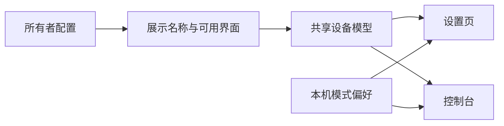
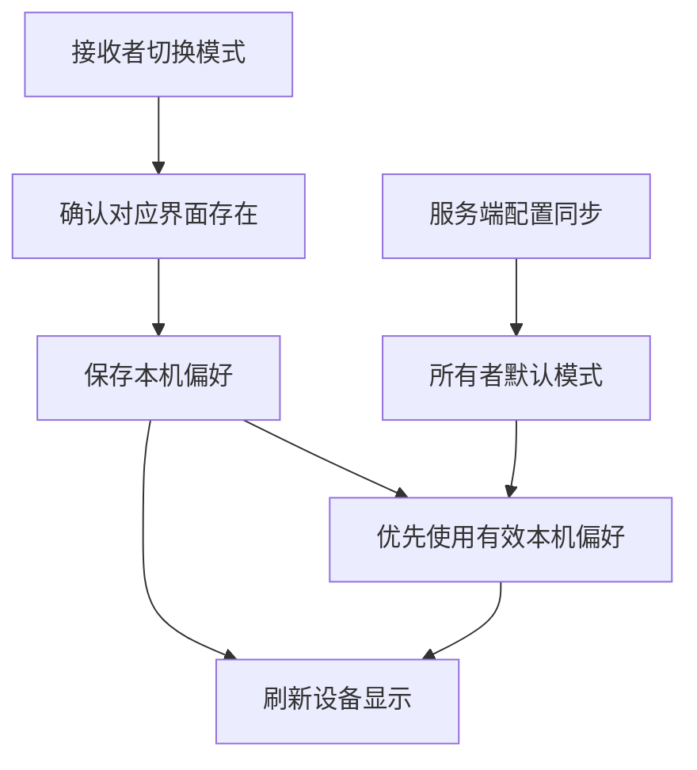

# 共享设备名称与显示模式修复计划

## Intent：最终目标

共享设备显示所有者设置的名称，接收者可以在已有组件界面与自定义界面之间切换。

## Data：可用证据

- 设置页直接使用 isSharedDevice 禁用了模式选择按钮和保存处理。
- 控制台配置读取会周期性覆盖 panelMode；仅解除按钮禁用并写入内存，会在下次同步时被覆盖。
- installConsole 读取了服务端名称字段，却没有更新共享设备的 customName。
- 普通控制台和设置页都读取 device.config.customName；共享设备列表的服务端名称来源需要一起核对。

## Edges：边界与限制

- 共享接收者切换显示模式属于本机查看偏好，不修改所有者的默认模式，不扩大设备控制或界面编辑权限。
- 本机偏好按服务地址和设备隔离，仅对共享设备生效；所有者继续使用原来的保存流程。
- 没有自定义界面时不能切换到自定义模式，也不能把只读用户引导到编辑页面。
- 名称接口只返回展示名称，不向共享用户暴露完整私有配置。
- 不使用浏览器、不新增测试用例，运行构建和相关现有检查。

## Answer：交付与成功标准

- 共享列表、控制台标题、设置页均以所有者自定义名称为准。
- 共享设备可切换已有显示模式，返回控制台和配置刷新后保留本机选择。
- 只读与控制权限保持原边界；所有者模式保存不变。
- 交付代码与 IDEA 执行记录，记录检查和限制。

## 架构图

## 数据流图

