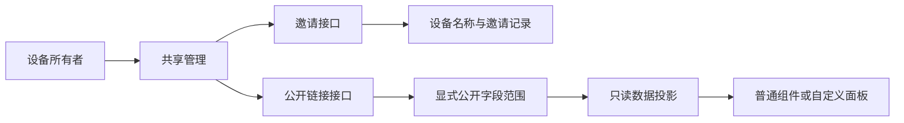
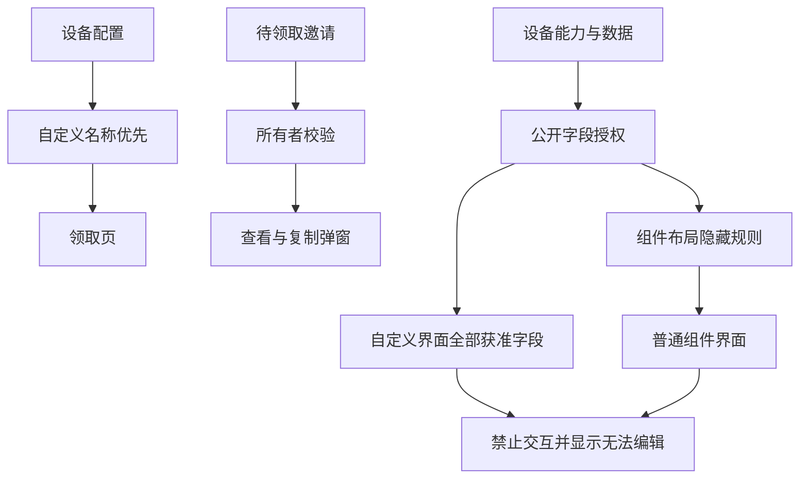

# 分享只读与邀请界面修正计划

## Intent：最终目标

- 公开控制台保留获准公开的输入组件及当前值，明确显示「无法编辑」。
- 邀请领取页显示设备自定义名称，仅保留有效期、权限和必要操作。
- 已创建的链接邀请可再次打开弹窗查看、复制同一链接。
- 公开访问卡片采用紧凑、清晰的链接区域，保留完整链接及独立复制操作。

## Data：可用证据

- 公开控制台把组件模式的 `hiddenEndpointKeys` 同时当成了数据权限，导致自定义界面仍引用的字段被删掉。
- 公开字段列表单独存储，旧链接可能已经保存了错误范围；不能用无条件合并字段绕过明确的公开授权。
- 领取页直接显示后端 `deviceName`，后端读取原始名称，正常控制台则优先读取 `ui_config.customName`。
- 邀请领取页缺少独立样式；所有说明、权限、动作都直接纵向堆叠。
- 用户截图中列表日期显示五位数年份，需核对时间单位。

## Edges：边界与限制

- 延续现有权限、登录、接受和撤销行为；不新增邮件邀请。
- 组件布局隐藏与公开字段授权分别处理；保留显式字段限制和只读事件隔离。
- 不改变既有邀请链接、不延长有效期；仅所有者可再次取得待领取链接。
- 不生成测试用例，不调用浏览器进行 UI 确认；运行相关现有检查及构建。
- 修改集中于分享页面、邀请接口和公开投影，保留本次会话已有修改。

## Answer：交付格式与成功标准

- 交付可运行代码、中文执行记录；文档采用 IDEA 框架。
- 授权字段在自定义公开面板保留组件与数值，输入框显示「无法编辑」。
- 接受邀请页名称与设备管理一致，信息层级清晰。
- 重进共享管理后仍能查看和复制待领取邀请，日期使用正确单位。
- 构建与相关现有检查通过，明确记录未作浏览器视觉验证。

## 架构图

## 数据流图

