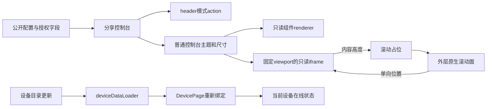
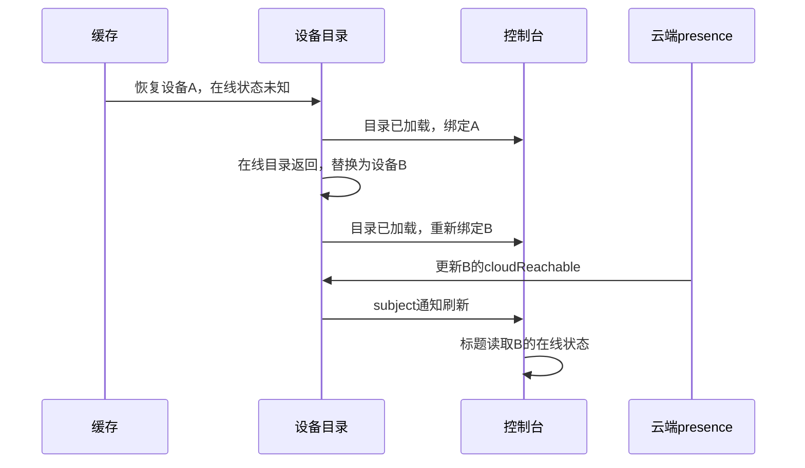

# 分享控制台样式对齐执行记录

## Intent：最终目标

使公开分享页沿用普通控制台的主题和布局，在 header 使用 action button 切换组件与自定义模式。修复正常控制台刷新后数值持续变化、标题却停留在“状态未知”的问题。

## Data：可用证据

### 分享页差异的根因

- 分享页只声明主题属性，没有应用正常控制台的主题变量与背景 mixin。
- 自定义 HTML 外层额外设置固定高度、边距和圆角，改变了文档看到的 viewport。
- 只读卡片统一设置 `disabled=true`，触发组件的淡化样式；禁止交互和禁用视觉被混在一起。
- HTML atom 在查不到公开字段时提前返回，没有设置网格 geometry。包含尺寸隔离的 `.cell` 因而缺少所需的占位尺寸。

### 刷新后状态未知的根因

1. 缓存恢复生成设备对象 A；缓存中的在线状态为未知。
2. 控制台收到首次初始化事件后绑定 A。
3. 在线设备目录返回，生成设备对象 B，并替换目录中的 A。
4. presence 更新写入 B；实时字段由独立 store 更新，仍能正常显示。
5. 控制台原先只监听一次初始化完成事件，标题继续读取 A 的未知状态。
6. 返回列表重新进入时，现有绑定逻辑取得 B，标题才恢复。

## Edges：边界与限制

- 公开分享保持只读。iframe 仍使用 opaque-origin sandbox、inert 与受限 CSP；renderer 和 bridge 均禁止设备动作。
- 不根据连接 ready 或实时数值变化伪造在线状态，标题继续使用设备 presence。
- 不扩大公开字段集合。分享链接不包含的字段显示通用占位，不针对截图中的字段名称编写特例。
- 只读滚动支持文档根滚动；HTML 内自行定义的独立嵌套滚动容器不在此次修复范围。保持 iframe viewport 不变，避免改变现有 `vh` 排版含义。
- 未使用浏览器进行 UI 确认；没有新增测试用例，只调整已有测试的服务 mock 与当前订阅接口一致。

## Answer：交付格式与成功标准

### 已实施改动

- 移除分享页模式 Tab、额外状态行和底部说明，使用 header 按钮切换模式。
- 组件模式复用普通控制台的 720px 最大内容宽度、16px 内边距和主题；自定义模式复用普通控制台的完整 viewport 结构。
- 只读卡片保留正常视觉，通过 renderer 的交互开关及 iframe 边界限制操作。
- 共享与正常控制台共用值格式化函数；文本、数值草稿和 telemetry 间隔按字段映射。
- 缺失字段的 atom 先设置 geometry，再显示占位；字段恢复后移除占位样式。
- 只读 HTML 使用外层原生滚动面控制 iframe 根滚动。内容高度只用于滚动占位，不改变 iframe 高度；位置单向传递，避免迟到回执拉回用户滚动。
- `DevicePage` 从监听 `initCompleted` 改为监听 `deviceDataLoader`。目录成功更新后复用已有 `bindDevice()`，对象未变时保留组件，替换对象时重新绑定。

### 架构图

### 数据流图

### 验证

- 8 个相关现有测试文件、96 项检查通过，涵盖设备页生命周期、目录映射、V2 页、配置页、布局、协议映射和请求拦截器。
- `git diff --check` 通过。
- `npm run custom-panel:build` 和 `ng build app --configuration local` 均通过。
- 本机 4200 服务返回的 `custom-panel-runtime/runtime.json` 与刚生成的运行资源 SHA-256 一致。

### 自我批判

- 样式一致性依据源码规则及用户截图判断，没有把编译通过写成视觉验收通过。
- 曾考虑按内容增高 iframe；复核发现 `100vh` 文档会构成高度反馈，最终使用固定 viewport，消除该问题。
- 滚动原型曾双向同步位置；复核发现旧位置回执会干扰惯性滚动，最终保留单向滚动命令。
- 目录对象替换时会沿用现有组件重建流程。此次没有为避免重建引入跨层对象同步机制，控制改动范围。
- 已有测试通过不等于覆盖了全部浏览器布局、任意用户 HTML 和原生 WebView 行为；嵌套滚动限制已明确记录。
