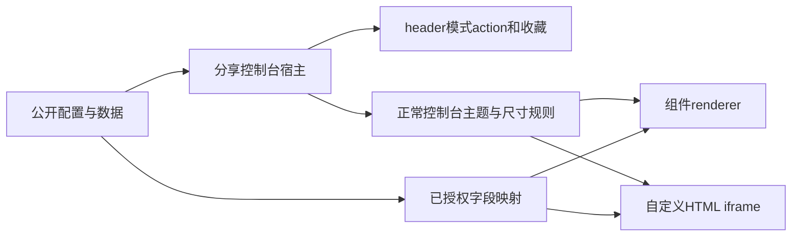
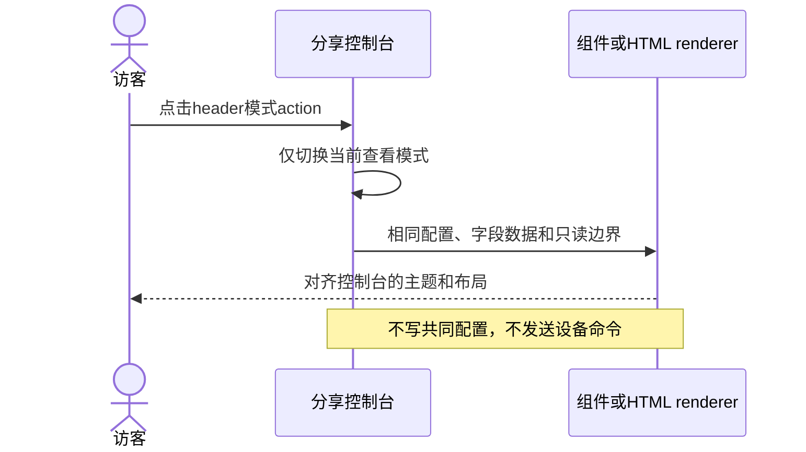

# 分享控制台样式对齐计划

## Intent：最终目标

分享查看页的组件模式、自定义模式与正常设备控制台保持同样的主题、内容宽度、内边距和滚动方式。移除顶部模式 Tab，改用 header 右侧 action button 切换，保留收藏及登录入口。

修复正常控制台刷新后在线状态停留在“状态未知”，需要返回设备列表重新进入才恢复的问题。

## Data：可用证据

- 用户提供分享页截图：大块模式 Tab、淡化的自定义组件、固定高度内容区、底部说明，以及字段占位错位。
- 正常 DevicePage 引入 ui-theme/ui-backdrop，V2 内容使用 panel-grid 尺寸，自定义模式由 iframe 自己滚动。
- 分享页此前只声明 data-ui-theme、使用普通页面背景，并将 HTML 放入固定高度圆角容器，额外加入状态行和底部说明。
- 两个入口复用 renderer，但只读参数和共享数据映射需要核对，不能仅改外层 CSS 掩盖渲染问题。
- 冷启动先从缓存恢复设备对象，在线设备目录随后替换该对象；控制台只订阅一次初始化完成事件，导致标题一直读取旧对象的未知状态。

## Edges：边界与限制

- 访客仍是只读；视觉对齐不能放开组件命令、HTML bridge 或公开数据范围。
- 不在普通控制台添加新的模式入口，不改变共享权限或 Last-write-wins。
- 不为截图中的具体字段名、设备名或 HTML 布局编写特例。
- 不调用浏览器做 UI 确认，不生成新测试用例；依据截图、源码及已有检查验证。

## Answer：交付格式与成功标准

交付分享页布局/header 修复及必要的通用只读渲染修正。组件与 HTML 使用正常控制台的布局规则；只读保留正常视觉表达，模式切换是本地状态，不保存共同配置。

## 架构图

## 数据流图

## 执行步骤

1. 对照正常控制台与公开页面 shell、主题及 renderer 输入。
2. 将模式切换移入 header，统一两种模式的内容结构。
3. 修复只读视觉和数据映射中的实质差异。
4. 构建及相关现有检查，自我复核权限边界与改动范围。
5. 控制台改为订阅设备目录加载事件，复用现有绑定逻辑更新设备引用，不根据数值变化推断在线状态。
