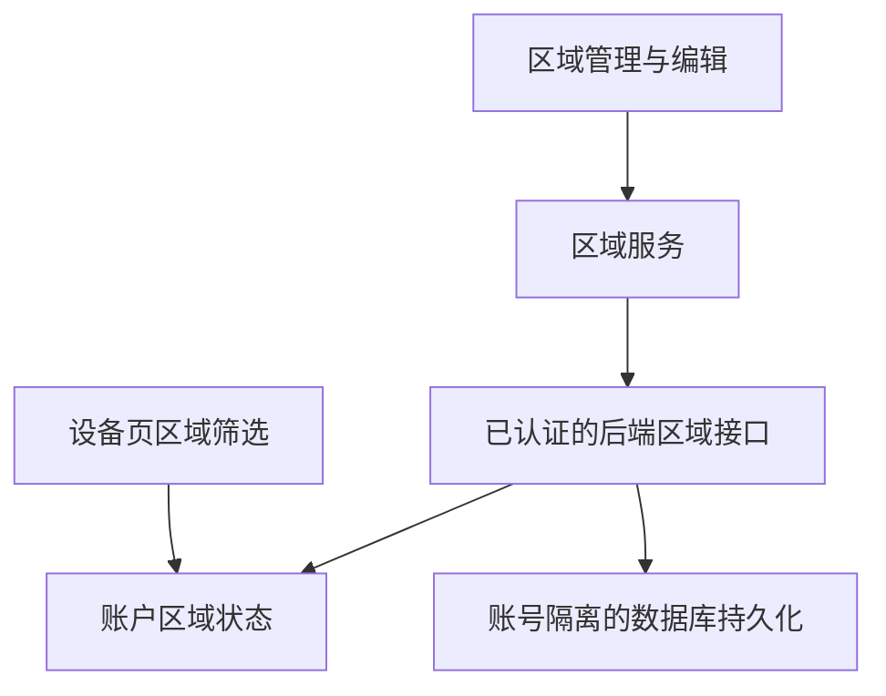
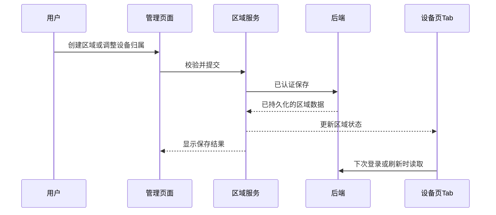

# 区域管理与同步实现计划

## Intent：最终目标

完成区域创建、设备归属、后端持久化与跨设备读取；设备页保留“全部”，其他分段项对应用户创建的区域。管理页采用极简、工整的列表。

## Data：可用证据

- 设备页“添加区域”原先只跳到管理页，没有直接进入创建流程。
- 区域管理和区域编辑已有内存操作，但保存依赖页面销毁与旧版 `/user/config/save`。
- 当前账户加载仅请求用户、设备和分享，缺少区域读取。
- 用户明确选择跨设备同步，不能使用仅本地保存替代。
- 组件库主题选择使用圆角轨道与浅色选中块；按此样式调整区域筛选。
- 用户要求移除管理页介绍卡、装饰元素；保留必要操作。

## Edges：边界与限制

- 使用现有账户鉴权，区域数据必须按账号隔离。
- 后端失败不能显示保存成功；区域创建、重命名、删除和设备归属修改都应持久化。
- 保留“全部”对应未筛选设备视图，区域项对应真实区域。
- 复用已有设备与区域结构，避免不必要的抽象和依赖。
- 不新增测试用例，不调用浏览器进行 UI 确认。
- 后端具体契约须以仓库证据为依据，不臆造现成接口。

## Answer：交付格式与成功标准

1. 设备页“添加区域”直接进入创建流程。
2. 创建成功后区域可在管理页与设备页筛选中使用。
3. 后端保存并支持重新加载和其他客户端读取。
4. 管理页只保留标题、新建/编辑操作、区域名称和设备数量，以及必要状态提示。
5. 空白名称、重名、超长名称有明确校验；保存失败保留用户输入并提示。
6. 完成前后端适当的构建或静态检查，记录未执行的验证和部署限制。

## 架构图

## 数据流图

