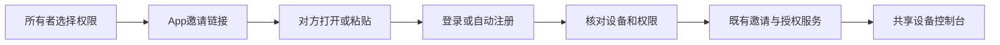
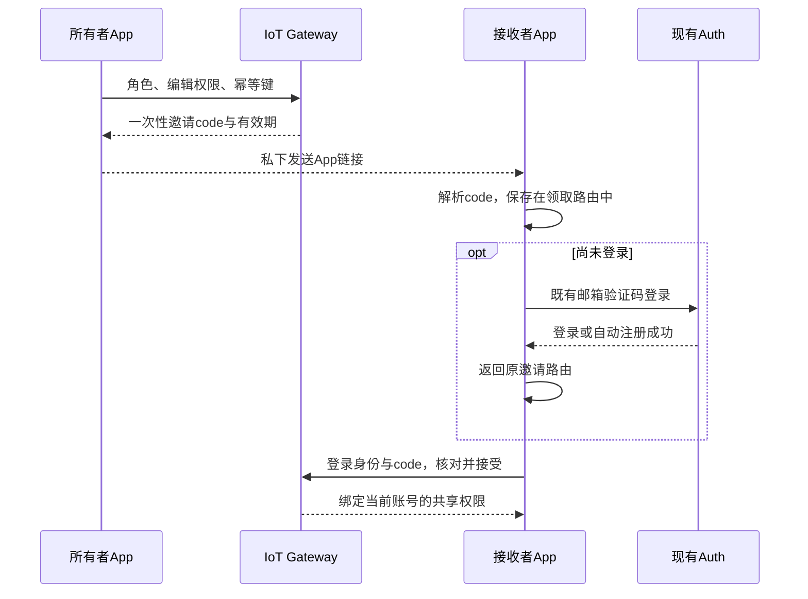

# 应用链接邀请简化计划

## Intent：最终目标

设备共享只保留 App 邀请链接。所有者选择权限并生成 `diandeng://share/<code>`，私下发给对方；收件人打开 App 登录或自动注册后，核对权限并领取。

## Data：可用证据

- 用户已明确选择只保留 App 邀请链接，并撤回本轮新增的邮件邀请实现。
- 原有链接邀请已具备随机 proof、有效期、幂等创建、撤销和单次领取后的账号绑定。
- 邮箱邀请的 503 来自尚未配置的账号目录；其创建流程与链接邀请独立。
- 本机登录验证码经 IoT Gateway 转发到 `https://api.yiyu.pro` 的 Auth 服务，不能把 local 调试视为隔离的认证测试环境。
- 原有邀请码仅保存在内存。带 code 的邀请路由和登录回跳参数可恢复刷新后的领取流程。

## Edges：边界与限制

- 邀请本身不发邮件；未登录用户仍使用原有邮箱验证码登录或自动注册。
- 普通链接不绑定指定邮箱，持有链接的账号首次领取后绑定，因此应私下发送。
- 不新增网页托管、HTTPS Universal Links/App Links 域名配置或 Auth 服务部署。
- 仅移除当前 App 的邮箱邀请创建入口，已有定向邀请和成员记录保持兼容。
- 撤回本轮邮件任务、数据库迁移、Auth 接口及配置修改，保留先前公开分享和页面样式工作。
- 不新增测试用例，不调用浏览器进行 UI 确认；使用构建和相关现有检查验证。

## Answer：交付格式与成功标准

1. 成员区域只显示“邀请链接”，删除邮箱输入及对应前端分支。
2. 保留权限选择、完整链接复制、取消邀请及既有成员管理。
3. 原生打开和手动粘贴都进入带 code 的邀请路由；登录页刷新后仍能回到领取页。
4. 连续打开不同邀请时，旧页面离场不会清除新邀请状态。
5. 构建与相关现有检查通过，Auth 仓库无本轮遗留修改，实际数据库没有新增邮件迁移。

## 架构图

## 数据流图

