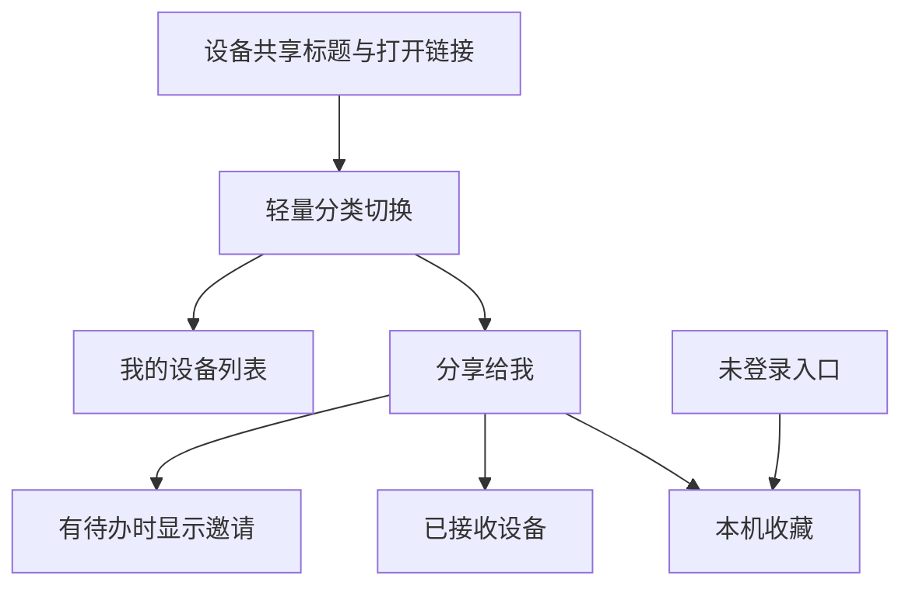
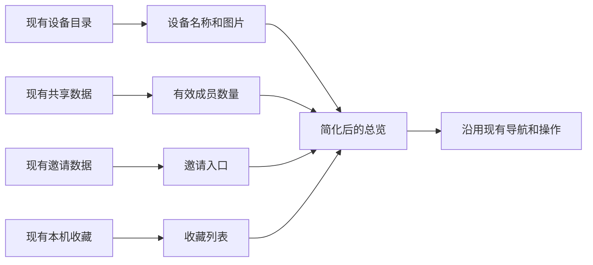

# 设备共享列表简化计划

## Intent：最终目标

将设备共享总览变成紧凑、安静、易扫描的设备管理列表，减少装饰和重复信息，让设备入口成为页面重点。

## Data：可用证据

- 用户截图显示介绍卡、英文眉题、共享总数与大面积分段切换先于设备列表，占用较多首屏空间。
- 同一设备行同时显示“尚未共享”和“可共享”，内容重复；成员数量不能代表公开链接的开启状态。
- 当前总览还包含收到的设备、待处理邀请和本机收藏，改版需要覆盖这些状态。
- 应用已有主题变量和管理页 header、安全区、宽度规则，可以直接沿用。

## Edges：边界与限制

- 仅修改 share-manager 的页面模板、样式与不再使用的展示代码。
- 保留粘贴链接、设备管理、邀请处理、退出共享、收藏打开和移除等操作。
- 不改共享权限、公开访问开关、接口或持久化行为。
- 不修改全局 TabSelector 或 HeroCard，不新增组件抽象。
- 不新增测试用例，不调用浏览器进行 UI 确认。

## Answer：交付格式与成功标准

- 去除介绍卡及其统计，使用两个轻量文字分类按钮。
- 第一栏命名为“我的设备”，与包含未共享设备的实际内容一致。
- 设备行显示图片、名称、成员数量和进入箭头，去掉重复徽标与阴影。
- 待处理邀请只在有邀请、加载中或异常时出现；空列表采用紧凑文字提示。
- 收藏提示在分组显示一次，保留明确的只读身份和操作入口。
- 构建通过、diff 检查通过；记录实现与自我复核，视觉效果仍以用户查看为准。

## 架构图

## 数据流图

