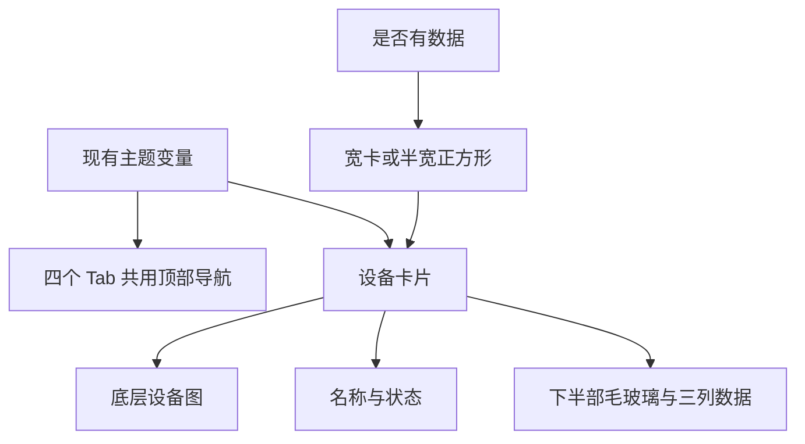
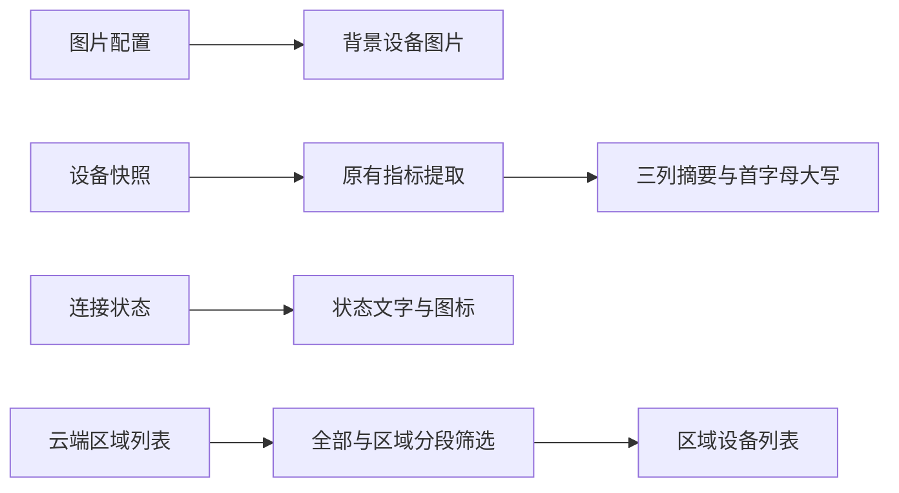

# 设备列表与四个顶部导航视觉优化计划

## Intent：最终目标

让设备列表紧凑、整齐、优雅。最终采用下半部毛玻璃覆盖、可辨认的设备图片、三列小字号数据；无数据设备使用半宽正方形卡片。统一四个 Tab 顶部，并采用组件库主题选择的分段样式展示区域。

## Data：可用证据

- 原始截图：宽卡左右对半且高度固定，无数据卡片保留大块空白。
- 用户反馈：三列大字号和灰色独立底板不协调；全覆盖强模糊使设备变成灰色斑块。
- 最终明确方向：图片上半部清晰、下半部玻璃覆盖；无数据卡片半宽、正方形。
- 数值一行三项、缩小字号；字段首字母大写；卡片内部不要描边。
- 四个 Tab 共享 `main-tab-header`；组件库主题导航是圆角轨道与浅色选中块。
- “全部”保留，其余 Tab 对应创建的区域；添加菜单去掉箭头和添加组件项。

## Edges：边界与限制

- 卡片仅更改显示结构、样式和数据有无对应的布局类，不改设备通信与指标选择。
- 原始字段名、单位、数值和设备图片来自真实数据，不针对截图设备写特例。
- 区域创建与后端同步另见《区域管理与同步实现计划》。
- 不新增测试用例，不使用浏览器进行 UI 验证。
- 编译检查不替代视觉验收，玻璃透明度与实际图片、主题有关。

## Answer：交付格式与成功标准

1. 宽卡不再固定高度，三列摘要使用 12px 数值、9px 字段标签。
2. 图片置于背景层，上半部可辨认，数据区施加半透明表面与 8px 模糊，无内部边框。
3. 无数据项占网格半宽，比例 1:1；底部 50% 为文字与玻璃覆盖区。
4. 四个 Header 使用统一标题、图标与点击区域，去掉圆框按钮与顶部光晕。
5. 恢复“全部”，区域筛选复用组件库主题选择的圆角分段视觉。
6. 菜单只保留添加设备、添加区域；关闭三角箭头，移除条目右侧箭头与相关对齐逻辑。
7. 构建、模板检查与差异检查通过，记录原有 lint 问题与验收限制。

## 架构图

## 数据流图

