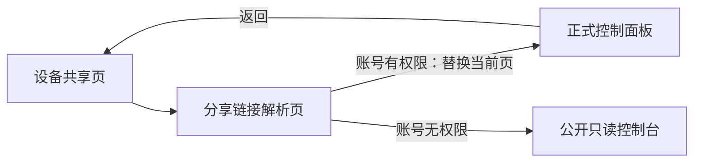

# 返回导航与只读滚动修复执行记录

## Intent：最终目标

修复所有活动页面中因 Ionic 组件混用产生的 header 返回异常，并让已领取的只读设备保持普通控制台外观和可滚动能力。

## Data：根因与实施

### 返回导航

用户明确的错误链路：设备共享 → 分享给我 → 设备控制台 → 返回，却进入设备列表。

- 根 outlet 使用 `@ionic/angular/standalone`，控制台及其他页面由 `IonicModule` 提供旧版返回按钮。
- 两者依赖注入的 `IonRouterOutlet` 类不同，旧返回按钮通过 Optional 注入得到空值，无法读取实际导航栈。
- Ionic 的返回实现因此执行 `navigateBack(defaultHref)`，控制台的兜底地址正是 `/home/device`。
- 将 36 个受影响页面改为按需引入 standalone Ionic 组件及控制器。保留 Angular RouterLink/RouterModule，并依据元素类型保留 IonRouterLink 或 IonRouterLinkWithHref。
- 同步移动弹窗控制器，避免移除 IonicModule 后旧 ModalController 缺少 provider；IonContent 组件查询类型也保持一致。
- 不修改原有合法兜底地址、不新增导航服务、不改框架依赖、不增加 DI 别名。
- 导航栈可以复用共享管理页面原实例，其「分享给我」标签仍保存在实例中，无需另建标签持久化逻辑。

### 全量覆盖

AST 共识别 52 处 ion-header、40 个标准返回按钮模板，并核对了自定义详情返回、弹层关闭及对应路由。

- 36 个页面存在组件混用，已修复。
- 3 个添加设备子向导原本已使用 standalone，无需更改。
- 1 个旧 device-manager 模板没有当前路由入口，未把它视为活动页面故障。
- 消息详情返回、文档/图标/头像/场景动作弹层关闭未发现双重导航，保留原实现。

以下页面完成导入迁移：

| 页面源码 |
| --- |
| `src/app/device/device.page.ts` |
| `src/app/device/v2/device-v2.page.ts` |
| `src/app/sections/about/about.page.ts` |
| `src/app/sections/device/component-preview/component-preview.page.ts` |
| `src/app/sections/device/device-components/device-components.page.ts` |
| `src/app/sections/device/device-location/device-location.page.ts` |
| `src/app/sections/device/device-log/device-log.component.ts` |
| `src/app/sections/device/device-settings/device-settings.ts` |
| `src/app/sections/device/device-share/device-share.ts` |
| `src/app/sections/device/device-storage/device-storage.page.ts` |
| `src/app/sections/device/device-timer/device-timer.page.ts` |
| `src/app/sections/device/device-timer/timing-edit/timing-edit.ts` |
| `src/app/sections/device/device-uic/device-uic.page.ts` |
| `src/app/sections/device/device-update/device-update.ts` |
| `src/app/sections/device/edge-gateway-enrollment/edge-gateway-enrollment.page.ts` |
| `src/app/sections/device/panel-editor/panel-editor.page.ts` |
| `src/app/sections/device/panel-editor/panel-widget-editor.page.ts` |
| `src/app/sections/device/share-invitation/share-invitation.page.ts` |
| `src/app/sections/device/share-manager/share-manager.page.ts` |
| `src/app/sections/device/shared-console/shared-console.page.ts` |
| `src/app/sections/feedback/feedback.component.ts` |
| `src/app/sections/guide/guide.page.ts` |
| `src/app/sections/message/message.page.ts` |
| `src/app/sections/room/room-edit/room-edit.ts` |
| `src/app/sections/room/room-manager/room-manager.ts` |
| `src/app/sections/scene/scene-editor/scene-edit.ts` |
| `src/app/sections/scene/scene-manager/scene-manager.ts` |
| `src/app/sections/self-hosted-server/self-hosted-server.page.ts` |
| `src/app/sections/settings/settings.page.ts` |
| `src/app/sections/third-party-services/third-party-services.page.ts` |
| `src/app/sections/user/user.page.ts` |
| `src/app/tools/ble-debug/ble-debug.page.ts` |
| `src/app/tools/ble-ota/ble-ota.page.ts` |
| `src/app/tools/esp32-provision/esp32-provision.page.ts` |
| `src/app/tools/lan-discovery/lan-discovery.page.ts` |
| `src/app/tools/wifi-ota/wifi-ota.page.ts` |

### 只读界面

- 把「仅查看」并入状态 getter，显示为「云端在线 · 仅查看」；外壳和独立 V2 标题共用这个来源。
- 删除正文独立的只读提示横幅；公开控制台也统一为连接状态在前、仅查看在后。
- 只读卡片不再设为视觉 disabled，消除整体 opacity 0.55 的变淡效果。
- 所有者及可控制共享用户仍按原有连接状态、pending、端点权限决定 disabled。
- 已领取只读设备的自定义面板增加 readOnlyScroll 绑定，复用独立透明滚动表面、高度报告和滚动位置桥接。
- 保留面板、控件和 iframe 的 inert、interactive 检查及发送动作权限检查；恢复颜色和滚动不代表开放点击、拖拽或控制指令。

### 验证结果

- App local 构建通过，本机 4200 返回 HTTP 200。
- 13 个已有测试文件、87 项检查通过，覆盖设备生命周期、界面编辑、消息、个人页、反馈、首页标签和导航动画等。
- 两份已有测试的全模块 Ionic mock 不能表达迁移后的组件导出；移除这些过时 mock 后使用真实 Ionic 导出，原测试用例和断言保持不变。没有新增测试用例。
- AST 复核：39 个活动返回页面全部引入 standalone IonBackButton；迁移的 36 个页面不再导入旧 @ionic/angular。
- 复核确认没有间接共享 NgModule 导出旧 Ionic 组件到页面作用域，也没有遗留旧 IonContent 查询类型。
- git diff --check 通过。

## Edges：边界与限制

- 用户明确要求不使用浏览器后，未再执行浏览器操作；未进行运行界面或真机交互验收。
- 本次结论基于框架注入源码、应用依赖关系、构建与现有检查，不把静态检查等同于真实点击验证。
- 无后端修改、权限扩大或设备控制指令；未改未启用的旧页面。
- 更新组件导入后建议完整刷新一次，再从共享列表进入设备，避免旧缓存组件影响观察。

## Answer：交付与成功标准

- 返回按钮与根导航使用同一套 Ionic standalone 类型，有历史时返回真实来源，无历史时使用已有 fallback。
- 只读状态放入标题的连接状态行，组件保持正常颜色，自定义面板可滚动且不可操作。
- 代码、全量覆盖清单与 IDEA 记录已完成；架构图和数据流图见对应计划。

## 自我批判

- 初次只比较了 fallback 地址与路由，未检查按钮和父 outlet 的注入类型，不能据此断言返回逻辑正常；本次补齐了实际根因证据。
- 把控制台 fallback 硬改为共享列表只会适配用户这一次路径，并破坏其他入口；因此修复框架组件的一致性，而非对指定路径特判。
- 仅统一按钮组件还不够，必须核对相关控制器 provider 与组件查询类型，避免引入新的运行时注入错误。
- 只读不等于设备失效。数据呈现、操作授权和滚动应分别处理，不能用整体变淡或封死 iframe 的所有输入替代权限控制。

## 补充：本机收藏进入控制台后返回错误

### Intent：最终目标

从设备共享页的本机收藏打开控制面板后，返回原来的设备共享页。

### Data：可用证据

- 收藏入口先导航到 `/s/:token`；登录账号具有设备权限时，SharedConsolePage 解析链接并调用 AppDeviceConsoleHost.openDevice。
- openDevice 使用 navigateRoot 跳转正式控制台，清空了设备共享页所在的 Ionic 返回栈，随后返回按钮只能使用 `/home/device` 兜底。
- 已核对本地 Ionic StackController.setActive：replaceUrl 会移除当前栈顶；forward 会保留其余历史并加入目标页面。
- 修改仅涉及 AppDeviceConsoleHost：统一 standalone NavController 导入，将该跳转改为 navigateForward 并设置 replaceUrl，替换链接解析页，保留真实来源。
- App local 构建通过，git diff --check 通过。

### Edges：边界与限制

- 不对设备共享路径添加特判，不改设备控制台的默认返回地址。
- 未授权账号继续停留在公开只读控制台；已授权账号继续进入正式设备控制台。
- 没有新增测试用例、浏览器验证或后端修改；结论基于实际调用链、Ionic 本地实现和构建检查。

### Answer：交付与成功标准

返回栈保留打开收藏的来源页，且不保留会再次触发跳转的链接解析页。

### 自我批判

此前统一返回按钮的注入类型，解决了按钮无法读取父导航栈的问题，但没有覆盖入口内部清空导航栈的重定向。本次直接修正产生丢栈行为的跳转；单纯改为普通 forward 又会留下链接解析页，造成返回后立即再次打开设备，因此需要同时使用 replaceUrl。
