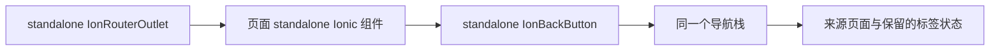
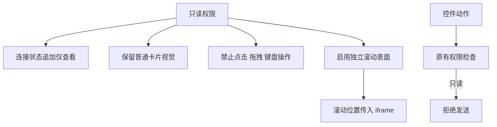

# 返回导航与只读滚动修复计划

## Intent：最终目标

- 检查所有 header 左侧返回入口，修复从设备共享的「分享给我」进入控制台后错误返回设备列表的问题。
- 只读控制台保持普通界面外观，将状态显示为「云端在线 · 仅查看」，禁止控件操作但允许滚动。

## Data：可用证据

- AST 枚举得到 52 处 `ion-header` 和 40 处标准返回按钮，同时检查自定义关闭与详情返回入口。
- 根路由和首页 tabs 使用 `@ionic/angular/standalone`，部分页面却从旧 `IonicModule` 引入返回按钮。
- Ionic 两种返回按钮注入不同的 `IonRouterOutlet` 类；旧按钮在 standalone 根路由下拿不到对应实例，因此跳过实际历史栈，直接使用 `defaultHref`。
- 设备控制台的兜底地址是 `/home/device`，与用户提供的错误路径完全一致。仅修改这个地址会破坏从其他入口进入设备的返回行为。
- 只读卡片把权限禁止当作 `disabled`，触发整体透明度 0.55；自定义面板漏传 `readOnlyScroll`，外层与 iframe 同时无法响应滚动。

## Edges：边界与限制

- 统一受影响页面的 Ionic standalone 组件导入，不新增自建历史栈、不修改依赖、不加兼容别名。
- 保留合法 fallback、RouterLink 导航语义、未保存离开守卫、弹层关闭与保存期间禁用。
- 所有者或可控制成员的离线、待处理、端点范围限制继续使用原 disabled 行为；只读交互仍由 inert 与动作权限检查禁止。
- 用户明确要求不使用浏览器；后续仅做代码核对、构建和已有检查。此前只读取了一次现有页面，未进行任何点击或导航，已停止浏览器操作。
- 不生成新测试用例，不操作真实设备，不改后端权限或用户邀请。

## Answer：交付与成功标准

- 受影响返回按钮与根 outlet 使用相同的 standalone 类型，存在历史时返回来源页面，直接打开时才使用兜底地址。
- 分享给我 → 控制台 → 返回可复用原共享页面及其标签状态。
- 只读状态并入连接状态；卡片不再因只读整体泛白，自定义页面启用已有滚动桥接。
- 完成构建、相关已有检查与覆盖清单，交付中文 IDEA 执行记录与自我批判。

## 架构图

## 数据流图

