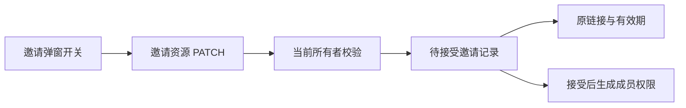
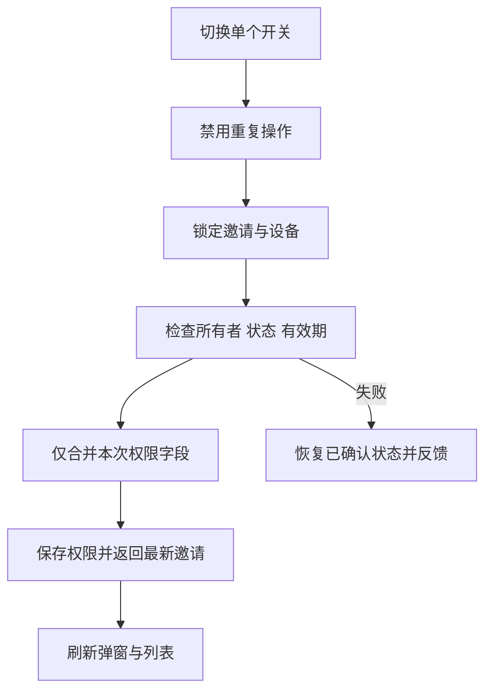

# 邀请链接权限开关计划

## Intent：最终目标

在已有邀请链接弹窗内，用「控制设备」「编辑控制台」两个开关修改待接受邀请的权限。切换后自动保存，保留原链接和有效期；同时收紧公开链接卡片的顶部间距。

## Data：可用证据

- 目前弹窗只展示权限文字，后台邀请资源支持 GET、DELETE，没有权限更新方法。
- 权限存于邀请记录，接受邀请时读取当前记录并生成成员授权；邀请 code 由邀请 ID 决定，与权限无关。
- 创建请求摘要用于幂等重试，不能把后续权限修改写回原创建摘要。
- 当前公开链接卡片的顶部 padding 与标题行按钮高度叠加，造成顶部留白偏大。

## Edges：边界与限制

- 仅设备所有者可修改未过期、待接受的链接邀请；已接受后的成员权限沿用现有成员管理。
- 每次开关只提交相应字段，事务中保留另一权限和原有控制字段范围，防止旧页面覆盖无关权限。
- 接受与修改必须通过同一邀请记录的事务锁串行处理。
- 不修改 token、到期时间、创建幂等摘要；不新增邮件、数据库迁移或字段选择界面。
- 保存失败恢复服务端状态；页面离开、关闭弹窗、账号切换后不重新弹出旧详情。
- 不新增测试用例，不调用浏览器确认 UI；运行已有检查、构建及必要的事务回滚验证。

## Answer：交付与成功标准

- 弹窗两个 switch 自动保存，保存期间禁用重复操作，失败有反馈。
- 重新打开链接能读到已保存权限；领取使用更新后的权限，旧链接地址和有效期不变。
- 公开链接卡片顶部间距缩小，保留现有复制按钮点击区域。
- 提交代码与 IDEA 执行记录，完成构建和相关现有检查。

## 架构图

## 数据流图

