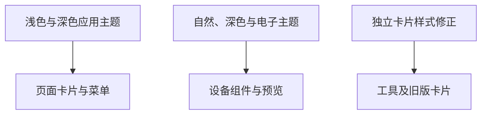
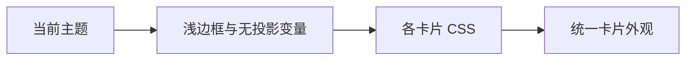

# 全站卡片弱化边框与移除阴影

## Intent：最终目标

用户明确要求全站所有卡片移除 box-shadow、边框变浅，不能仅覆盖设备设置页。

后续用户指定例外：首页设备卡片保留柔和阴影，其余页面仍为无阴影卡片。

## Data：可用证据

- 多数应用卡片使用 `--blinker-shadow`、`--blinker-shadow-soft` 与 `--blinker-border`。
- 控制台组件使用独立的 UI 主题变量，必须同时处理自然、深色、电子主题。
- 蓝牙工具卡片、旧菜单等存在硬编码阴影，主题变量无法覆盖。
- 此前设备设置页存在局部覆盖，统一后需要消除重复淡化。

## Edges：边界与限制

- 调整应用自身的卡片样式，不改动用户保存的自定义 HTML 内容。
- 保留按钮、滑块手柄、选中状态、焦点提示等有交互意义的局部效果。
- 不改业务逻辑、卡片内容、布局尺寸或交互。
- 不生成测试用例、不进行浏览器 UI 确认。

## Answer：交付格式与成功标准

交付主题与例外样式修改。全站共享卡片和独立卡片不再产生装饰投影；边框统一降低视觉对比；应用与自定义面板运行时编译通过。

### 执行计划

1. 用 AST 搜索卡片阴影与边框来源，区分卡片和交互效果。
2. 修改共享主题与独立卡片样式，清理局部重复覆盖。
3. 复查剩余阴影的用途，编译并记录结果。

### 架构图

### 数据流图

### 验证与自我审查

执行结果：

- 全局浅色、深色主题的两种表面阴影变量均设为 `none`，普通边框使用原颜色的 60% 不透明度。
- 控制台自然主题移除卡片阴影，三种主题的边框同步弱化；滑块手柄的独立阴影变量保留。
- 清理蓝牙工具卡片、网关接入卡片、旧版菜单卡片、组件选择预览卡片、编辑中的布局卡片及主题预览卡片的硬编码投影。
- Ionic 卡片统一使用浅边框和无阴影样式。
- 删除设备设置页的局部菜单样式参数和二次淡化，设备列表边框也改为直接使用全局值。
- 旧组件预览的选中光晕改为选中边框，避免卡片再次出现投影。
- 首页设备卡片单独使用 `--blinker-device-card-shadow`，浅色与深色主题分别恢复原来的柔和投影，不恢复全站阴影变量。

验证：

- 应用 development 构建通过。
- 自定义面板运行时构建与打包通过。
- AST 复查确认应用及控制台主题中的卡片阴影变量全部为 `none`。
- 差异格式检查通过，未新增测试用例、未使用浏览器。

自我审查：

- 修改共享来源而非添加全局通配符或 `!important`，避免覆盖组件内部控制效果。
- 未通过删除所有 `box-shadow` 的方式误删焦点环、状态灯、滑块手柄等局部效果；卡片装饰投影和交互状态分开处理。
- 全局表面阴影变量也被少量按钮与弹出层复用，这些使用共享变量的表面同样变为无投影，交互行为未改变。
- 原本已透明的自然主题卡片边框保持透明，未为了“统一”增加额外边框。
- 不修改用户保存的自定义 HTML/CSS；应用提供的原子组件通过共享主题同步更新。
- 构建与静态检查不等价于视觉验证，本次遵循用户约束未启动浏览器。
