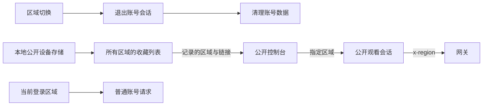
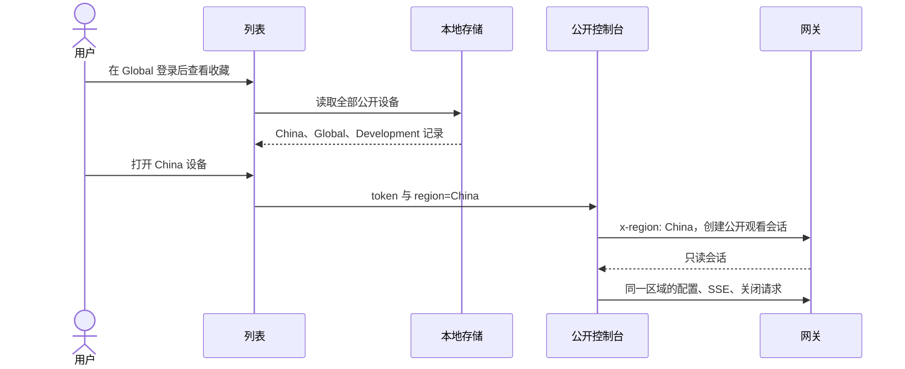

# 公开链接设备跨区域共存执行计划

## Intent：最终目标

切换服务区域并重新登录时，保留本机保存的公开链接设备。多个区域的公开设备在同一列表共存，访问时使用各自所属区域。

## Data：可用证据

- `AppDeviceConsoleHost` 将公开设备保存到以网关地址为范围的独立本地存储键；现有退出逻辑不会删除该键。
- `PublicConsoleBookmark` 没有区域字段，读取、添加、删除均只按设备 ID 区分记录。
- 共享管理页按设备 ID 跟踪列表，打开 `/s/:token` 时没有携带区域。
- 公开控制台的 HTTP 和 SSE 请求使用当前全局区域，切换后无法继续准确访问原区域收藏。
- 用户明确确认：没有区域字段的旧记录归入 `China`。

## Edges：边界与限制

- 保持切换区域后重新登录的要求；公开设备收藏不属于账号清理范围。
- 不按当前区域过滤本地公开设备列表，不按账号或区域拆分现有存储键。
- 同一区域的同设备更新原记录，不同区域的同设备 ID 独立共存；删除只作用于指定区域的记录。
- 公开访问不向其他区域发送当前账号凭据；成员访问升级只在记录区域与当前登录区域一致时尝试。
- 旧记录按 `China` 兼容读取，不删除旧记录，不尝试逐个区域探测链接。
- 本轮不修改后端分发逻辑和已有对外分享链接协议；新增保存记录保留打开时的所属区域。
- 不新增测试用例，不调用浏览器验证 UI；复用构建、静态检查和已有回归测试。

## Answer：交付格式与成功标准

1. 为公开设备记录增加区域字段，使用区域与设备 ID 共同确定身份。
2. 列表显示所有记录及区域，打开、保存、移除均保留区域语义。
3. 公开控制台会话、配置更新、SSE 和关闭请求固定使用该会话区域。
4. 拦截器仅允许公开观看接口使用指定区域，普通账号 API 继续使用全局区域。
5. 完成验证与自我审查，并在执行记录中说明兼容和联调边界。

### 架构图

### 数据流图

