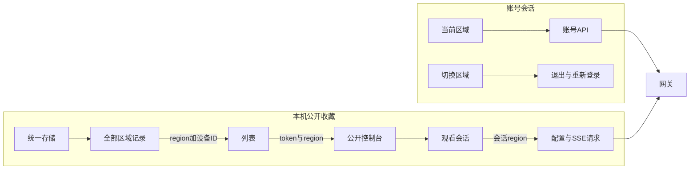
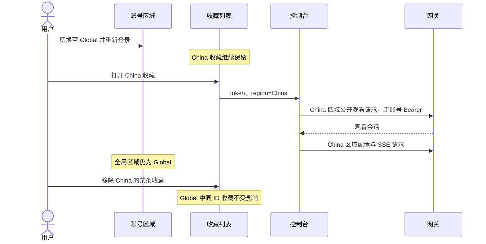

# 公开链接设备跨区域共存执行记录

## Intent：最终目标

切换 region 后继续保留和显示本机保存的公开链接设备。来自 China、Global、Development 的记录共存，打开时使用设备所属区域；账号区域切换仍要求重新登录。

## Data：可用证据

### 问题本质

现有退出流程只清理账号会话和账号数据，不删除 `blinker-public-consoles:v1:<网关地址>` 中的公开收藏。真正缺少的是每条收藏的区域信息：此前按设备 ID 去重，且打开后的请求全部使用当前账号区域，所以不同区域的同 ID 设备会互相覆盖，切换后也可能请求错误区域。

### 修改内容

| 位置 | 结果 |
| --- | --- |
| `configs/service-region.config.ts` | 增加区域值校验，供存储读取和路由参数复用。 |
| `core/device-v2/console-host.ts` | 公开收藏增加 `region` 字段，公开页登录入口可携带设备区域。 |
| `core/services/public-console-bookmarks.service.ts` | 读取旧记录时按用户确认的 China 兼容；去重、保存、查重和删除均使用区域与设备 ID 共同确定身份。 |
| `sections/device/share-manager/share-manager.page.ts/html` | 统一显示所有区域收藏，行内显示区域；打开链接携带 region，删除只影响指定区域的记录。 |
| `core/services/device-console.service.ts` | 公开观看会话记录区域，创建、配置刷新、SSE 和关闭请求携带指定区域。 |
| `core/injectable/server.interceptor.ts` | 仅公开观看接口允许使用合法的指定区域；普通账号 API 仍强制使用当前全局区域。 |
| `sections/device/shared-console/shared-console.page.ts` | 固定一次加载的 token 和 region；跨区域打开时只使用公开观看会话，不尝试当前账号的成员权限或跳入同 ID 的账号设备。 |
| `core/services/device-console-host.service.ts`、`sections/login/login.ts` | 公开页跳转登录后，返回时恢复原设备区域。 |

保留原本的本地存储键，不按账号或 region 拆分存储。缺少区域的旧记录在读取时被解释为 China；后续正常添加或删除收藏时，将写回带区域的记录。没有运行迁移脚本，也没有修改用户当前保存的设备数据。

### 验证结果

| 验证 | 结果 |
| --- | --- |
| 应用开发构建 | 通过，包含 Angular 模板和样式编译。 |
| 最终代码 `ngc --noEmit -p tsconfig.app.json` | 通过。 |
| 本次修改文件的 ESLint | 通过。 |
| 现有请求拦截器测试 | 29 项通过。 |
| 现有认证服务测试 | 9 项通过。 |
| 现有本地数据服务测试 | 10 项通过。 |
| `git diff --check` | 通过。 |

沿用临时 TypeScript 编译配置运行上述 48 项现有测试，避开仓库已有 BLE 测试中的过期导入；没有新增测试用例。未调用浏览器做 UI 验证。

## Edges：边界与限制

- 旧收藏区域缺失时固定使用用户指定的 China，不随当前全局区域变化。
- 当前列表上限仍为 100 条；同一区域同设备更新原记录，不同区域同 ID 可以并存。
- 普通账号区域、登录态与公开收藏区域相互独立；打开其他区域公开设备不会更改全局区域。
- 公开链接本身的失效、到期、关闭公开访问等行为继续由网关决定，保留本地记录不等于绕过访问限制。
- 本次没有修改对外分享链接格式；没有区域参数的新链接首次打开时使用当前所选区域，保存后固定记录该区域。
- 后端区域分发仍由后续任务实现，真实的跨区域网关路由尚未联调。

## Answer：交付格式与成功标准

已交付区域字段、兼容读取、复合身份的收藏操作、跨区域列表导航，以及完整的公开观看请求区域传递。退出账号继续保留公开收藏，切换后可从同一个本机收藏列表打开来自不同区域的设备。

### 自我审查

- 没有通过取消退出流程或保留账号数据来满足需求；保留公开收藏依赖原有独立存储边界。
- 没有为每个区域复制一份列表，也没有增加通用多区域状态框架；每条记录和观看会话直接持有自己的区域。
- 指定区域的请求头只对公开观看接口生效，这些请求原本就禁止携带账号 Bearer；跨区域收藏也跳过账号成员解析，避免混用凭据或同 ID 设备。
- 保存、列表跟踪、查重和删除均检查了复合身份，避免只改展示后仍出现跨区域覆盖或误删。
- 异步加载固定捕获 token 与 region，过期加载不再创建新观看会话；迟到的会话关闭请求也携带原会话区域。
- 构建和现有回归测试通过，但没有新增跨区域专项测试或进行浏览器、真实后端联调，不能将这些检查等同于完整端到端验证。

### 架构图

### 数据流图

