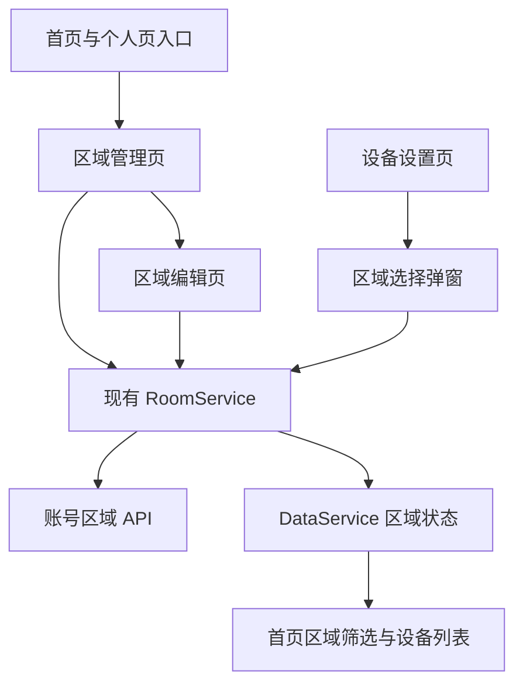
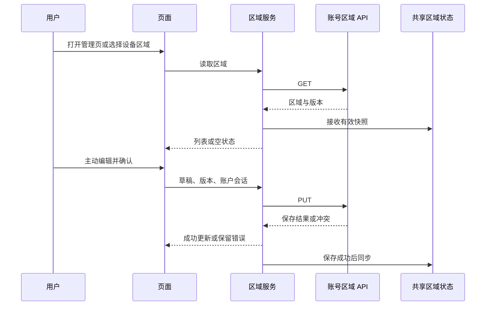

# 区域页面修复执行计划

## Intent：最终目标

修复区域管理页停留在加载状态、进入时自动弹出新建区域的问题，并让设备设置可以分配或取消区域归属。

## Data：可用证据

- 管理页通过导航状态 `createRegion` 在加载后自动调用新建弹窗；首页添加区域入口传入该标记。
- 当前安装的 Angular 22 默认使用 OnPush；区域管理与编辑页没有指定检测策略，异步请求结束后只修改普通字段，没有通知视图检查。
- 主应用使用 `provideZoneChangeDetection()`，已有设置页采用 `ChangeDetectionStrategy.Eager` 适配普通字段与 Ionic 生命周期。
- `RoomService` 已提供区域读取与带 revision、账户会话校验的保存接口。
- `DataService.loadRegions()` 更新账户区域数据并通知首页；同一设备允许属于多个区域。
- 一个只读分析子任务确认：设备设置可复用现有管理菜单与 `AlertController`，账号区域分类同时适用于自有设备和共享设备。

## Edges：边界与限制

- 只修改区域页面、对应导航入口及设备设置的必要代码；保留当前工作区其他修改。
- 空区域是成功加载后的业务状态，请求失败继续显示错误与重试，不能伪装为空区域。
- 不自动创建区域、不更改既有多区域模型、不修改后端协议。
- 保存使用区域草稿与已读取版本；取消不写入，保存失败不显示成功。
- 按用户要求，不新增测试用例，不调用浏览器进行 UI 确认。

## Answer：交付格式与成功标准

1. 区域管理页加载结束后显示列表或“还没有区域”占位，只有主动点击新建才打开弹窗。
2. 区域编辑页同样能正确显示加载与保存结果。
3. 设备设置显示区域归属，可选择多个已有区域或全部取消；没有区域时提供前往区域管理的入口。
4. 复用现有账号区域 API 完成持久化，并更新首页区域筛选数据。
5. 完成构建、适当静态检查与差异审查，另写执行记录，明确验证边界和自我审查结论。

## 架构图

## 数据流图

