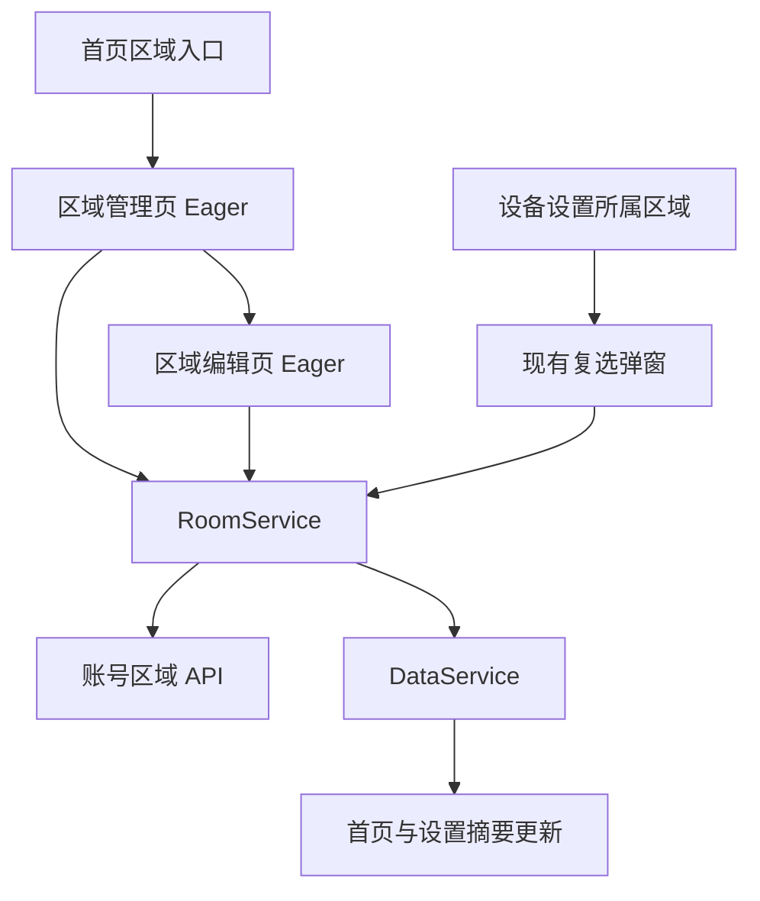
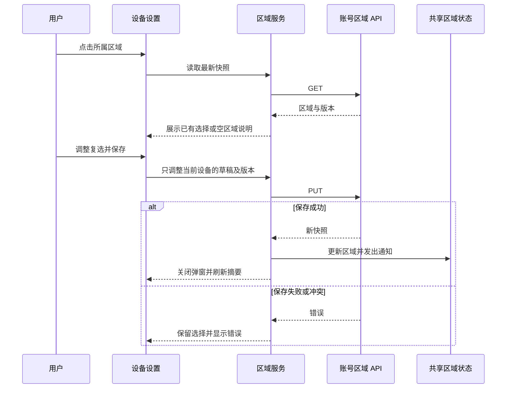

# 区域页面修复执行记录

## Intent：最终目标

进入区域管理页后正常显示区域列表或空区域占位，创建由用户主动发起；设备设置提供账号区域分配入口。

## Data：可用证据与实际修改

### 持续加载的原因

- 本地 Angular 类型定义注明 OnPush 为默认策略。
- 区域管理页在异步请求后修改 `loaded/error` 等普通字段，没有通知变更检测；区域编辑页有同样的问题。
- 主应用使用 Zone 变更检测。两个区域页面显式采用 `ChangeDetectionStrategy.Eager`，与仓库 Angular 22 迁移约定一致，使加载成功、失败和保存结果能更新到视图。
- 保留原有“还没有区域”占位。只有成功读到空区域才显示该占位，读取失败仍显示错误与重试。

### 自动弹窗的原因

- 首页导航传入 `createRegion: true`，管理页读取后在进入生命周期中调用 `addRoom()`。
- 删除这条隐式创建链路；保留管理页右上角新建按钮与空态新建按钮。
- 保留导航中的返回地址，不改变已有返回行为。

### 设备设置分配区域

- 在现有“设备管理”菜单加入“所属区域”，显示已有归属或未分配状态。
- 使用现有 `AlertController` 展示区域复选项，保持一个设备可属于多个区域的既有语义。
- 打开时读取最新区域；确认时仅调整当前设备的成员关系，保留其他设备、区域顺序及区域内已有设备顺序。
- 全部取消可解除所有区域归属；选择未变化时不提交；取消不写入。
- 使用既有 `RoomService.saveData()` 提交快照、revision 和会话 epoch，保留账户隔离与版本冲突保护。
- 保存失败保留弹窗及选择，并显示错误。冲突后可取消并重新打开以读取最新版本。
- 无区域时提供“管理区域”入口，由用户进入管理页后主动新建。
- 通过现有 `userDataLoader` 通知刷新设置摘要与首页区域数据；共享设备同样可以在当前账号内分类。
- 预览设备禁用区域分配，避免把预览 ID 提交到账号接口。
- 加载期间防止重复打开，保存期间防止重复提交，页面销毁时清理弹窗。

### 验证

- `npx ngc -p tsconfig.app.json --noEmit` 通过，覆盖 TypeScript 与 Angular 模板编译。
- `npx ng build app --configuration development --progress=false` 通过，已生成构建产物且命令以状态 0 退出；末次弹窗清理细化后，另行通过上述 Angular 编译检查。
- 四个修改的 TypeScript 文件执行 ESLint，报告三处已有选择器前缀错误：`tab-device`、`page-room-edit`、`room-manager`。这些选择器均未修改。
- 仅在检查命令中关闭上述历史规则后，四个文件的 ESLint 全部通过；未修改仓库检查配置。
- `git diff --check` 通过。

## Edges：边界与限制

- 代码改动限制在四个文件：两个区域页面、首页区域入口、设备设置页面；没有新增组件、路由或后端接口。
- 未改动工作区其他已有修改，未新增测试用例，未调用浏览器进行 UI 确认。
- 编译与静态检查不能替代真实账户端到端验证；未对真实账号执行区域读写，也未执行部署。

## Answer：交付与自我审查

- 已修正页面更新机制并移除自动创建触发，不用延时、轮询或强制显示空状态掩盖加载问题。
- 设备区域分配复用既有账号数据模型和保存链路，没有把区域归属写进设备全局配置，也没有强制收敛为单区域。
- 采用现有菜单与弹窗，保持改动集中；没有为单一入口添加新的抽象层。
- 自我审查确认错误状态与空状态不同、取消不落库、失败不伪装成功、其他设备成员关系和顺序保持不变。
- 仍需用户在目标服务可用的环境中确认最终交互；本次遵循不使用浏览器检查的要求，未声称已完成运行时 UI 验证。

## 架构图

## 数据流图

