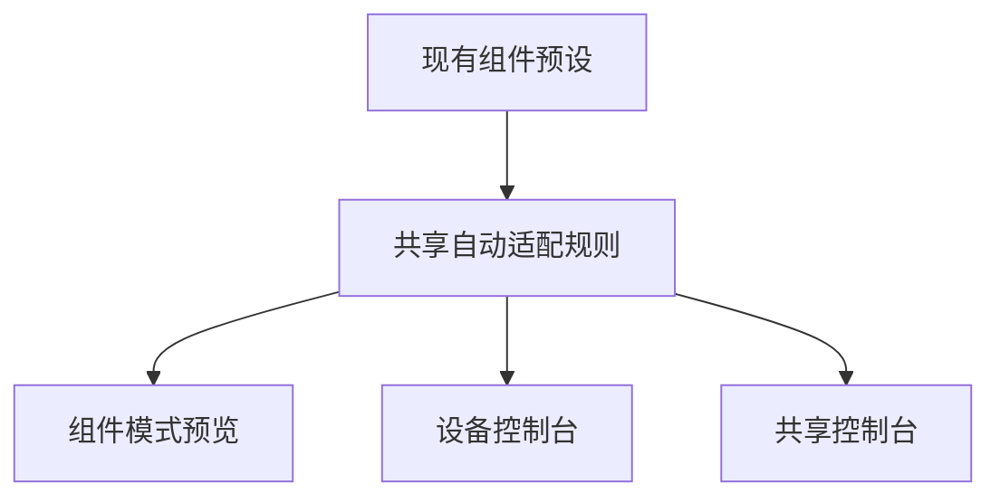
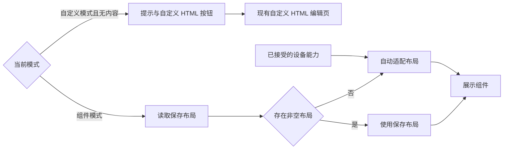

# 控制台空布局自动适配

## Intent：最终目标

用户已确认：仅在组件模式下，设备未保存组件布局时，控制台直接展示根据设备能力生成的“组件模式 → 自动适配”界面。自定义模式无内容时显示提示和直达“自定义 HTML”的按钮。

## Data：可用证据

- BBP2 控制台已有无记录或空 widgets 时生成默认布局的分支，但首次渲染依赖布局读取完成。
- 控制台默认布局与配置页自动适配的预设尺寸、标题、样式和排序处理存在差异。
- 共享控制台只判断布局是否存在，未将空 widgets 视为自动适配条件。
- 旧协议入口已映射到 `LegacyPanelComponent`，沿用已有配置、明确的开关能力及数值读数生成组件，不改动该路径。

## Edges：边界与限制

- 仅根据已接受的设备能力生成真实组件，不生成示例数据。
- 保留非空保存布局、自定义 HTML 模式、隐藏部件设置和控制权限。
- 自定义模式不因 HTML 缺失而自动切换到组件模式；无编辑权限的共享访问仅显示配置提示。
- 自动生成仅用于显示，不自动保存或覆盖服务端布局；读取失败继续报告错误。
- 保留工作区已有的能力缓存读取修改，不扩展旧协议。
- 不新增测试用例、不调用浏览器；复用现有检查与编译。

## Answer：交付格式与成功标准

交付共享的自动适配规则及控制台接入修改。组件模式无布局和空布局都直接展示适配组件；配置页预览、设备控制台、共享控制台使用一致的组件预设。自定义模式的空状态进入现有 `/device/:id/edit/custom` 编辑入口。

### 执行计划

1. 提取现有自动适配中的纯布局规则，配置页与控制台共同使用。
2. 设备能力就绪即展示临时自动布局，读取到非空保存布局后恢复保存布局。
3. 修正共享控制台空布局判断，校准无能力时的提示。
4. 运行现有相关检查与编译，记录自我审查。

### 架构图

### 数据流图

### 验证与自我审查

已完成：

- 提取 `automatic-page-layout.ts`，复用现有标题映射、组件预设、尺寸约束及布局排布；没有新增针对某台设备的特殊规则。
- 配置页自动适配的预览和应用、设备控制台的空布局显示、共享控制台的空布局显示调用同一函数。
- 设备能力已接受时先生成临时适配界面，避免首次展示依赖布局请求完成；非空保存布局读取成功后仍优先使用。
- 空保存记录保留修订号与已有主题；隐藏部件在排布前过滤。
- 没有设备能力时明确提示等待连接，不再误导用户必须先添加组件或生成界面。
- 后续补充：BBP2、旧协议与共享控制台的自定义空状态均不再回退渲染组件；编辑按钮按所选模式进入对应编辑页。

验证结果：

- 应用 development 编译通过，差异格式检查通过。
- 使用仓库现有 4 个测试文件，46 个用例全部通过，覆盖布局、界面草稿、配置页面与控制台。
- 默认测试编译受无关的 `ble-direct/session.spec.ts` 失效导入阻塞；使用临时 TypeScript 配置限定相关测试后通过，未改动该蓝牙测试或仓库测试配置。
- 未新增测试用例、未使用浏览器。

自我审查：

- 修正在布局生成入口及共享规则，不通过修改空状态文案掩盖问题。
- 自动布局是当前显示结果，不会隐式持久化，也不会把接口失败认定为服务端不存在布局；失败信息继续可见。
- 自定义 HTML 的数据绑定、非空保存布局与命令权限判断保留。
- 缺少已接受能力清单时不能创建真实控件，仍需设备连接或现有缓存提供能力。
- 现有测试与编译能验证代码集成和已有行为，但未进行实际设备及视觉验证。
