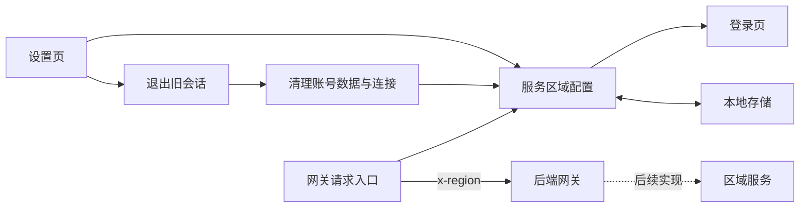
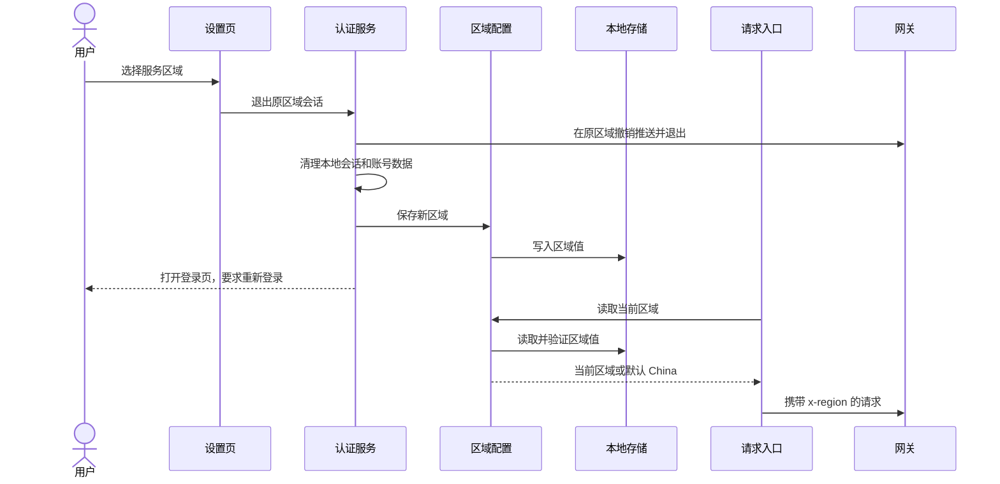

# 服务区域切换执行计划

## Intent：最终目标

在设置页面底部提供 China、Global、Development 三个服务区域选项，保存用户选择，并在应用后端请求中携带 `x-region`，供后续网关分发使用。切换不同区域时退出旧会话，并要求重新登录。

## Data：可用证据

- 设置页由 `settings.page.ts/html/scss` 实现，已有语言、外观卡片和自动保存提示。
- `ServerInterceptor` 集中处理网关请求；令牌刷新使用原始 `HttpClient`，需单独覆盖。
- 项目通过 `localStorage` 保存语言等客户端偏好；服务区域采用相同存储方式。
- 界面支持 11 种语言，新增标题和提示需同步补齐。
- 当前工作树有设备界面、排序等未提交修改，必须保留。
- `AuthService.logout` 先撤销推送、请求服务端退出，再调用 `clearLocalSession` 清理登录状态、通知连接释放并进入登录页；切换需复用该流程。

## Edges：边界与限制

- 本轮实现客户端区域选择和请求头；`aily-blinker-services` 的实际服务分发后续实现。
- 查明网关 CORS 白名单缺少 `x-region` 后，用户已确认一并放行；后端仅追加这一允许头。
- 请求头值严格使用 `China`、`Global`、`Development`；首次未保存或保存值无效时默认 `China`。
- 切换不同区域需重新登录；原区域的退出和推送撤销先完成，清理本地会话后再保存新区域，最后进入登录页。
- 选择当前区域不退出，切换进行中阻止重复操作；若旧会话已被新会话替换，沿用现有会话保护逻辑，不覆盖新会话的区域。
- 服务区域不是设备房间分组，不复用已有 `RegionSnapshot` 模型。
- 本机公开设备收藏保留并跨区域共存；公开观看请求使用收藏记录的区域，详见《公开链接设备跨区域共存执行计划》。
- 不为第三方服务、静态资源或局域网设备请求添加该请求头。
- 不新增测试用例，不调用浏览器做 UI 确认；使用已有相关测试、编译和静态检查验证。

## Answer：交付格式与成功标准

1. 新增一个小型服务区域配置模块，集中维护候选值、默认值和持久化。
2. 在设置页底部增加可选择、有明确选中状态且支持键盘操作的区域卡片。
3. 完成网关请求和绕过拦截器路径的覆盖核查，按需补充请求头，并完成用户确认的 CORS 白名单兼容修改。
4. 复用退出流程完成切换后重新登录，在切换前显示说明，并补齐全部语言翻译；运行相关现有验证并审查变更范围。
5. 在执行记录中说明实际修改、验证结果、限制和自我审查。

### 架构图

### 数据流图

