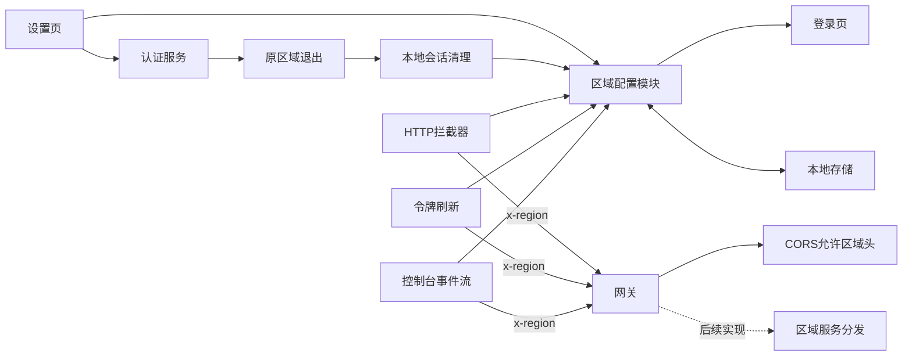
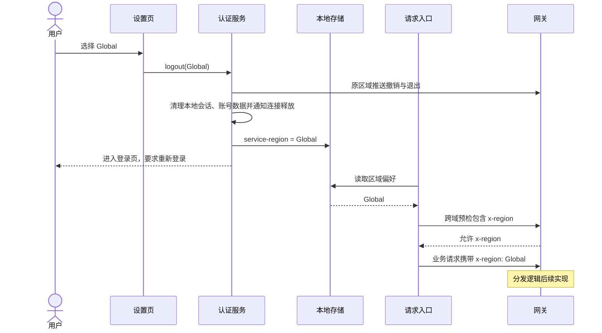

# 服务区域切换执行记录

## Intent：最终目标

在设置页底部提供服务区域切换，将选择持久化，并以 `x-region` 请求头交给后端网关，为后续区域分发建立客户端入口。根据用户补充要求，切换不同区域后必须重新登录。

## Data：可用证据

### 实际修改

| 文件 | 修改内容 |
| --- | --- |
| `src/app/configs/service-region.config.ts` | 维护三个允许值、区域类型、读取和保存函数；使用本地存储键 `service-region`，默认 `China`。 |
| `src/app/sections/settings/settings.page.ts/html/scss` | 在外观设置下方添加服务区域卡片；原生单选按钮支持键盘操作，切换期间禁用重复操作，选择当前区域不退出。 |
| `src/app/core/services/auth.service.ts` | 复用退出流程，在原区域完成推送撤销和服务端退出；清理本地会话并确认会话未被替换后，保存新区域，再打开登录页。 |
| `src/app/core/injectable/server.interceptor.ts` | 对当前网关基地址下 `/api/` 请求注入区域头；原始客户端发送的令牌刷新请求单独补充该头。 |
| `src/app/core/services/device-console.service.ts` | 控制台 SSE 使用直接 `fetch`，在该请求中补充区域头。 |
| `public/i18n/*/*.json` | 11 种语言各增加服务区域标题和重新登录说明；区域值统一显示 China、Global、Development。 |
| `../aily-blinker-services/services/gateway/src/index.js` | 经用户明确确认，在 `Access-Control-Allow-Headers` 中追加 `x-region`。 |

### 原因分析

需求的核心是让请求携带稳定、统一的路由信息。服务地址仍由现有环境配置决定，客户端无需维护三组后端 URL。

现有 `isGatewayUrl` 实际上是新鉴权规则的路由白名单，并不覆盖全部旧版网关 API。扩大它会让旧接口进入不适用的鉴权和参数清理逻辑。因此区域头在独立的网关 API 地址判断中添加，原有鉴权判断保持原样。

令牌刷新通过 `HttpBackend` 创建原始客户端，控制台实时事件流直接使用 `fetch`；二者均不经过常规拦截器，所以分别补充相同的配置读取。MQTT 连接地址和凭据由网关接口返回，BLE、局域网连接无需新增 HTTP 头。

区域值由一个无状态配置模块直接读取本地存储，不额外引入注入服务、状态容器或配置同步机制。

切换区域涉及会话边界，不能先保存新区域再退出，否则推送撤销、退出请求会携带旧账号凭据发到新区域。`logout` 和 `clearLocalSession` 增加可选的目标区域参数；原区域退出后，复用既有的账号数据清理、连接释放通知和会话版本检查，最后保存区域并进入登录页。现有普通退出调用不传参数，行为保持不变。

### 验证结果

| 验证 | 结果 |
| --- | --- |
| `ng build app --configuration development --progress=false` | 通过，完成应用 TypeScript、Angular 模板和样式构建。 |
| 本次修改的 TypeScript / HTML 文件 ESLint | 通过。 |
| `server.interceptor.spec.ts` | 现有 29 项测试通过。 |
| `auth.service.spec.ts` | 现有 9 项测试通过。 |
| `data.service.spec.ts` | 现有 10 项测试通过。 |
| 11 份语言 JSON 及新增文案完整性检查 | 通过。 |
| 后端 `node --check services/gateway/src/index.js` | 通过。 |
| 两个仓库的 `git diff --check` | 通过。 |

默认测试入口即使通过 `--include` 选择文件，仍会编译整个测试 TypeScript 范围，因已有 `ble-direct/session.spec.ts` 导入不存在的 `BleDirectFrameChannel`、`BleDirectProtocolError` 而失败。本次使用临时 TypeScript 配置，仅编译所选的现有测试及必要依赖，完成 48 项测试。临时配置执行后已删除，未修改 BLE 代码或新增测试用例。

## Edges：边界与限制

- 请求头值保持 `China`、`Global`、`Development` 的大小写；没有有效保存值时默认 `China`。
- 选择不同区域后先退出旧会话，清理完成后保存新区域并进入登录页；启动应用时仍使用已保存值。
- 选择当前区域不退出，切换进行中不接受其他区域选择。已有会话版本检查会阻止迟到的退出结果覆盖新登录会话。
- 不为第三方 API、静态资源和本地设备请求注入区域头。
- 复用现有退出逻辑清理账号数据并通知相关连接释放；新区域的登录和设备连接沿用现有登录流程，本轮不实现后端分发或跨区域数据迁移。
- 公开设备收藏使用独立本地存储，退出和区域切换不会删除。后续补充的跨区域共存和观看请求区域规则见《公开链接设备跨区域共存执行记录》。
- CORS 修改已写入后端源码，但未启动、重启或部署网关。运行环境需要应用该修改，才能接受新增请求头的跨域预检。
- 按用户要求没有调用浏览器进行 UI 确认，没有新增测试用例。
- 两个仓库原有的界面生成、设备卡片等未提交修改均予以保留。

## Answer：交付格式与成功标准

已完成客户端区域选择、持久化、网关 API 请求头、刷新和 SSE 补充，以及用户确认的网关 CORS 兼容修改。区域切换会退出旧会话并要求重新登录。代码、翻译、执行计划和本记录均位于对应工作区，未提交或部署。

### 自我审查

- 修改围绕区域偏好和请求边界，没有将简单偏好扩展为通用配置框架，也没有复用名称相近但语义不同的设备房间区域模型。
- 单选控件采用浏览器原生交互；沿用现有颜色和卡片变量，避免引入新的视觉系统。
- 已确认旧网关 API 仍保留原有鉴权语义，两个绕过拦截器的业务路径均有区域头。
- 重新检查了切换顺序：区域写入位于本地会话清理与版本校验之后、登录页导航之前，退出请求仍使用原区域，登录页初始化则读取新区域。
- 服务端退出失败时仍沿用既有本地清理逻辑；没有新增会话清理实现，也没有绕过现有会话版本保护。
- 构建和已有回归测试能证明基本集成正常，但不代表已验证真实的跨区域路由、区域账号隔离或数据切换；这些需在后端分发实现后联调。
- 清理了工具自动引入的无关空行变化，使改动保持集中。

### 架构图

### 数据流图

