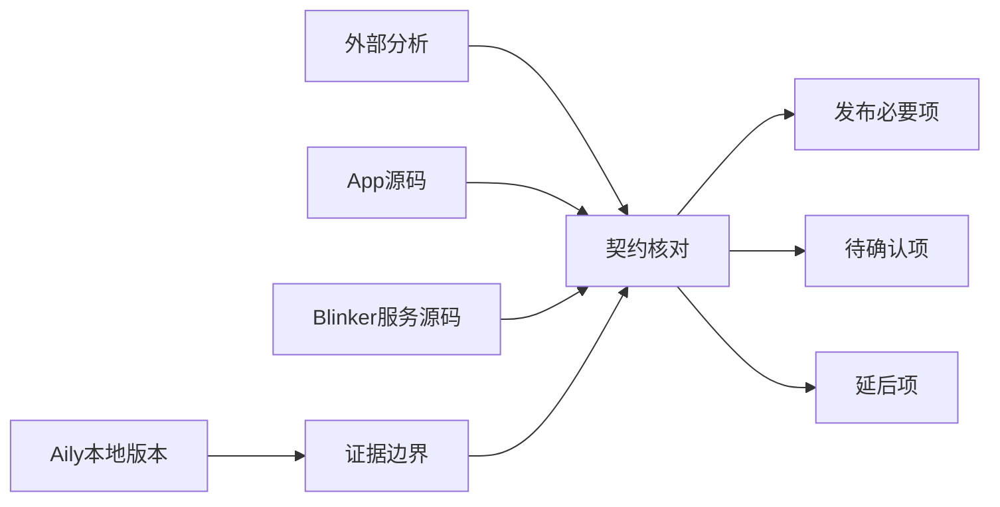
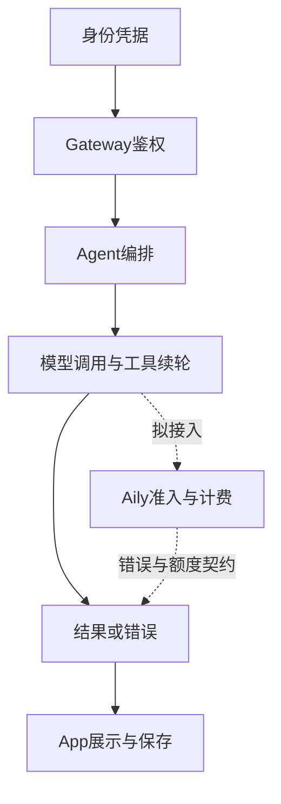

# 模型计费接入审查计划

## Intent：最终目标

审查外部 AI 给出的「Blinker 保留 Agent 编排，Aily V3 Interactions 负责模型调用及 Credits」方案，确定合并主分支、部署上线前真正必要的服务端与 App 改动。

从身份归属、模型执行、扣费一致性和用户可理解的结果四个问题出发，避免把计费接入默认扩大为完整任务调度平台。

## Data：可用证据

- 用户提供的外部分析全文。
- 当前 `blinker-app` 与相邻 `aily-blinker-services` 的源码和已有记录。
- 相邻 `aily-services` 的本地代码；其最新本地提交日期为 2026-06-29，不能代表分析引用的远端 V3/Credits 版本。
- 用户澄清：「同步」指合并主分支、部署上线，而不是合并到某份文档。
- 用户进一步要求：现有功能是新实现的，不应因外部方案提出改动就重复改写。每项改动必须说明接入 Aily 后的具体失效点。

## Edges：边界与限制

- 本轮属于必要性评估，不修改业务代码、不合并分支、不部署、不发起付费模型调用。
- 最多使用一个子代理，只做 App 文件定位与分析；服务端由主代理核对。
- 代码搜索使用 `ast-grep`；定位文件后先用 `ast-outline` 查看结构，再读取实现。
- 不生成测试用例，不调用浏览器作 UI 确认；区分静态代码证据、推断和待服务端确认的契约。
- 不把外部分析中的接口、金额单位、恢复语义或文件行号当成已验证事实。
- 已实现的能力直接复用；不以「顺便规范」「将来扩展」为由纳入上线必要范围。

## Answer：交付格式与成功标准

- 交付中文审查记录，明确上线必要项、条件必要项、可延后项和不成立的推断。
- 分别列出 Aily、Blinker Gateway/Agent 和 App 的最小修改边界，附源码证据。
- 区分「已有功能正常发布」与「本次启用按用户 Credits 收费」两种发布范围。
- 提供架构图、数据流图、部署顺序和验收条件，并做一次自我批判。

### 执行步骤

1. 核对三个仓库版本、实际入口和已有鉴权。
2. 跟踪模型调用、工具续轮、错误、断线和取消处理。
3. 核对 App 请求字段与 Agent 校验契约。
4. 对外部分析逐项裁剪，将无法核验的 Aily 能力列为发布前需补齐的证据。
5. 形成发布范围建议，检查文档内部一致性与差异格式。

### 审查架构图

### 审查数据流图

