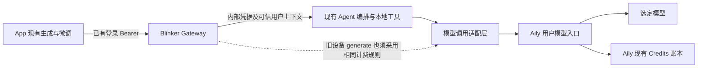
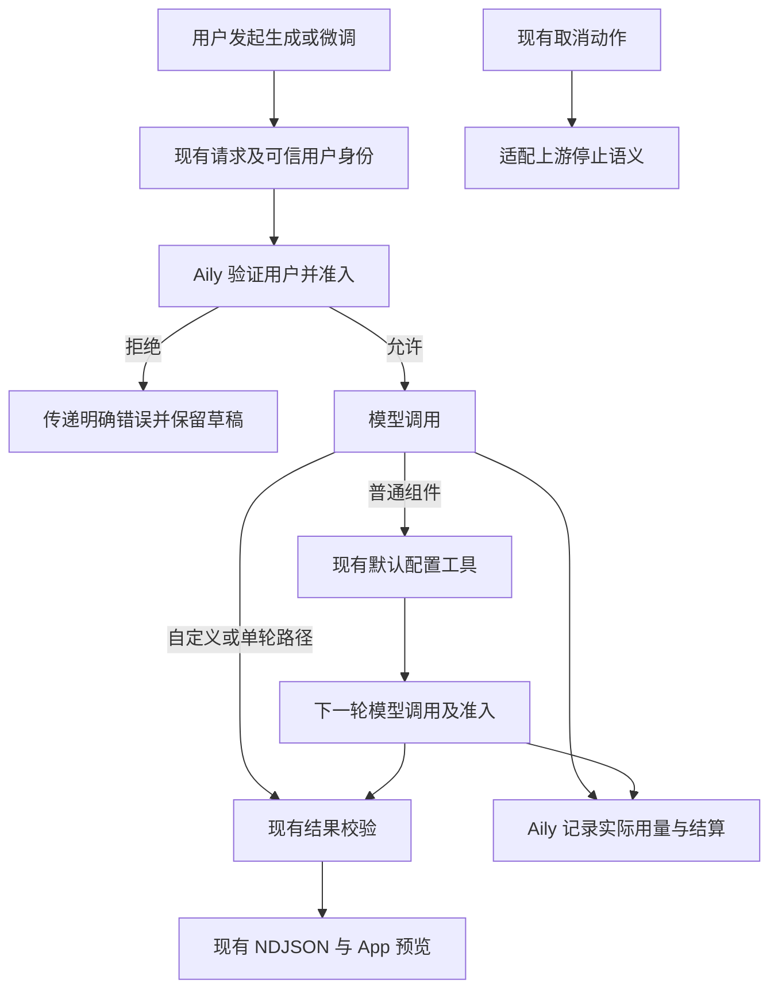

# 模型计费接入必要性审查

## Intent：最终目标

确定合并主分支、部署上线时，接入 Aily 模型与 Credits 真正增加了哪些必要工作。现有生成、微调、自定义面板都是近期实现，直接复用其功能与协议；只改接入后确实不成立的地方。

结论：外部方案的职责划分可以保留，但实施范围明显扩大。它混合了模型计费接入、已有功能发布和持久任务恢复三个目标。不能把整份清单当作合并上线的前置要求。

后续进展：用户进一步确认当前重点是 Agent 错误反馈。本地已完成该部分修复，见同目录《界面生成错误反馈修复记录》。下文错误吞并的源码描述保留为修复前审查证据；没有因此加入任务恢复系统或 Credits 接入。

## Data：可用证据

### 核对范围与版本

| 仓库 | 本地分支与提交 | 证据范围 |
| --- | --- | --- |
| `blinker-app` | `xwd`，`9816fd4`，2026-10-14 | 当前 App 请求、鉴权、事件处理和界面状态 |
| `aily-blinker-services` | `xwd`，`631b743`，2026-10-14 | Gateway、Agent、仓库部署配置 |
| `aily-services` | `main`，`f21ec666`，2026-06-29 | 旧版本；不能核验外部方案描述的 V3/Credits 实现 |

下文 App 路径相对 `blinker-app`，服务端路径相对相邻的 `aily-blinker-services`。本次没有读取生产部署状态，没有认定本地配置已经在线上生效。

### 已经具备的功能

| 证据 | 当前行为 | 审查结论 |
| --- | --- | --- |
| App `src/app/core/injectable/server.interceptor.ts:110`、`:137`、`:181` | Bearer 注入、401 刷新并重放一次；克隆原请求 | 不重写登录与刷新机制；新增请求头会随克隆保留 |
| App `src/app/core/model/response.model.ts:296`；拦截器 `:426` | HTTP 错误已有机器码、消息、数据、追踪号等 | 不为计费重建全局错误体系 |
| 服务端 `packages/device-ui-agent/src/model.ts:70`、`:100`、`:140` | 首轮强制读取默认配置，第二轮输出结果，执行本地工具并续接历史 | 两轮工具行为已经实现，不是待建设的新工作流 |
| 服务端 `packages/device-ui-agent/src/custom-workflow.ts:6` | 字段 schema 明确接受 `id`、`telemetryMinimumIntervalMs` 等 | 「这些字段会被 strict 拒绝」的修复理由不成立 |
| 服务端 `services/gateway/src/interface-workflow.ts:54`；Agent `workflow-http.ts:34` | 连接关闭沿 AbortSignal 取消上游请求 | 已有与连接绑定的执行方式，不能直接换成后台持续运行 |
| 服务端 `services/gateway/src/interface-workflow.ts:70`；Agent `workflow-http.ts:39` | 已有 NDJSON 与 `X-Accel-Buffering: no` | 不重做流式协议；部署代理配置另行核对 |

App 的 `round: 1` 表示界面工作流轮次，不能据此推断只调用了一次模型。旧记录《界面生成合并为单次调用》已被后续《组件默认配置工具接入》修正；本次以当前代码为准。

### 接入按用户收费后确实会失效的地方

1. **用户身份没有到达模型调用层。** Gateway 工作流请求只发送内部 Token 和 `X-Workflow-Owner` 哈希（`services/gateway/src/interface-workflow.ts:61`）；Agent 使用配置中的固定 API Key（`packages/device-ui-agent/src/model.ts:46`）。仅替换模型 URL 不能把用量记到当前 Aily 用户。
2. **另有一个仍在使用的生成入口。** App 根据设备类型调用 `/workflow`、`/refine` 或 `/generate`（`interface-generation.service.ts:114`）。`services/gateway/src/interface-generation.js:292` 自己组织模型请求。只接工作流的计费会遗漏当前旧协议设备入口；这是现有用户路径，不是为假想旧客户端增加兼容层。
3. **收费错误会被抹平。** Agent `model.ts:123` 把模型错误统一改为 `MODEL_REQUEST_FAILED`；`workflow-http.ts:50` 再改为通用生成错误；Gateway `interface-workflow.ts:64` 丢弃非成功响应正文。现有行为无法表达余额不足、用户会话失效等新增业务原因。
4. **微调失败会被返回成旧草稿完成。** Agent `workflow.ts:43` 对非取消错误返回原 proposal 的 `complete`；App `interface-generation.service.ts:54` 在已有 draft 时也会把错误 resolve 成结果。自定义页面 `custom-panel-editor.component.ts:122` 丢弃 NDJSON 错误细节。保留原草稿是合理功能，但付费失败原因不能因此丢失。

## Edges：边界与限制

- 本轮只做必要性审查，新增两份中文记录，没有修改业务代码、合并分支或部署。
- 不新增测试、不调用浏览器、不发起真实模型请求；静态核对不能证明端到端生成质量、线上配置或实际扣费正确。
- 没有当前 Aily V3/Credits 代码或契约，不能确认 `operation_stream_v1`、`threadId + idempotencyKey`、step lease、回放期限、`available_micros`、outbox 状态与金额单位。
- 若本次仅发布已完成的界面功能，Credits 接入本身就是独立新需求，不是发布必备改造。以下最小计费范围以「本次确定按用户 Credits 收费」为条件。
- 新功能发布不需要额外设计旧协议兼容层；三个仍被当前 App 调用的入口必须继续有效。

## Answer：交付格式与成功标准

### 一、保留的最小计费范围

| 工作 | 为什么需要 | 最小边界 |
| --- | --- | --- |
| 模型调用接入 Aily 的用户计费入口 | 当前固定服务 Key 没有用户扣费归属 | Gateway 传可信用户凭据/授权上下文；Agent 模型适配层使用它。凭据不进入提示词或持久任务内容 |
| 覆盖当前全部生成路径 | `/generate` 与 `/workflow`、`/refine` 当前并非同一转发链 | 三条入口采用同一计费规则；不要求先建设通用操作服务 |
| 保持现有工具及输出能力 | 普通组件确实依赖强制工具调用、工具结果续接和最终 JSON | 仅补 Aily 选定模型实际缺少的能力。若已有接口支持，则不改 Aily；不预先为所有供应商铺设抽象 |
| 传递可识别的收费错误 | 当前会抹平错误，或把原草稿返回为完成 | 只映射允许公开的机器码和安全提示；草稿可保留，错误必须保留，不转发原始供应商异常 |
| 核对收费重试与取消语义 | 超时/丢响应不代表未执行，断开 HTTP 也不必然终止 Aily 后台任务 | 优先复用 Aily 的去重和取消能力；未确认执行状态时不自动重新发起收费调用 |

幂等的最低要求是同一逻辑调用的重发不会变成新的模型执行。若 Aily 已有可用能力，直接采用其用户作用域、幂等键、轮次和保存期限；App 同一次操作及 401 重放复用同一键，用户发起新的生成才产生新键。不能仅增加一个未被服务端执行的请求头就宣称防重完成。

两次实际模型调用各自如何去重、工具续轮如何去重，需要以 Aily 的真实契约决定。不能照抄「同一个 operationId 足够」或「重复 stepIndex + lease 一定安全」。若上游没有所需保证，再补最小共享去重记录及状态；这不自动要求租约、心跳、自动接管和完整事件存储。

取消也要保持当前产品语义。如果选用的 Aily 接口在客户端断流后继续执行，适配层需要将现有取消传到它的停止接口。只有要实现断线继续、跨页面恢复时，才需要重新设计 App 的“离开”和“取消”，并增加独立操作 API。

### 二、App 实际需要改多少

首要改动集中在两个实际生成入口：

- `src/app/sections/device/device-uic/interface-generation.service.ts`：保留付费错误原因；需要业务幂等时由操作入口持有稳定键。
- `src/app/sections/device/device-uic/custom-panel-editor.component.ts`：它直接请求工作流，不经过上述 service，必须同样保留错误与操作键。
- `src/app/sections/device/device-uic/device-uic.page.ts` 及自定义模板：仅补实际新增错误的提示和状态，不重新设计生成交互。

其余文件按真实新增接口决定：

- 继续使用现有生成 URL，无需改变它们的鉴权匹配。
- 若增加余额接口，在 `api.config.ts` 注册 Gateway URL；现有拦截器白名单会决定是否注入 Bearer。无需重写拦截器的刷新流程。
- 余额展示是产品选择，可以先在生成页查询、操作后刷新；不必先做登录订阅、前台监听和全局缓存。只有实际需要缓存才处理其生命周期，且必须隔离账号。
- 不新增 operation 游标、恢复页面或结算摘要解析，除非本次明确交付这些功能。
- 不改自定义字段白名单：本次没有找到字段契约不匹配的证据。显式列字段可以是另一次代码整理，但不是计费或发布阻塞项。

### 三、从“本次必须做”清单移除的要求

| 外部分析要求 | 判断 | 原因 |
| --- | --- | --- |
| 必须使用 V3 Interactions | 待证据，不能先定 | 需要的是带用户准入和计费的模型调用；V3 是候选协议。若 Aily 现有更轻接口同样支持计费和工具，则足够 |
| 每次强制 `/me` 刷新并新增付费鉴权体系 | 非必然 | 真正要求是在模型执行前验证当前用户授权、由 Aily 做准入；如果 Aily 入口已经可靠验证同一用户，就不必重复多一次 `/me` |
| PostgreSQL 完整操作表、执行租约、heartbeat、checkpoint、release | 移出首期 | 服务于持久工作流、重启接管和后台恢复；当前执行随 HTTP 连接结束，没有这项产品需求 |
| App operation 状态、事件游标和断线自动恢复 | 移出首期 | 是新增体验，不是切换计费入口的自然要求 |
| 所有场景都新增 `/operations/{id}/cancel` | 条件必要 | 仅当任务生命周期脱离当前连接或需恢复后取消时才需要；停止上游任务的能力仍需确认 |
| 新建公开 interaction billing API，并增加多层聚合文件 | 移出首期 | Aily 需要正确结算与内部可追踪；App 若不显示逐操作结算详情，就不需要公开新增聚合 API |
| 把 available/reserved/pending 等全部展示到 App | 产品可选 | 可先展示可用额度与明确失败原因；是否显示预留、是否支持消费明细不是模型调用正确性的条件 |
| 重做登录、401 刷新、通用 HTTP 错误模型 | 删除 | 当前已经具备 |
| 修复自定义字段白名单 | 删除 | 当前 Agent schema 已接受被质疑的字段 |
| 重做工具工作流、为旧解析器增加新兼容层 | 删除 | 当前工作流已实现，继续复用其请求/结果结构即可 |
| 写死下一次 migration 为 054 | 删除 | 尚未确定需要新表，更不能根据其他环境预定迁移编号 |

若收费或鉴权错误发生，不能恢复到固定服务 Key 或另一条不计费链路继续调用。保留用户草稿与绕过计费是两件不同的事。

### 四、与计费无关，但有本地证据的部署核对项

1. `deploy/nginx/conf.d/aily-gateway-api.conf:44` 的 `/api/v1/` 上游读取空闲超时为 60 秒；Agent 工作流为 180 秒，Gateway 为 190 秒。Agent 在阶段事件后可能长时间没有输出，因此存在中途断开的风险。若生产采用这份配置，应只对实际 AI 路由调整超时；不需要改业务生成流程。现有响应已提供禁缓冲头，不能笼统认定流式完全没配置。
2. `services/gateway/src/device-panels-http.js:5` 实现 `/api/v2/device-panels/{hash}`，但这份 Nginx 的 V2 白名单没有它；`ui-config` 和 `page-layout` 已在白名单中。若发布包含旧协议设备面板保存，应补齐缺失的这一条实际路由，而不是重做面板保存接口。
3. 两个工作仓库当前最新提交说明都标有「区域管理（未完工）」。这只能说明合并范围需要明确，不能仅凭提交标题认定功能有缺陷，也不能据本次计费审查替整条分支作上线背书。

以上是仓库证据，不是已验证的生产事故。

### 五、最小架构图

图中适配层表示职责边界，不要求为了图新增独立服务；Aily 具体协议需以当前实现确定。

### 六、数据流图

生成完成、取消和校验失败都不能直接推导扣费结果。App 不显示已结算金额时，没有必要为此新建结算状态事件；实际用量结算由 Aily 保证。

### 七、建议实施顺序与成功标准

1. 先取得本次上线对应的 Aily 契约或源码版本，只确认用户鉴权、计费准入、模型参数、工具续轮、错误、幂等和取消这几项。没有证据前不指定 V3 文件改动清单。
2. 完成最小模型适配和用户上下文传递，覆盖当前所有生成路径；原有工具、结果校验、草稿、保存流程继续复用。
3. 只补服务端和 App 的收费错误处理；按真实 API 加操作键。余额 UI 若在本次产品范围内再增加。
4. 核对实际生产代理路由与超时。先使后端支持当前 App，再发布依赖新增契约的 App，最后启用收费。
5. 收费启用前验证：不足时不执行模型、两轮计费归同一用户、同一调用重发不重复执行、错误仍能保留原草稿、取消按真实用量结算、旧协议设备和自定义模式均无遗漏。这里列的是验收条件，本次没有生成测试用例或执行真实扣费验证。

### 八、自我批判与验证结果

- 最初把「自定义 fields 使用展开语法」列为疑点；对照服务端 schema 后，没有确认不匹配，因此不把代码风格建议包装成必要修复。
- 不能因文档写过「单次模型调用」就推翻现在的工具两轮实现；后续记录与当前源码表明这是用户明确选择的现状。
- 不能为了追求最小实现，就删除收费去重、真实鉴权或取消的约束。应先利用上游保证，确有缺口再补；延后的是整套任务恢复系统，不是正确收费本身。
- 没有当前 Aily 服务端证据，因此没有判断其计费是否已经可靠，也没有断言原分析的 V3 接口一定错误。明确不能确认的部分，比按假设铺开多个文件更符合本次范围。
- 本次完成源码、类型与路由的静态核对；未运行应用、未调用浏览器、未新增测试或业务代码。文档差异格式检查通过不等同于发布验收通过。
