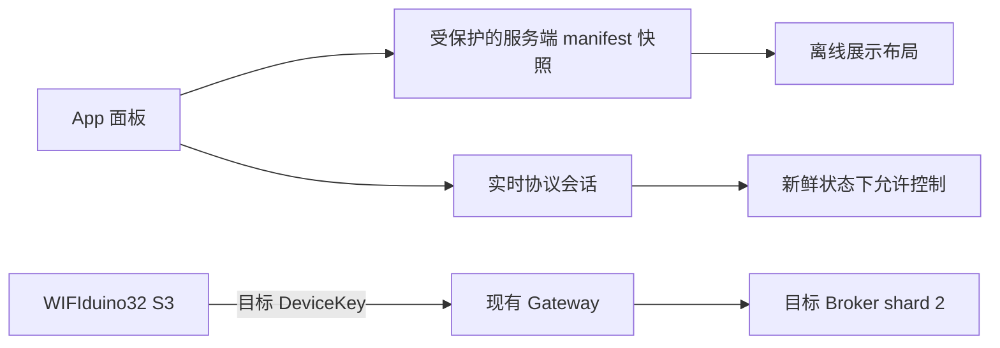
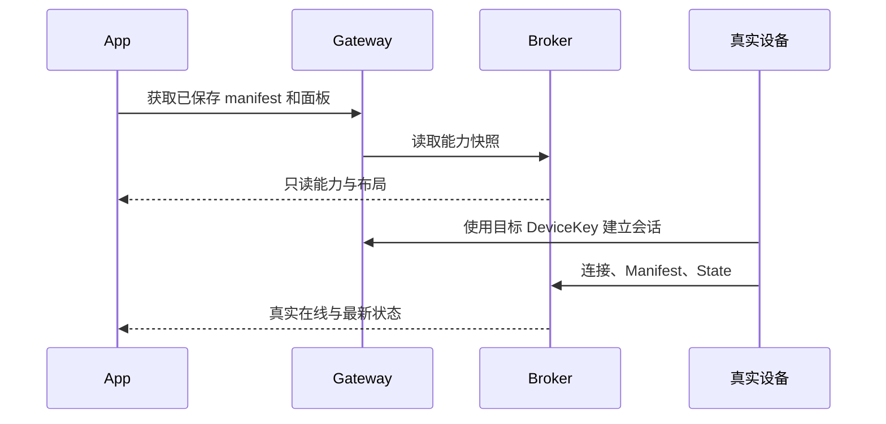

# 测试设备连接与离线面板修复记录

## Intent：最终目标

让当前测试账号的 WIFIduino32 S3 自有设备真正接入，并修复已保存 V2 面板在首次离线打开时被误显示为“尚未配置”的问题。

## Data：可用证据

- App 本地服务已重新启动，http://localhost:4200 返回 HTTP 200；后端服务健康。
- 两台目标设备的 owner、UI 配置、PageLayout 和 Broker manifest 均已存在且核对一致，普通布局分别有 3 和 9 个组件。
- 真实 WIFIduino32 S3 会话仍绑定原 logical ID，shard 1 在线；目标新 ID 尚无 session，shard 2 离线。
- App 首次打开新 ID 没有本地 manifest 缓存；实时同步又要求设备在线，因此跳过布局读取并错误显示未配置。
- 用户提供 blinker-library 路径，现有 Esp32S3InterfaceDemo 与 9 字段 manifest 一致，存在 /dev/cu.usbserial-310。

## Edges：边界与限制

- 通过正常 DeviceKey 接入把实际硬件绑定到目标设备，不伪造 presence 或 session。
- 离线 manifest 仅用于展示，不改变实时协议 ready、presence 或命令门槛。
- 只修改当前例程被 Git 忽略的接入凭据，保留现有 Wi-Fi 配置与固件功能。凭据不打印、不提交。
- 使用现有编译和烧录工具，只更新应用分区，保留 NVS。
- 不新增测试用例，不使用浏览器做 UI 确认；执行类型检查、构建和真实后端状态核对。

## Answer：步骤与成功标准

1. 增加受保护的已保存 manifest 读取，复用现有离线能力展示路径；真实控制仍要求新鲜会话和状态。
2. 将当前板子使用的 DeviceKey 更新为目标账号自有设备的 key，构建相同例程并烧录。
3. 核对新 logical ID 下的有效 session、Broker 在线、9 字段 manifest 与持续状态上报。
4. 记录 App 检查与硬件接入结果，保留第二台未接入硬件的真实离线状态。

## 执行结果与自我复核

已完成 WIFIduino32 S3 的真实接入和 App 离线面板加载修复。

### App 修复

- 增加已有 owner manifest HTTP 接口的 URL 与受保护请求识别，正常携带当前账号鉴权。
- 缺少本地能力缓存时，读取并校验服务端 manifest；校验设备 ID、会话 epoch，并优先保留更新的实时 manifest。
- 复用现有缓存展示快照，`stateFresh=false`，不写入实时协议 store、不伪造在线状态。
- 页面在等待真实连接的同时读取已保存能力，随后使用原有 console/layout 加载与字段校验逻辑。
- 读取失败与未配置分别显示，避免失败时误导用户重新生成界面。
- 现有只允许 owner 的 manifest 接口未扩展为共享接口；本次修复针对当前自有设备路径。

### 硬件验证

- 已确认固件配置中的旧 DeviceKey 对应原 WIFIduino32 S3，目标新 key 对应当前测试账号设备。
- 只更新被 Git 忽略的 secrets.h 中 DeviceKey，保留 Wi-Fi 与例程代码；旧配置备份在受限权限的 .build 中。
- Aily Builder 编译成功：程序 1,015,703 字节，静态内存 49,856 字节。
- esptool 确认原 ESP32-S3 revision 0.2、16 MB Flash；只烧录 0x10000 应用分区，hash 校验通过并重启，未整片擦除。
- Gateway 新会话明确绑定 `device_d66c92aa-80d9-4b52-a7b2-a9df38b682b9`、shard 2。
- 新设备 Broker 快照确认在线；持续采样状态 revision 从 45 增至 199，9 个 manifest 字段齐全。
- 经正常 owner 管理服务发送一次 demoLabel 当前值不变的命令，返回 acknowledged=true、replayed=false、sequence=16，验证硬件命令回执；没有触发灯光或其他执行器动作。
- 第二台 Esp32 S3 没有对应本次接入硬件，保留真实离线状态。

### 检查与范围

- App TypeScript 检查通过，开发服务器重新构建成功，http://localhost:4200 可用。
- 默认单测编译被既有 ble-direct/session.spec.ts 的旧类型引用阻塞（BleDirectFrameChannel、BleDirectProtocolError）。未修改该无关测试。
- 使用临时 tsconfig 仅编译并运行既有 device-v2.page.spec.ts，12 项测试全部通过；没有新增测试用例，临时配置已清理。
- 未进行浏览器 UI 确认；没有把类型检查或单测当成视觉确认。

### 自我复核

此前只完成数据复制，没有完成硬件身份切换，也未覆盖新设备首次离线展示路径。本次以新设备会话、持续状态和真实 ACK 补足硬件证据，并将已保存能力展示与实时可控状态分开，避免将“能显示面板”误当成“设备已经在线”。
