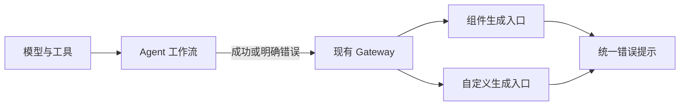
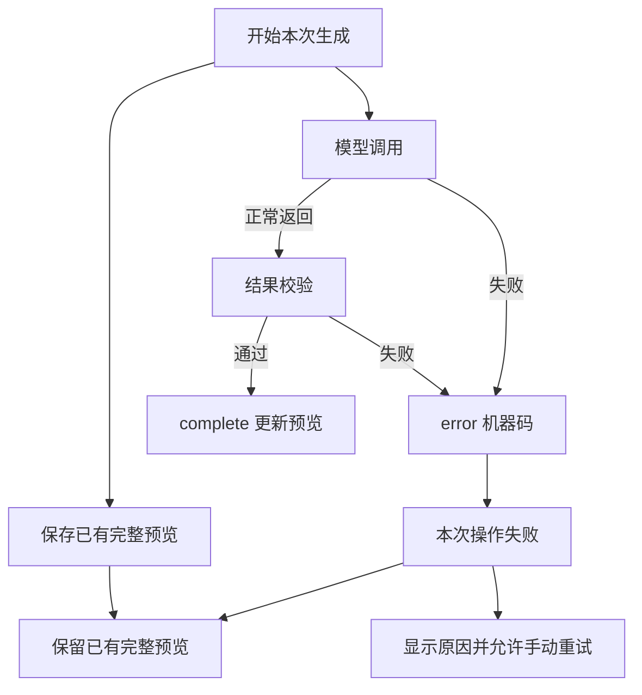

# 界面生成错误反馈修复计划

## Intent：最终目标

让 Agent 失败后，App 明确显示本次生成失败及可识别原因，同时保留上一次完整预览。现有请求与连接生命周期足够，不引入任务恢复系统。

## Data：可用证据

- Agent `workflow.ts` 捕获微调错误后，把原 proposal 作为 `complete` 返回。
- App `interface-generation.service.ts` 在已有 draft 时，把错误或缺少 complete 转成成功结果。
- 自定义编辑器不读取 NDJSON error 的 code，所有错误都显示同一句话。
- Agent 已区分部分模型超时、输出截断与工具错误，但 HTTP 层只返回通用生成失败。
- Gateway 把 Agent 的请求错误 400 也归为生成失败。
- App 页面已有 `previousDraft` 和 `restoreDraft()`，不需要另建恢复存储。
- 开始生成时 `scrollToPreview()` 把视口滚动到预览区，但原错误提示位于上方输入区，可能离开视口。把同一条错误提示移到预览顶部。

## Edges：边界与限制

- 仅修改上述错误反馈链，不接入 Credits，不改模型编排、正常结果协议、面板字段、Nginx 或任务生命周期。
- 不把供应商原始异常、请求内容和凭据直接发送到 App；只返回已识别的机器码。
- 不新增测试用例、不调用浏览器、不发起付费模型请求、不合并或部署。
- 使用现有检查和相关已有测试验证；没有可用的真实上游错误证据时，仍以通用失败提示收束。

## Answer：交付格式与成功标准

1. Agent 模型或校验失败发送 error，不再以旧草稿发送 complete。
2. App 的错误或缺失 complete 均拒绝本次生成；已有页面逻辑恢复之前的完整结果。
3. 普通组件与自定义生成复用简短的错误提示映射；HTTP 与 NDJSON 错误一致显示。
4. 请求无效、超时、结果不完整、结果过大、结果校验失败与服务不可用可以区分；未知错误不显示内部异常。
5. 记录实际验证结果及自我复核，保留完整成功、取消与手动重试行为。

### 架构图

### 数据流图

