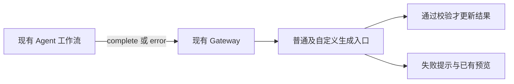
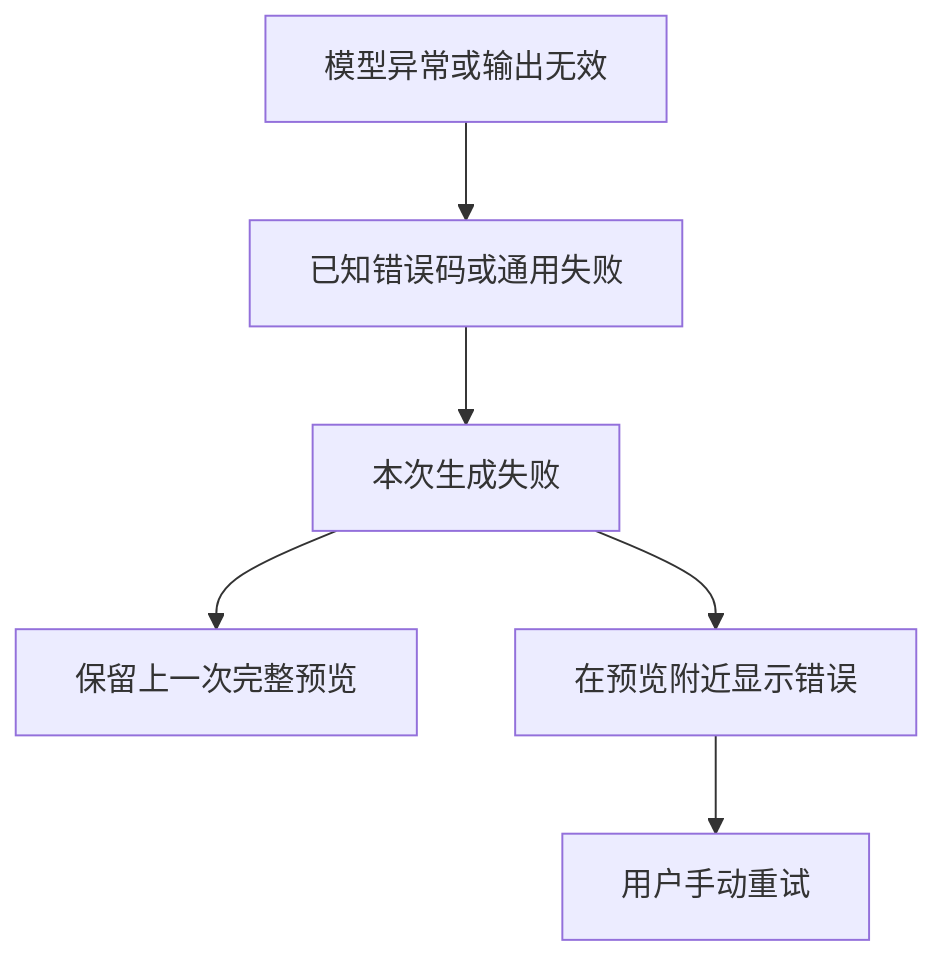

# 界面生成错误反馈修复记录

## Intent：最终目标

当前界面生成不需要任务恢复系统。修复实际存在的错误吞并，让用户分清「本次生成失败」与「上一次结果仍可使用」，并继续使用现有取消和手动重试方式。

## Data：根因与修改

### 失败被两层转换成成功

1. Agent 微调流程捕获模型或校验错误，随后把旧 proposal 作为 `complete` 返回。
2. App 生成服务发现已有 draft 后，即使收到 error 或未收到 complete，也 resolve 为成功结果。

此次删除这两处成功回退。Agent 模型异常继续向 HTTP 层抛出，结果校验异常转为明确的无效输出错误；App 只有合法 complete 才 resolve。失败后页面已有的 `previousDraft` / `restoreDraft()` 负责恢复上一次完整预览，不接受本次未完成片段。

### 已知错误原因在传输中丢失

- Agent 将已有的超时、输出不完整/截断、输出过大、工具结果或输出校验失败映射为有限的公开机器码。
- Gateway 保留其已知 HTTP 400 的「请求无效」含义；自身等待超时在响应仍可写时反馈超时。
- App 普通组件与自定义生成使用同一个简短提示映射，包含自定义入口的 RxJS 超时。
- 自定义 NDJSON 先读取 error 机器码，缺少 complete 与结果无效分别提示；不再全部归成「结果暂不可用」。

没有修改模型供应商异常的隔离策略。供应商原始报文仍不直接显示；未能识别的异常继续提示通用失败，不声称已还原其具体上游原因。

### 错误位置可能不在当前视口

普通生成开始时调用 `scrollToPreview()`，滚动到预览区；原来的错误提示位于上方输入区。将同一条提示移到预览标题下，保留原来的错误颜色、`role="alert"` 和重新读取入口，仅补充局部间距。

### 文件范围

| 仓库 | 文件 | 修改 |
| --- | --- | --- |
| App | `src/app/sections/device/device-uic/interface-generation.service.ts` | 失败和缺失 complete 不再 resolve 草稿；本地无效响应明确归类 |
| App | 同目录 `interface-generation-error.ts` | 仅两个纯函数：构造机器码错误、映射用户提示 |
| App | 同目录 `device-uic.page.ts`、`.html`、`.scss` | 复用旧预览恢复，统一提示，调整提示位置 |
| App | 同目录 `custom-panel-editor.component.ts` | 读取 NDJSON 错误与超时，保留已有 HTML 预览 |
| `aily-blinker-services` | `packages/device-ui-agent/src/workflow.ts` | 删除失败后返回旧 proposal complete 的逻辑 |
| `aily-blinker-services` | `packages/device-ui-agent/src/workflow-http.ts` | 安全映射已知内部错误类型 |
| `aily-blinker-services` | `services/gateway/src/interface-workflow.ts` | 请求错误与超时不再一概改为通用生成失败 |

## Edges：边界与限制

- 没有加入任务表、事件回放、租约、心跳、后台执行或自动重试。
- 没有改模型调用次数、提示词、默认配置工具、字段白名单、结果结构、Credits 或代理部署配置。
- 没有新建测试用例、调用浏览器、请求真实模型、合并分支、重启服务或部署。
- 本次主要修复组件工作流与自定义工作流的失败语义；旧协议生成的模型适配代码保持原样，其错误仍会被 App 作为失败处理。
- Gateway 流已经不可写时不能保证补发错误事件；App 会通过现有 HTTP 失败、缺失 complete 或超时结束本次操作，不把它认作成功。

## Answer：验证与交付

已完成：

- App TypeScript 检查通过。
- Agent、Gateway TypeScript 检查通过。
- Angular `ngc --noEmit -p tsconfig.app.json` 模板编译通过。
- 现有生成服务 6 项与页面 22 项测试通过，共 28 项；包含取消、部分流失败、保留已有完整草稿和继续重试等既有场景。
- 所改 App TypeScript 和 HTML 的 ESLint 通过；两个仓库的 `git diff --check` 通过。
- 静态核对 Agent 已不再发送失败回退的 `complete, round: 0`；正常完成仍通过现有结果校验。

没有新增针对各公开机器码的测试，也没有真实上游或浏览器验证；上述结果不能等同于已完成端到端验收。改动目前在两个仓库的本地源码中，需要发布相应 Agent、Gateway 和 App 才能在线上完整生效。

### 自我批判

- 单独修改错误文案不足以修复问题，因为 Agent 与 App 都曾将失败转换成成功。本次同时修正了这两处语义。
- 单独让 App reject 也不够，还需利用已有页面状态保留完整预览。没有引入第二套草稿缓存，也没有把未完成结果变成可应用结果。
- 只修传输仍可能让用户看不到提示；自动滚动与提示位置存在源码可证的错位，因此做了局部位置调整，没有扩大成界面重设计。
- 详细上游报错可能包含敏感内容。此次只公开已识别的错误类别；未知错误保持通用提示，是证据边界，不代表其根因已经解决。

### 架构图

### 数据流图

