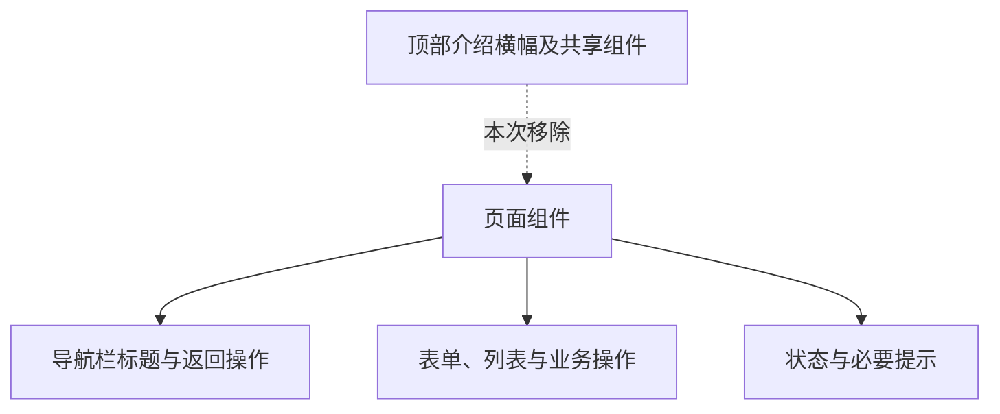
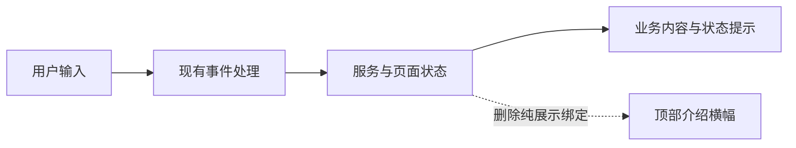

# 移除页面顶部横幅

## Intent：最终目标

移除各页面中图标、英文眉题、标题和介绍组成的顶部横幅，让用户直接进入页面操作内容。

## Data：可用证据

- 用户以设置页横幅截图为例，要求移除所有页面中的同类横幅。
- AST 搜索定位到 19 个页面使用 `app-hero-card`，这些页面均有导航栏标题。
- 页面还包含独立的表单、状态提示和操作区，横幅组件不承载操作事件。
- 工作区已有其他未提交修改，需在现有内容上做局部删除。

## Edges：边界与限制

- 删除顶部介绍横幅、组件引用及失效样式，清理仅供横幅使用的字段与派生属性。
- 保留导航栏、返回按钮、业务操作、状态与必要提示。
- 排查独立实现的同类介绍横幅，不以类名包含 hero 作为删除业务内容的依据。
- 不新增测试用例，不使用浏览器验证；通过 AST 残留检查、编译和差异检查验证。
- 不批量清理多语言资源，不调整与横幅无关的业务逻辑。

## Answer：交付格式与成功标准

交付实际代码修改及本执行记录。页面不再渲染同类介绍横幅；共享组件没有残留引用；编译通过或准确记录阻塞原因。

### 执行计划

1. 定位共享横幅与独立实现，核实功能边界。
2. 删除页面横幅和失效依赖，保留现有业务内容。
3. 检查引用、编译和差异，记录自我审查结论。

### 架构图

### 数据流图

### 执行结果与自我审查

已完成以下修改：

- 移除 19 个页面中的共享横幅，覆盖设置、关于、反馈、场景列表、自建服务器、第三方服务、三种接入引导、设备日志、存储、位置、定时、任务编辑、固件更新，以及四个工具页面。
- 移除设备接入入口、添加场景步骤、社区页面的 3 处独立介绍横幅，共 22 处。
- 后续按用户截图移除 BLE 调试器的扫描介绍横幅，总计 23 处。删除雷达装饰与扫描时长专属计时器；实际扫描的 15 秒自动停止与底部操作保持不变。
- 删除共享横幅组件的 TypeScript、HTML、SCSS 文件，清理 19 个页面的导入与组件注册，以及专属样式和失效的展示属性。
- 移除接入入口与社区首段内容原本用于隔开横幅的顶部间距。

验证结果：

- AST 检查：共享横幅的两种模板写法、组件符号、专属样式选择器均为零引用。
- `ng build app --configuration development --progress=false` 编译通过。
- `git diff --check` 通过。
- 按要求未新增测试用例、未使用浏览器进行 UI 确认。

自我审查：

- 根因是页面重复渲染介绍组件，所以直接删除模板与依赖，没有使用 CSS 隐藏或增加条件分支。
- 场景名称和图标编辑、设备状态和开关、主题切换、扫描状态、网关身份等区域承载业务功能，未按类名机械删除。
- 横幅中的附属计数与介绍随横幅移除，实际列表和业务数据不变；配网必要提示仍由独立通知区展示。
- 编译验证能够发现模板与引用问题，但不能证明实际视觉效果；本次遵循用户约束，不进行浏览器验证。
