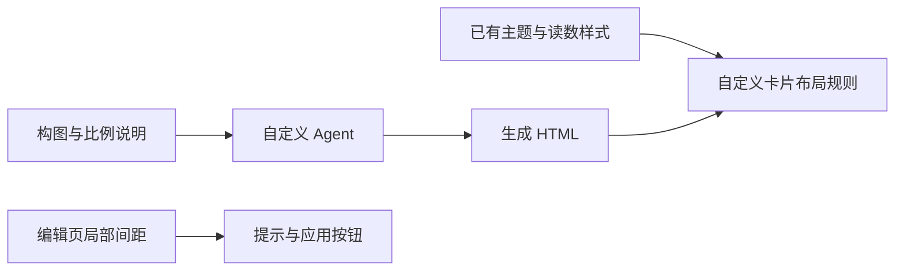
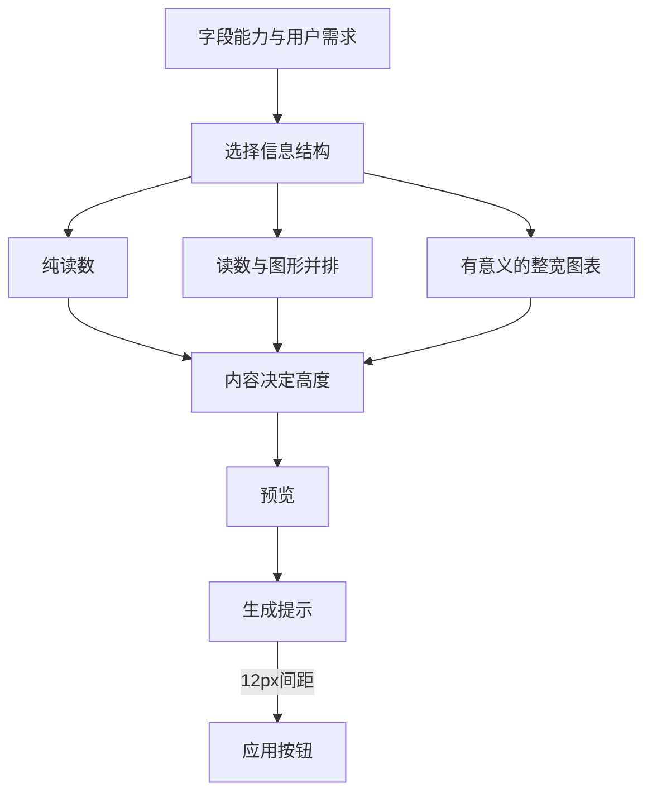

# 自定义卡片排版与按钮留白执行计划

## Intent：最终目标

修正自定义卡片中读数、说明与可视化之间的比例和位置关系，并缩短自定义编辑页提示文字到应用按钮之间的空白。

## Data：可用证据

- 新截图中字体已接近内置卡片，但读数位于左上、小图形孤立地落在底部中间，视觉重心分散。
- 上轮复用了内置 readout，其中 `.bn` 的 `flex: 1` 与底部对齐依赖内置组件的确定几何；普通 HTML 按内容排版时不应默认沿用撑满策略。
- 现有 design 示例只有纵向读数，没有定义图文组合和图形尺寸，模型仍需自行发明构图。
- 自定义编辑页的成功提示是 `
`，继承段落默认外边距与上下12px内边距，又叠加 footer 的20px上外边距。
- 当前只有截图，没有这次生成的 HTML；不能断言截图中具体哪一条生成 CSS 导致问题。

## Edges：边界与限制

- 不针对 WiFi 字段或某个固定读数定制，不修改内置组件布局。
- 提供少量通用组合规则：纯读数、读数与辅助可视化并排、独立整宽图表；不建立新的组件框架。
- 只调整自定义模式按钮间距，保留点击面积与页面底部安全区。
- 保留已有工作，不新增测试用例，不调用浏览器，不发起真实模型请求，不部署。
- 已保存且自带布局 CSS 的 HTML 需要重新调整；不尝试自动迁移任意生成 DOM。

## Answer：交付格式与成功标准

1. 自定义卡片默认随内容收缩；读数组不再撑满高度或推向底部。
2. 运行时提供通用图文布局与随卡片宽度变化的图形尺寸，catalog 明确何时使用；图形不能以微小图标占一整行。
3. 生成端要求先选择合适的信息结构，再处理内部图形，避免绝对定位、空白占位和任意固定卡片高度。
4. 自定义编辑页成功提示取消重复间距，提示与应用按钮只保留12px显式间距。
5. 完成构建、类型检查与差异复核，记录真实视觉验收的限制。

### 架构图

### 数据流图

