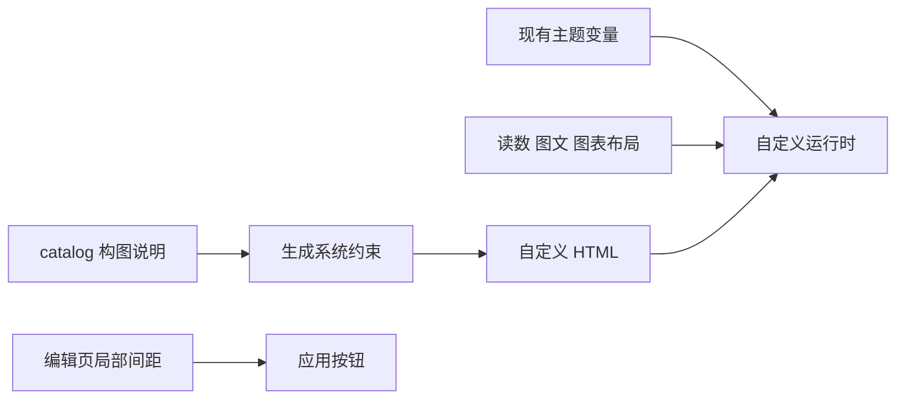
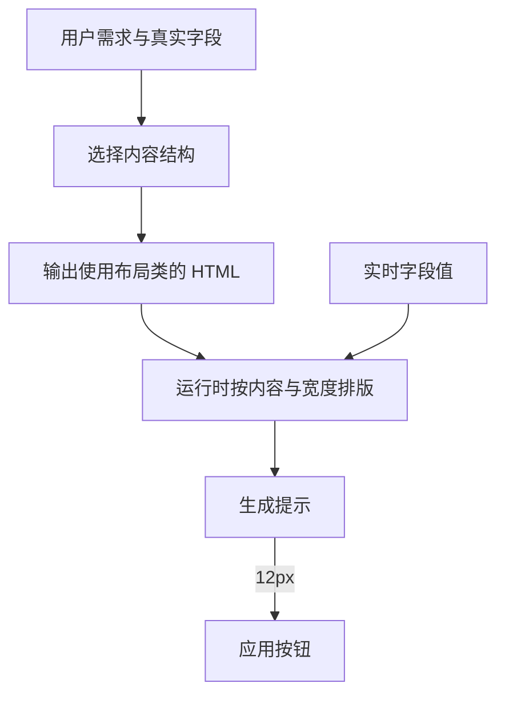

# 自定义卡片排版与按钮留白执行记录

## Intent：最终目标

补齐上轮只统一视觉表面、未规定信息构图的缺口，让自定义卡片有合理的图文关系；减少应用按钮上方的重复留白。

## Data：可用证据

### 修改结果

- `src/custom-panel/styles.scss`：自定义卡片取消 flex 扩张，读数组取消撑满高度及底部对齐；根 Grid 中自定义卡片按内容高度排列。
- 增加 `custom-body`，将读数/单位/说明与辅助图形放在同一行，间距16px并垂直居中。
- 增加 `custom-visual`，随卡片内容宽度按24%缩放，范围48–80px；`custom-chart` 整宽，高度随宽度变化，范围80–144px。SVG/canvas 填满各自容器。
- `src/app/device/custom-panel/atom-catalog.ts`：补充纯读数、图文并排、整宽图表的选择规则与图形比例说明，纯读数示例采用已有单位下沿对齐类，要求添加图形时重组内容。
- `../aily-blinker-services/packages/device-ui-agent/src/custom-workflow.ts`：生成前选择信息结构；修正排版时移除旧布局覆盖，明确禁止孤立小图形、空白占位和用固定卡片高度撑版。
- `src/app/sections/device/device-uic/custom-panel-editor.component.scss`：成功提示 `margin: 10px 0 0; padding: 0`，应用按钮区域上间距12px。取消默认段落外边距与内边距的叠加，按钮尺寸和底部安全区保持原有行为。

### 验证结果

- 自定义运行时构建和打包通过。
- App local 构建通过。
- Agent 类型检查通过。
- 打包产物包含三个布局辅助类；目录含 composition/graphics 说明，大小20,980字节，小于接口65,536字节上限。
- 两个仓库 `git diff --check` 通过。
- 没有新增测试用例，没有调用浏览器或真实模型。

## Edges：边界与限制

- 未取得截图对应的原始 HTML，截图只能证明实际视觉问题，不能确定模型写出的具体选择器。
- 修改约束通用信息结构，没有硬编码 WiFi 指标、当前读数或设备名称。
- 图表尺寸属于通用辅助图形的默认布局，不代表所有复杂自定义界面都应强行套用同一结构；复杂内容仍可按需求组合。
- 生成 HTML 自带的覆盖样式不会被自动清洗。旧卡片如有固定高度或孤立图形结构，需要通过再次调整重组 HTML。
- 没有部署、重启服务或执行真实生成验收。构建成功不代表已验证模型输出的美观程度。

## Answer：交付结果与自我复核

本次交付四个代码文件的局部修改，分别覆盖运行时布局、生成上下文、Agent 构图约束和编辑页间距。

自我复核：

1. 上轮共享 surface/readout 确保了表面一致，却带入了依赖确定网格高度的 flex 行为；本轮仅在自定义范围解除该行为，内置组件不变。
2. 仅说“美观、协调”不足以产生稳定构图，因此本轮提供少量实际可用的布局规则和尺寸，而非继续堆叠抽象形容词。
3. Grid 的 `align-self: start` 仅作用于 `.panel` 的直接子卡片，避免普通 flex 分组中把横向尺寸收缩到错误宽度。
4. 按钮空白来自多层间距叠加，修复只消除自定义编辑页重复间距，没有改全站按钮或页面安全区。
5. 布局类仍需生成结果正确采用；没有把代码检查当成真实视觉验收，也没有承诺任意模型输出必然好看。

### 架构图

### 数据流图

