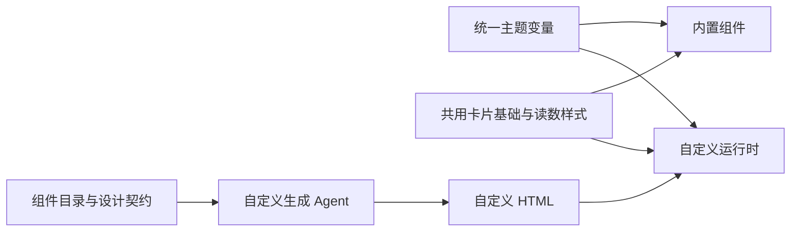
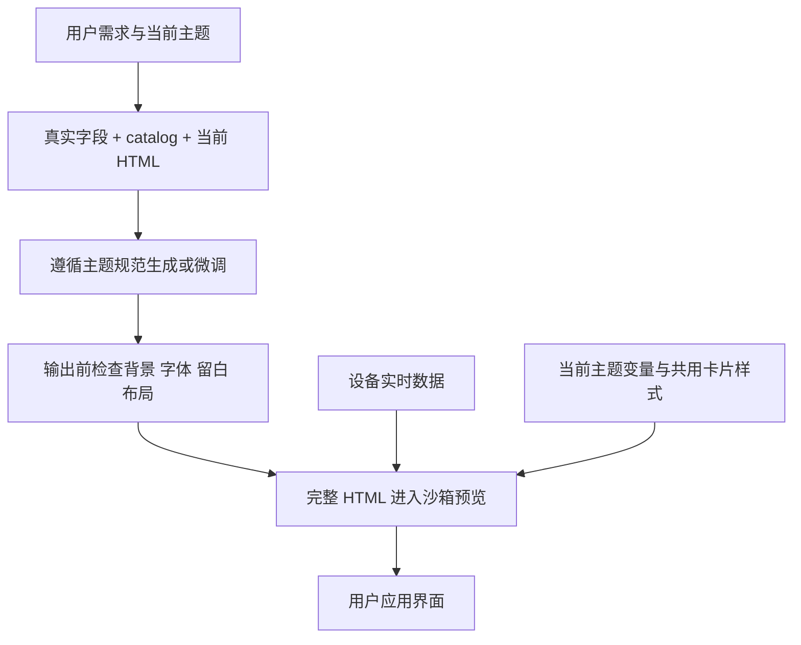

# 自定义组件风格统一执行计划

## Intent：最终目标

自定义组件可以自由组织数据和交互，但默认必须融入当前主题，与内置卡片保持一致的背景、圆角、字体、文字层级和留白。约束适用于任意真实数据字段，不针对截图中的 WiFi 指标编写特例。

## Data：可用证据

- 用户截图中自定义读数使用绿色底色、描边和粗体数字，与下方白色内置卡片不一致。
- 内置组件通过 `widgets/_card.scss` 与 `theme/ui-theme.scss` 共用卡片规范；自定义运行时已经加载相同主题和字体。
- 自定义运行时只提供原子组件与 Grid，没有供普通 HTML 直接复用的卡片样式。
- Agent 的 `custom-workflow.ts` 约束原子组件不被改写，却允许普通 HTML 自由设计，没有明确要求普通 HTML 遵循主题规范。
- 自定义请求中的 `catalog` 可透传新增设计说明，不需要增加接口或改变请求协议。

## Edges：边界与限制

- 保留工作区已有修改。只调整自定义组件样式复用、生成上下文及自定义 Agent 提示词。
- 复用现有主题变量、卡片基础与读数样式，不另外维护主题颜色表。
- 不做任意 HTML/CSS 的自动重写，不宣称仅凭提示词就能保证所有模型输出的审美。
- 不新增测试用例，不调用浏览器，不调用付费模型，不部署；使用构建、类型检查和已有相关测试验证。
- 已保存的自定义 HTML 不做迁移；重新生成或调整后采用新规范。

## Answer：交付格式与成功标准

1. 运行时提供可直接使用的自定义卡片容器与读数层级，卡片外观来自内置组件同一份 SCSS。
2. catalog 提供可用类名、主题变量、结构示例及布局边界；模板明确说明必须继承主题。
3. Agent 对普通 HTML 同样要求保持主题一致，使用主题颜色和字体，禁止默认生成独立色块背景或装饰边框，并在输出前检查一致性。
4. 记录实际验证结果与自我复核，包括未做真实模型生成与视觉验证的限制。

### 架构图

### 数据流图

