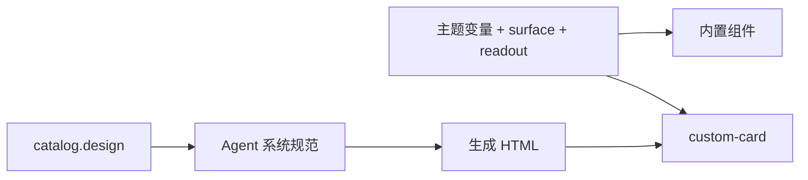
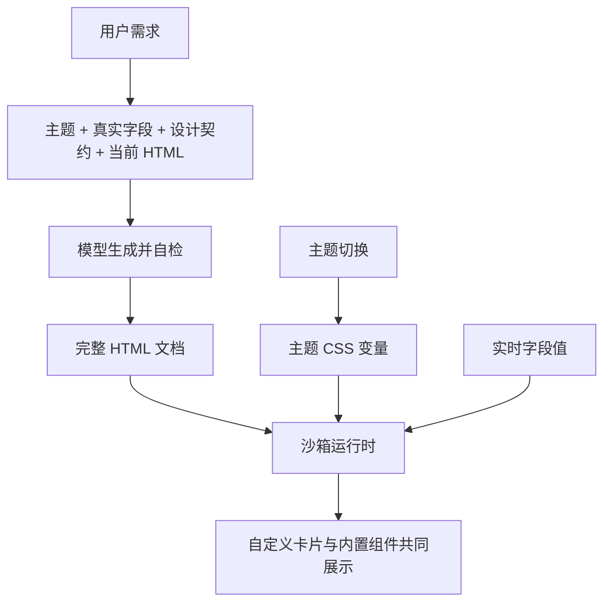

# 自定义组件风格统一执行记录

## Intent：最终目标

让自定义 HTML 组件默认与内置组件保持统一的视觉语言，同时保留自定义信息布局、图表和交互的能力。

## Data：可用证据

### 根因与实际修改

原子组件已继承统一主题，但普通 HTML 没有公共卡片样式和明确的生成规范。只传递“自然”主题名称无法让模型知道内置卡片的背景、字体和密度。

| 文件 | 修改 |
| --- | --- |
| `src/app/device/v2/widgets/_card.scss` | 抽出原有 surface mixin，内置组件继续通过 base 使用它，声明保持不变。 |
| `src/custom-panel/styles.scss` | 提供 custom-card，复用 surface 和 readout；补齐标题、主题数字和窄屏换行，辅助类仅作用于自定义卡片范围。 |
| `src/app/device/custom-panel/atom-catalog.ts` | 增加 design 契约，描述真实类名、主题变量、排版层级、结构示例和一致性检查。示例不绑定具体设备或指标。 |
| `src/app/device/custom-panel/custom-panel-template.ts` | 模板明确普通 HTML 应采用公共卡片和读数样式。 |
| `../aily-blinker-services/packages/device-ui-agent/src/custom-workflow.ts` | 系统提示词同样约束普通 HTML 的主题一致性，并要求输出前复核。保留该文件已有的模型调用与请求上下文改动。 |

### 验证结果

- `npm run custom-panel:build`：通过，生成运行时包、模板与组件目录。
- `npx ng build app --configuration local --progress=false`：通过。
- 服务仓库 `npm run typecheck --workspace=@aily-iot/device-ui-agent`：通过。
- 使用 Angular 构建工具依赖的 Sass 编译器对比修改前后 `base` 与 `readout` 的压缩 CSS：完全一致，确认抽取 surface 没有改变内置卡片样式。首次直接导入项目根目录的 sass 不可用，改为从现有 Angular 构建依赖解析，没有安装依赖。
- 打包目录大小 19,629 字节，低于接口 65,536 字节限制；运行时产物包含 custom-card 与配套读数规则。
- 两个仓库 `git diff --check`：通过。

## Edges：边界与限制

- 未新增测试文件或测试用例，未调用浏览器，未调用真实生成模型，未部署或重启服务。
- 构建与静态检查只证明样式和上下文正确接入，不能证明每次模型输出都符合审美。
- 运行时提供共享样式，但不会强行解析或改写任意 HTML/CSS；模型仍可能不遵守提示词。
- 已保存 HTML 原样保留。更新 App/运行时与 Agent 后，重新生成或针对旧组件发起调整才会采用新规范。
- Agent 兼容没有 design 契约的旧客户端，提示其使用已经存在的主题变量；新客户端优先使用共享类。没有新增协议字段、网关逻辑或校验框架。

## Answer：交付结果与自我复核

已补齐“共享样式 + 生成上下文 + 系统约束”三处缺口，未将截图中的字段、读数、绿色或特定设备作为修复条件。

自我复核：

1. 公共样式直接复用内置卡片基础与读数规则，避免维护另一套主题颜色。
2. 修改没有限制自定义组件只能使用内置原子；约束集中在外观一致性，内部图表和交互仍可定制。
3. 没有引入视觉审核服务、额外模型轮次或任意 CSS 自动重写，修改范围保持有限。
4. 标题与数字工具类保留少量明确排版声明；主题颜色、数字字体、字重和圆角继续由已有主题变量控制。
5. 尚缺一次真实生成结果的视觉验收，因此交付表述限定为“已接入规范并通过构建”，不宣称截图中的旧组件已经自动变好。

### 架构图

### 数据流图

