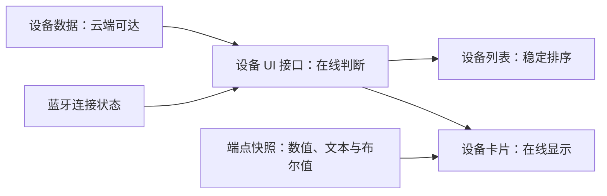
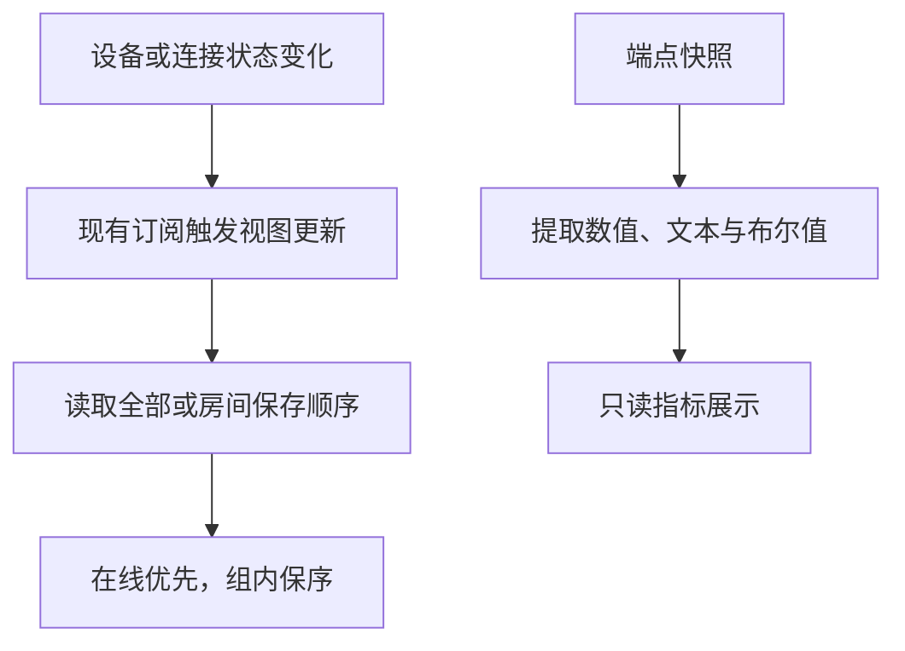

# 设备卡片排序与状态展示计划

## Intent：最终目标

- 首页设备列表在线优先，状态相同的设备保持原有相对顺序。
- 查明 `power` 字段未显示的原因；按用户最新要求，移除首页开关控件，布尔值作为只读状态展示。

## Data：可用证据

- 用户截图中离线设备排在云端已同步设备之前。
- 列表直接读取保存顺序，没有根据连接状态排序。
- 卡片以“云端可达或蓝牙已连接”判断在线，并订阅设备及连接状态变化。
- 卡片开关识别、取值和命令发送均固定使用 `switch`；指标列表同时排除了布尔值。
- 用户明确要求首页不要开关控件。

## Edges：边界与限制

- 使用现有在线定义，不把扫描中、附近或状态未知当作已上线。
- 在线排序只作用于显示，不因状态变化写入用户或房间配置。
- 保持拖动手势可用，拖动过程中避免设备突然重排。
- 不按设备名称或 `power` 字段名增加特例。
- 首页只展示设备状态，移除开关模板、样式、等待状态及命令发送逻辑。
- 不新增测试用例，不调用浏览器验证，不修改本次任务以外的已有变更。

## Answer：交付格式与成功标准

1. 最小范围修改现有组件和设备 UI 接口。
2. 全部设备与房间设备使用相同的在线优先规则。
3. 布尔字段进入普通指标展示，不添加字段名特例，不通过首页发送控制命令。
4. 完成本地编译、差异检查与代码自查，记录尚未验证的实际交互。

## 架构图

## 数据流图

## 执行步骤

- [x] 定位排序、在线状态和开关显示链路。
- [x] 实现在线优先，检查拖动顺序与持久化边界。
- [x] 移除首页开关控件，将布尔值纳入指标展示。
- [x] 验证编译，复核差异并记录结果。
