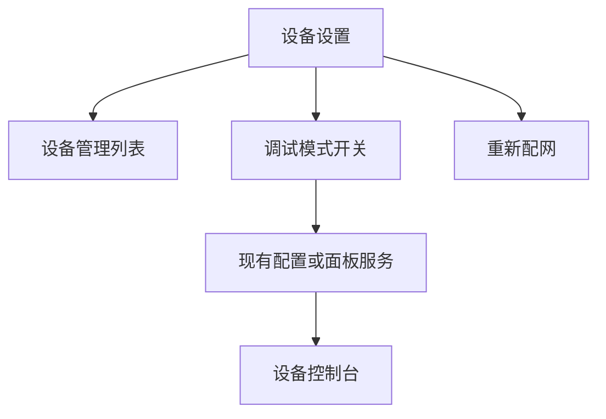
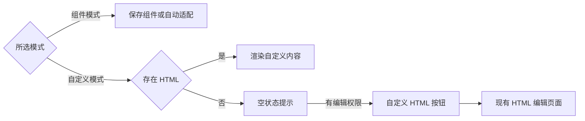

# 设备控制台入口与空状态调整

## Intent：最终目标

- 自定义模式没有 HTML 内容时显示提示与编辑入口，组件模式才显示自动适配。
- 将调试模式开关移到设备设置页的设备管理区域下方，重新配网仍在最底部。
- 首页设备卡片恢复柔和阴影，BLE 调试器移除扫描介绍横幅。

## Data：可用证据

- 原控制台用“是否有自定义文档”决定回退渲染，没有单独处理自定义空状态。
- 已有 `/device/:id/edit/custom` 路由，带返回控制台行为，无需新增页面。
- 原调试开关位于界面配置页，BBP2 保存组件标识，旧协议通过面板服务切换视图。
- 首页设备卡片原本引用全局阴影变量；BLE 横幅计时器仅用于展示扫描时长。

## Edges：边界与限制

- 保留编辑权限、账户隔离、现有布局和自定义内容。
- 共享只读控制台无编辑入口，显示联系所有者配置的提示。
- 不新增测试用例、不调用浏览器；复用现有测试与编译。
- 仅调整入口、空状态和指定视觉元素，不改变扫描协议与数据处理。

## Answer：交付格式与成功标准

实际代码修改和本记录。自定义空状态按钮直达现有 HTML 编辑器；调试开关从界面配置移除且在设备管理下方可切换；首页设备卡片恢复投影；BLE 扫描入口不再出现介绍横幅。

### 执行细节

1. 将所选模式与自定义文档是否存在分开判断，覆盖 BBP2、旧协议和共享只读页面。
2. 将调试开关的保存行为移至设备设置页，与显示模式切换互斥；保存成功后继续返回控制台。
3. 清理原界面配置页的调试方法、属性与专属样式。
4. 增加首页设备卡片专用阴影变量；移除 BLE 横幅、专属动画与展示计时器，扫描状态变化时显式请求渲染。

### 架构图

### 数据流图

### 验证与自我审查

- 应用 development 构建通过，差异格式检查通过。
- 设备页面、BBP2 控制台、界面配置页的 3 个现有测试文件共 44 个用例通过。
- 继续使用临时测试配置隔离此前无关蓝牙测试的失效导入，没有修改仓库测试配置或新增测试用例。
- AST 检查确认界面配置页不再包含调试开关方法，BLE 横幅专属计时字段和方法没有残留引用。
- 未调用浏览器。

自我审查：

- 空状态基于所选模式判断，缺失文档不再改变模式；没有向只读共享访问开放编辑权限。
- 调试切换沿用原有配置与面板服务，保存期间阻止和显示模式同时切换，并复用现有账户上下文校验。
- 首页阴影通过专用变量恢复，没有恢复其他页面的卡片阴影。
- BLE 实际扫描时限仍由原扫描器控制，移除的是展示计时器；开始与结束扫描时仍更新界面状态。
- 编译和现有测试不等于真机交互验证，保留这一验证边界。
