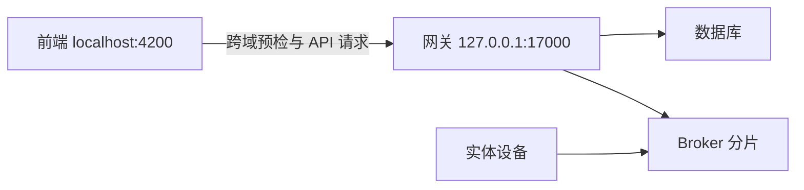
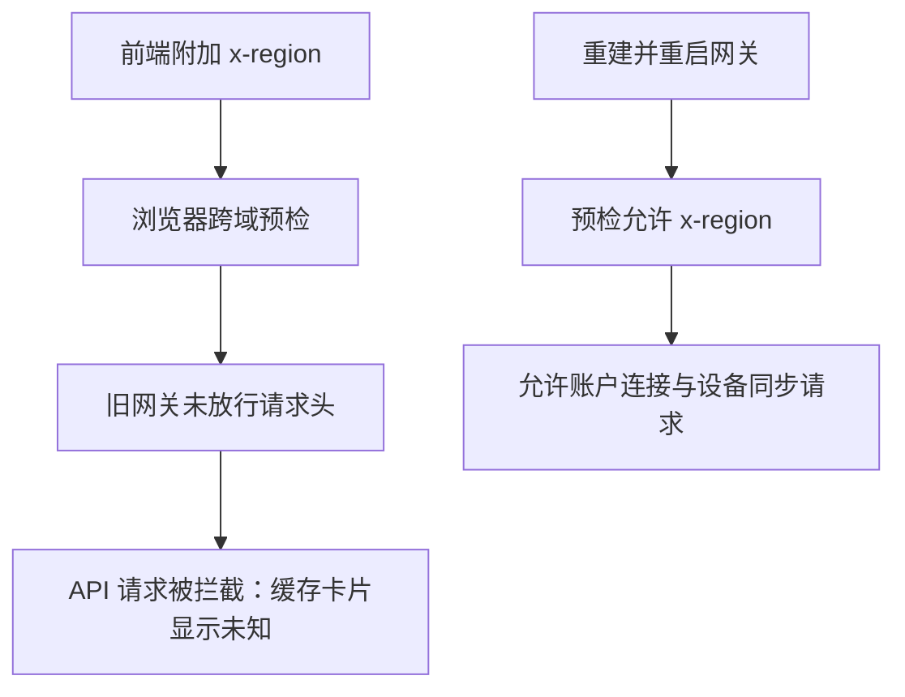

# 设备状态未知恢复计划

## Intent：最终目标

恢复本地首页设备在线状态和实时数据同步，定位实际中断原因，不把未知状态伪装为离线。

## Data：可用证据

- 用户确认两台设备一直显示“状态未知”，并怀疑后端未重启。
- 前端本地配置连接 `http://127.0.0.1:17000`；前端拦截器新增 `x-region` 请求头。
- 网关容器于 2026-10-15 10:05 启动，源码的跨域请求头修改发生在 11:26，容器未挂载源码。
- 实际 OPTIONS 响应的 `Access-Control-Allow-Headers` 缺少 `x-region`，现有源码已加入该头。
- 网关、数据库和 Broker 健康，Broker 仍有设备连接，故优先修复网关部署版本不一致。

## Edges：边界与限制

- 只重新构建并重启本地网关，不更改数据库、不重启其他容器。
- 不读取浏览器存储或账号凭据，不新增测试用例，不调用浏览器。
- 不修改设备状态判定，也不修改他人已完成的区域配置源码。
- 完成 HTTP 跨域预检和健康检查后，页面实际数据恢复仍需要浏览器重新请求。

## Answer：交付格式与成功标准

1. 网关使用当前源码重新构建并启动。
2. 实际跨域预检响应放行 `x-region`。
3. 网关健康、数据库可用、Broker 仍健康，前端正常响应。
4. 汇报验证结果与页面复核边界，另存执行记录。

## 架构图

## 数据流图

