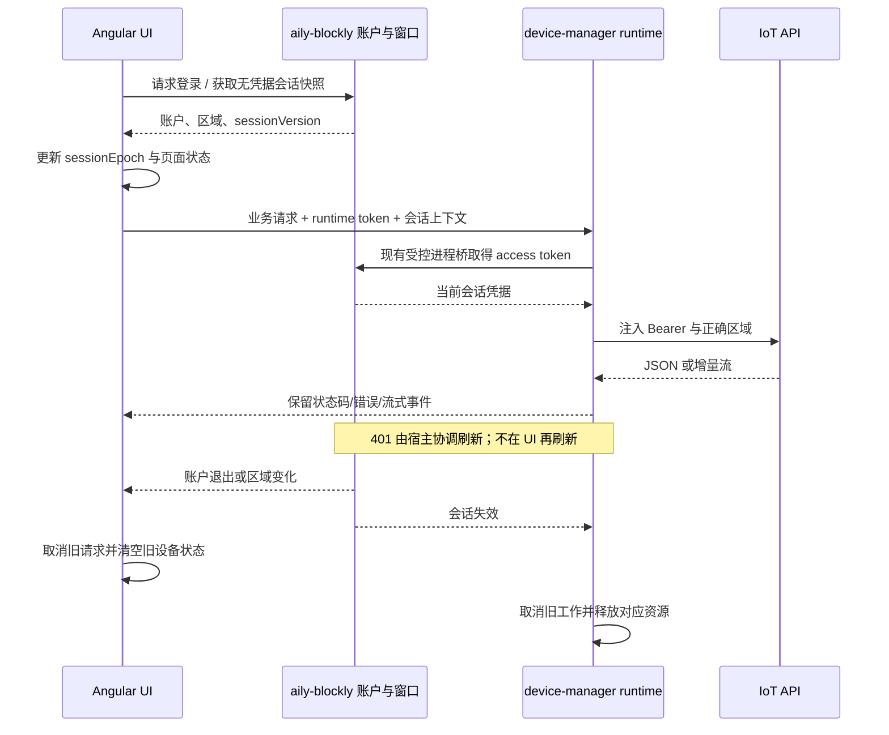

# 设备管理子应用迁移执行计划

> 日期：2026-10-15。状态：待用户审阅确认，未执行迁移。
> 依据：[迁移调查报告](设备管理子应用迁移调查报告.md)。
> 已确认补充：允许修改 aily-blockly 宿主，为 device-manager 支持登录接入。

## I — Intent：最终目标

在 `aily-subapp` 的 `xwd` 分支建立 `packages/device-manager`，沿用源 app 的 Angular/Ionic UI 和设备业务实现，完成设备管理功能的独立交付。宿主只增加必要的登录、凭据及生命周期接入；设备功能保留在子应用内。

本计划不把“全部复制过来再逐个修报错”作为实施方式，也不为迁移先建立新的通用框架。按页面闭环迁入，按实际平台边界适配，保留原文件分组，确保差异可逐文件审阅。

## D — Data：可用证据与实施设计

### 1. 交付物和改动范围

| 仓库 | 计划交付 | 范围控制 |
| --- | --- | --- |
| aily-subapp | `packages/device-manager`、必要锁文件更新、开发目录元数据 | 不修改其他 subapp 的行为，不复制无关 daemon/agent/compact 框架 |
| aily-blockly | device-manager 受限鉴权接入、必要凭据桥、登录状态/前后台通知 | 复用 `/child-tool/:toolId` 与动态工具注册，不新增专有 Angular 设备页面 |
| blinker-app | 本轮调查及计划文档 | 源业务实现保留，作为逐项对照基线 |
| 实施记录 | 原文件→目标文件映射、批准偏差、构建与打包结果、未验证项 | 中文文件，放在对应仓库的 `docs/<日期>/`，按 IDEA 维护，每份小于 1000 行 |

拟定结构：

```text
packages/device-manager/
  package.json
  index.js
  server.js
  core.js
  cli.js

  scripts/
    build-ui.mjs
    pack-custom-panel.mjs

  runtime/
    host-auth.js
    device-api.js
    storage.js
    ble.js
    provisioning/
      ...按实际协议职责拆分...

  i18n/
    en.json
    zh_cn.json
    zh_hk.json

  ui/
    package.json
    angular.json
    tsconfig*.json
    public/
      devices/
      fontawesome6/
      i18n/
      ...必要静态资源...
    src/
      app/
        app.component.*
        app.config.ts
        app.routes.ts
        host/
          ...宿主接入与平台适配...
        home/components/
          ...设备与区域组件...
        sections/
          guide/
          room/
          device/
          ...设备闭环所需支撑页...
        device/
        core/
      custom-panel/
      theme/
      global.scss
      blinker.scss

  device-template/
    ...原独立模板源码及构建配置...
```

结构是职责边界建议，不要求预先创建空模块。`runtime` 中仅在确有职责时增加文件；source UI 目录尽量保持原名，避免大面积 import 改名。静态资源只保留一个权威源目录，不在 `assets` 与 `ui/public` 各复制一份。

### 2. 包与宿主握手

`package.json` 使用以下身份：

| 字段 | 计划值/含义 |
| --- | --- |
| `name` | `@aily-project/subapp-device-manager` |
| `version` | 初始 `0.1.0`，正式发布前按仓库版本规范处理 |
| `main` / `bin` | `index.js` / `aily-device-manager` |
| `ailySubapp.id` | `device-manager` |
| `ailySubapp.namespace` | `DEVICE_MANAGER` |
| `ailySubapp.app` | 有效图标、`enabled: true`；首轮不隐式设自动安装、默认置顶 |
| `ailySubapp.runtime.processMessagePort.transport` | `node-ipc-v1`，启用现有 Node 进程鉴权通道 |
| i18n | 默认语言必须包含非空 `DEVICE_MANAGER.TITLE` 和 `DESCRIPTION` |
| UI 产物 | 可分发包根 `ui/index.html` 及完整资源 |

不另造 `manifest.json`。根构建与索引脚本会发现新包，不为此硬编码新的宿主工具条目。

采用模板现有 CLI/serve/rpc 外壳：

1. 宿主以 `node index.js serve --host 127.0.0.1 --port 0` 启动。
2. 服务就绪后输出一行标准 ready JSON：`url/origin/wsUrl/shutdownUrl/port/pid`。
3. UI 初始化 Penpal、完成所需宿主握手并报告 `childReady`；设备数据加载另有页面状态，不阻塞 ready 等待整个设备连接成功。
4. 保留 runtime token，与账户 access token 严格区分。内部 hash 路由切换不能丢失启动 URL 的 token/lang/surface/launch 参数。
5. 退出走现有 shutdown 生命周期，`core.shutdown()` 实际释放设备资源。

参考：[Angular 模板入口](/Users/xiewendao/Documents/aily/aily-subapp/templates/subapp-angular/index.js:101)、[模板 server](/Users/xiewendao/Documents/aily/aily-subapp/templates/subapp-angular/server.js:222)、[宿主启动逻辑](/Users/xiewendao/Documents/aily/aily-blockly/src/app/services/integrations/subapps/child-tool-process.service.ts:801)、[元数据生成](/Users/xiewendao/Documents/aily/aily-subapp/scripts/generate-subapp-index.mjs:128)。

### 3. 登录接入：宿主拥有会话，子应用复用身份

用户已授权修改宿主，因此**推荐宿主统一登录，refresh token 与刷新逻辑由宿主单独管理**。不要把两边现有 AuthService 同时运行，造成两个 refresh 流程竞争。

本地设备网关源码已确认 China/Global 使用宿主相同的上游账号服务并转发 Bearer token，因此统一登录有服务端实现基础。实施验证关注实际部署是否一致，而不是重新设计一套账号系统。

计划基于现有 host-auth 进程桥增加 `device-manager` 这一受控调用方：

- UI 获得不含敏感 token 的登录状态、账户标识、服务区域和会话版本；未登录时通过宿主打开登录窗口。
- Node runtime 按已有进程桥取得短期 access token，用于被允许的 IoT API 请求；不把 refresh token 下发给 iframe。
- IoT API 地址使用明确配置。不能因宿主注入 `AILY_API_SERVER`，就断言所有设备 API 都在这个地址。
- 显式映射宿主 cn→China、eu→Global；localhost 不自动映射 Development。设备服务 Development 的独立上游必须具备对应宿主认证配置后才可选择，避免把正式 token 发到错误的认证域。
- 验证 host token 对 IoT `/auth/me` 与 `/devices` 的授权、用户 ID、tenant、区域语义；若服务器不接受该 token，需要补服务端会话交换或其他明确认证契约，不使用伪 token 绕过条件。
- 设备域用户资料仍由 IoT `/auth/me` 获取；不把宿主 UI 的用户对象直接当成完整 IoT 用户/tenant 信息。
- 源 `DataService` 保留设备、区域和 sessionEpoch 模型；改为接收宿主认证快照。少量依赖 `auth.accessToken` 判断登录的业务代码改为显式 authenticated 状态，不填入假的 access/refresh token。
- 源 `ServerInterceptor` 的业务错误、区域、请求 ID 与公开会话规则保留；普通 Bearer 注入及 401 刷新职责移至 runtime/宿主，不能双重刷新。
- 切换账户、退出或改变服务区域后，先失效旧代次并取消旧请求/连接，再清空相应内存并加载新账户；token 自身续期不应被误当成账户切换。
- 原 `/login` 返回邀请/公开控制台的语义保留为子应用中的“宿主登录衔接”流程；不默认搬入独立注册、找回密码、微信插件。

预期宿主改动点如下。新增能力按真实 caller ID 限制，不能让 UI 自报任意子应用身份；也不能把整个 `isAilyChatTool` 判定扩大，否则会额外开放聊天、订阅等无关能力。

| 文件 | 最小修改目标 |
| --- | --- |
| [aily-host-auth-process-bridge.js](/Users/xiewendao/Documents/aily/aily-blockly/electron/aily-host-auth-process-bridge.js:3) | 允许 device-manager 使用 `access-token` / `refresh-access-token`；关闭设备工具不等于全局 logout |
| [child-tool-host.component.ts](/Users/xiewendao/Documents/aily/aily-blockly/src/app/tools/child-tool-host/child-tool-host.component.ts:1808) | 仅扩展登录 capability、requestHostLogin、无 token 状态同步 |
| [detached-aily-chat-auth.ts](/Users/xiewendao/Documents/aily/aily-blockly/src/app/services/core/auth/policies/detached-aily-chat-auth.ts:11) | 将设备独立窗口纳入无 token 的宿主外壳模式，避免第二套刷新者 |
| [ui.service.ts](/Users/xiewendao/Documents/aily/aily-blockly/src/app/services/core/app-shell/ui.service.ts:532) | 退出/切区时清理相应设备工具与 runtime，不能只停止默认 Chat runtime |
| [settings.component.ts](/Users/xiewendao/Documents/aily/aily-blockly/src/app/windows/settings/settings.component.ts:352) 与 ui.service 的切区入口 | 复用既有切区顺序，并把 device-manager 的资源失效纳入 |
| [auth-required-tool.ts](/Users/xiewendao/Documents/aily/aily-blockly/src/app/services/core/auth/policies/auth-required-tool.ts:1) 的使用位置 | 区分“参与账户切换清理”与“打开必须登录”；不能用一个列表强制阻断公开匿名控制台 |

现有 relay、真实 child session 身份判定和 AuthService 刷新本身原则上复用。参考 [token lease 桥](/Users/xiewendao/Documents/aily/aily-blockly/src/app/services/core/auth/bridges/aily-chat-host-auth-runtime-bridge.ts:41)；使用已有 `{ accessToken, apiServer, generation }` 与 `rejectedGeneration` 契约，只有确需新增区域字段才扩展返回类型。

保留匿名路径：`/s/:token`、邀请预览和公开设备收藏在原功能允许的情况下无需宿主先登录；访问自有设备、创建、共享管理或接受邀请时再触发宿主登录。认证能力可用不等于整个子应用强制认证。

### 4. HTTP 与流式请求分工

建议增加**设备 API 专用中继**，复用 Angular HttpClient 及领域服务，不建设任意 URL 代理。

| 请求 | 计划路径 | 必须保持 |
| --- | --- | --- |
| 受保护 IoT JSON API | Angular → 本机受控中继 → IoT API | HTTP method/body/query/status、错误码、request ID、区域、取消 |
| AI NDJSON | 同一中继，原样流式转发 | 增量进度、流式错误、超时、AbortSignal，不先缓冲整段响应 |
| 公开 ConsoleView | 可经同一限定中继，但鉴权分流 | 创建匿名会话不得附加宿主 Bearer；后续 ConsoleView token 不被覆盖 |
| MQTT | 原 UI MQTT WebSocket + 原 BBP2 状态机 | 连接参数校验、ACK、telemetry、重连、权限变更 |
| 天气/地理服务/视频等外部内容 | 保留已有服务边界，按实际 CORS 能力处理 | 不转发宿主 token，不把所有外部请求放入账户代理 |

中继只接受批准的 API 目标与路径，runtime token 校验和账户代次绑定沿用现有外壳机制。凭据调用失败或服务区域不匹配时应显示真实错误。首阶段通过实际契约核对确定最终实现，不把中继方案写成已经存在的宿主 API。

401 通过 `rejectedGeneration` 协调一次刷新，只有确认属于认证失效且可以安全重试时才重试；业务权限错误、已输出的流和结果不确定的有副作用请求不得无条件重放。

特别处理两个实现差异：公开控制台 events 使用原生 `fetch`，不经过 Angular interceptor，需显式适配 SSE URL、runtime token 和取消；AI 生成使用 `HttpClient` 的 `DownloadProgress.partialText`，中继必须让 chunk 及时抵达。不能只替换 HttpClient URL 就声称全部流式链路完成。



### 5. 平台与存储适配

**BLE**：参考 `ble-debugger/core.js` 的 Noble I/O，实现源 `BleDirectRecordLink`/扫描所需契约；保留 serviceData、设备身份校验、GATT 分片、超时、通知、扫描协调和账户隔离。不要让设备管理依赖另一个 debugger subapp 正在运行。

**Wi-Fi 配网**：保留 `Esp32ProvisionPage` 的步骤、Security 1、身份创建/恢复和凭据确认，替换移动 WiFiProv transport。先做端到端协议可行性验证，再迁全部页面；不能把不可用 Web 插件装进去后标记完成。BLE 与 SoftAP 都需在能力矩阵中独立列项。

**打包平台**：现有 Noble portable 构建只明确覆盖 `darwin-arm64` 与 `win32-x64`。优先按这两种现有目标设计；是否需要 Linux/Intel Mac 必须明确，不能自动声称全桌面平台已支持。

**LAN**：保留源生产默认关闭设置。启用桌面 BBP2 LAN 属于独立范围，需要 mDNS、原生/Node WebSocket 链路、身份认证及网络生命周期全部成立后再开。

**存储**：

1. 普通偏好/缓存放稳定用户数据目录，不含版本号；不要写 package root、dist 或版本安装目录。
2. 对同步读取的主题/模式等少量偏好，在 UI 启动前加载到内存；写入通过明确的 adapter 串行持久化，不全局 monkey-patch localStorage。
3. BLE controller secret、presence key、配网检查点中的秘密及记住的 Wi-Fi 密码走受保护存储。宿主登录凭据继续由宿主拥有。
4. 宿主 safeStorage 提供最小受限桥；自定义面板 iframe 不接触该桥。设备凭据与宿主登录凭据分命名空间存储。
5. 不从手机端静默导出凭据；需要重新注册/恢复的设备按已有协议处理。

参考：[BLE 核心](/Users/xiewendao/Documents/aily/aily-subapp/packages/ble-debugger/core.js:136)、[原生打包支持](/Users/xiewendao/Documents/aily/aily-subapp/scripts/build-tools.mjs:19)、[稳定路径参考](/Users/xiewendao/Documents/aily/aily-subapp/packages/serial-debugger/runtime/runtime-paths.js:8)。

### 6. 页面范围与入口安排

推荐以设备页作为唯一首页，保留源页面内容与样式；不携带社区/工具箱/个人中心三个无关 tab。设备设置、共享、区域、组件库、面板编辑及其返回路径全部保留。

原共享总览、主题/语言/服务区域和天气服务设置有入口来自个人中心。去掉个人中心后，需要给它们明确入口：推荐使用子应用现有标题/菜单区域承接相关设置，新增入口位置单列为外壳差异供审阅，不悄悄改变页面内容。

消息铃铛若保留，需迁移消息页及设备/邀请跳转所需服务；原生 ntfy 推送不随之自动纳入。若移除铃铛，必须记录这是经确认的界面差异。

分享链接保持原 token/格式与解析。子应用内粘贴导入可先复用已有路径；系统级点击 `diandeng://...` 自动进入 aily-blockly 会涉及宿主协议注册与路由竞争，需独立确认。不得把 `http://127.0.0.1:<port>` 当作对外分享网址。

### 7. 构建链与资源交付

按顺序构建：

1. `device-template`：原独立模板构建。
2. `custom-panel-runtime`：原 Angular 运行时构建并执行 pack，输出 runtime/template/atoms。
3. 主 Angular/Ionic UI：保留源构建选项及依赖，采用内部 hash 路由，输出内容平铺到分发包 `ui/`。
4. 根 subapp 构建：打包 Node 入口、运行依赖、native/vendor 及静态资源。

根工作区当前包含 `packages/*`、`packages/*/ui`，未覆盖拟迁入的 `packages/device-manager/device-template`。实施时需明确让设备模板被该包的构建脚本安装/构建，或做一个精确 workspace 追加；不能假定移动项目的 npm workspaces 规则会自动生效。优先选择依赖和锁文件最清晰、无需重复安装整个仓库的方案。

生成输出路径与原脚本工作目录必须调整，特别是 `pack.mjs` 的相对路径和 esbuild 显式依赖。编译成功后还需核对深层路由、动态 chunk、字体、图片、翻译和嵌套 iframe 资源均包含在可分发包内。

### 8. 生命周期和关闭规则

| 事件 | 计划行为 |
| --- | --- |
| 离开设备页面 | 延续源连接需求/telemetry 释放语义；不粗暴关闭整个账户 MQTT |
| 进入属性编辑再返回 | 保留编辑上下文与未保存状态，不重新生成面板覆盖用户修改 |
| 子应用隐藏/显示 | 按真实可见性暂停展示订阅/扫描；重新显示时刷新状态 |
| 关闭子应用 | beforeClose 对接当前页面离开保护；取消配网/扫描、落盘、释放资源 |
| runtime 重启或 iframe 重载 | 重建握手和订阅；恢复展示状态，不重放控制/绑定/共享等副作用命令 |
| 退出/换账户/换区域 | 先撤销旧代次，再关闭连接与任务；旧响应不得落入新状态 |
| 异常退出 | 依赖既有 supervisor 回收进程；持久检查点按原恢复协议处理 |

不复制 Serial 的 daemon、Journal、Agent tools，也不把 manifest 中 `resourceLifecycle` 声明当作 BLE/MQTT 已获得通用挂起支持。

## E — Edges：执行顺序、门槛与限制

### 阶段 0：审阅与基线冻结

- 确认本计划末尾的范围选择。
- 重新检查三仓库分支、HEAD、工作区和既有构建产物。
- 在 aily-subapp 从确认的当前基线创建 `xwd`；若已出现同名分支，先核对来源，不覆盖。
- 宿主改动应落在单独可审阅的分支或既有获准工作分支；不自动切换或丢弃 `xwd-lex` 的改动。
- 建立逐文件迁移映射和批准偏差清单。

完成门槛：基线固定、目录和范围清楚。此阶段前不执行下列实现工作。

### 阶段 1：优先验证最大的可行性风险

- 核对宿主 token/IoT API/区域契约，并打通最小登录状态与受保护请求链路。
- 明确普通配置与 BLE 凭据的跨重启保存方式。
- 核对 Node BLE 广播数据及 WiFiProv Security 1、BLE/SoftAP 的桌面实现路径和平台打包依赖。
- 把不能成立的能力报告为阻碍；不先复制大量 UI 再被迫取消关键功能。

完成门槛：认证、存储、配网均有明确可实现契约；实际运行验证缺失的部分被清楚记录。若需要服务端改动或未覆盖平台，在此时追加精确计划。

### 阶段 2：建立可安装外壳和原 UI 构建链

- 创建 package/serve/rpc 外壳和 host handshake。
- 配置 Angular 22/Ionic、hash 路由、global styles、主题、翻译与图片索引。
- 迁入 device-template 和 custom-panel-runtime 的构建过程。
- 构建产物符合宿主 ready 与 `ui/index.html` 约定。

完成门槛：可分发产物结构正确，资源清单完整，框架与模板兼容；尚不宣称设备业务已完成。

### 阶段 3：设备清单、区域和共享闭环

- 迁入设备卡片、排序、区域切换、刷新及空/错误状态。
- 迁入设备清单加载和 region revision 并发控制。
- 迁入共享管理、邀请接收、公开只读控制台和收藏。
- 对接宿主身份、公开会话鉴权分流和跨区域公开设备收藏。

完成门槛：各入口与返回路径完整，所有数据源明确；没有用预览数据替代真实账户结果。

### 阶段 4：面板、编辑和设备管理子页

- 迁入 BBP2/旧协议面板、部件库、三主题、自定义 HTML、调试入口。
- 迁入布局/属性编辑、保存/撤销、实时预览和离开保护。
- 迁入自动/AI 界面配置，保留 NDJSON、错误和取消语义。
- 迁入设备设置及审阅确认的定时/位置/日志/存储/固件子页。

完成门槛：控制与编辑遵守相同设备能力/权限；自定义面板与普通面板的行为都可追溯到原实现。

### 阶段 5：添加、配网与硬件资源收尾

- 密钥添加完整闭环，包括幂等、等待、reveal、复制、进入设备。
- BLE 注册、直连、断开、恢复与凭据隔离。
- Wi-Fi BLE/SoftAP 配网、重配、失败恢复及密钥确认。
- 网关接入及设备解除绑定/退出共享对本地凭据的影响。
- 接入真实前后台、关闭与 runtime shutdown。

完成门槛：确认范围内的添加与控制能力无桌面替代空壳。无法获取真机证据的路径标为未验证，不能勾选成已通过。

### 阶段 6：构建、打包与交付审阅

计划命令如下，当前均未运行：

```sh
cd /Users/xiewendao/Documents/aily/aily-subapp

git switch -c xwd

pnpm install

pnpm --filter @aily-project/subapp-device-manager run build:ui

pnpm build -- device-manager

pnpm dev:link -- device-manager --app-root <选定的隔离安装目录>

node scripts/generate-subapp-index.mjs --dev
```

这些不是可盲目一次执行的脚本：分支命令仅阶段 0 执行一次；安装在依赖修改后执行；打包前检查根 dist；dev link 必须使用已确认安装目录，并让对应宿主实例使用同一目录。

`pnpm build -- device-manager` 会重建根 dist；不能覆盖其他待交付产物。`dev:link` 会写安装目录与激活状态，属于集成步骤。默认不会发布、提交或推送，不默认安装/置顶到用户日常宿主。

### 验证方式

遵循用户要求：**不新增测试用例，不调用浏览器进行 UI 确认。** 本计划中的对照标准是交付验收要求，不是新增自动化测试文件。

- 执行相关 Angular/TypeScript/Node 构建、宿主类型检查与打包校验；具体使用各仓库现有脚本。
- 核对路由可达性、相对资源路径、manifest/i18n、依赖闭包与可分发文件清单。
- 逐文件比较迁入的模板/SCSS/协议与源版本，说明所有改动原因。
- 检查生产代码不存在绝对路径、移动端 sibling `file:../capacitor-*` 依赖、账户占位 token 或硬编码设备结果。
- 真机和视觉差异由用户在可运行产物上审阅；没有获得相应证据时保留未验证标记。若用户后续明确要求自动化 UI 或新增测试，再补对应工作。

## A — Answer：成功标准与待审阅选择

### 交付核对表

| 类别 | 完成标准 |
| --- | --- |
| 可安装性 | 包名/ID/namespace 一致；UI/Node/native 资源完整；宿主能够通过通用 child-tool 打开 |
| 宿主账号 | 登录、刷新、退出、切区只有一个会话权威；设备账户与区域正确 |
| 设备页 | 原布局、卡片状态、数值、排序、刷新与区域手势保持 |
| 添加设备 | 密钥、BLE、Wi-Fi 及确认范围内的恢复路径完整，不冒充支持 |
| 区域 | 新增/编辑/删除/排序/设备归属与冲突处理保持 |
| 共享 | 邀请、权限、撤销、退出、公开只读、收藏和返回保持 |
| 控制台 | 原协议控制、反馈、主题、模式、编辑、自定义面板和 AI 流保持 |
| 数据持久化 | 重启/升级不因临时端口丢失配置；账户/区域隔离；秘密受保护 |
| 生命周期 | 无重复订阅、残留扫描、旧账户回写或重放控制命令 |
| 可审阅性 | 有源→目标映射、允许差异、运行验证结果和未验证项；不以构建成功冒充全部功能成功 |

### 建议一次审阅的选择

| 编号 | 建议默认方案 | 需要明确的边界 |
| --- | --- | --- |
| R1 | 迁移五类核心功能及所有设备设置/编辑子流程，包括 AI 界面配置 | 是否排除定时、位置、日志、存储、固件等现有子页；不明确排除则按完整闭环规划 |
| R2 | 复用宿主登录，允许最小宿主鉴权/凭据/状态桥修改 | **宿主可修改已获确认**；IoT token 兼容性仍需实施验证，不需要再次询问“能否改宿主” |
| R3 | 以原生设备能力为目标，包括 BLE 和 Wi-Fi 配网；优先既有 `darwin-arm64`、`win32-x64` 发布路径 | 是否还需 Linux/Intel Mac；LAN 保持源默认关闭 |
| R4 | 去掉无关底部 tab，保留设备页内容；共享和设备相关设置由子应用菜单承接 | 这是外壳差异；消息页保留设备/邀请相关功能，原生推送不自动纳入 |
| R5 | 真实设备的日志/存储无数据时显示空状态，演示仅限明确预览设备 | 这是建议修正的源端行为，需审阅认可后实施；不能偷偷改变一比一基线 |
| R6 | 保留邀请/公开链接的应用内导入，系统级外链唤起单列实现 | 若要求点击原 `diandeng://` 直接打开 aily-blockly，需确认与手机 App/桌面协议注册的关系 |

上述 R1/R3–R6 是产品边界选择，不是为了开始调查额外申请权限。用户确认计划时可统一接受建议，也可只指出要调整的条目。

### 自我批判与风险控制

- 原文件可复用不代表所有依赖适合桌面；优先验证认证/配网，避免做出只有界面的半成品。
- API 中继是为统一鉴权与保留 HttpClient 语义服务；若演变成任意 URL 代理或第二套领域后端，应收缩实现。
- 37 路由/225 文件的调查统计不是实施配额；实际复制清单必须逐项可达，不把全 core 或历史编辑器一并搬入。
- 一比一与修复源缺陷存在冲突，使用批准偏差清单解决，不擅自借迁移重做 UI，也不为了像原页面而伪造真实设备数据。
- 硬件与多个桌面平台存在实测不确定性，不给出没有证据的完成日期或全平台支持承诺；以各阶段门槛控制进度。
