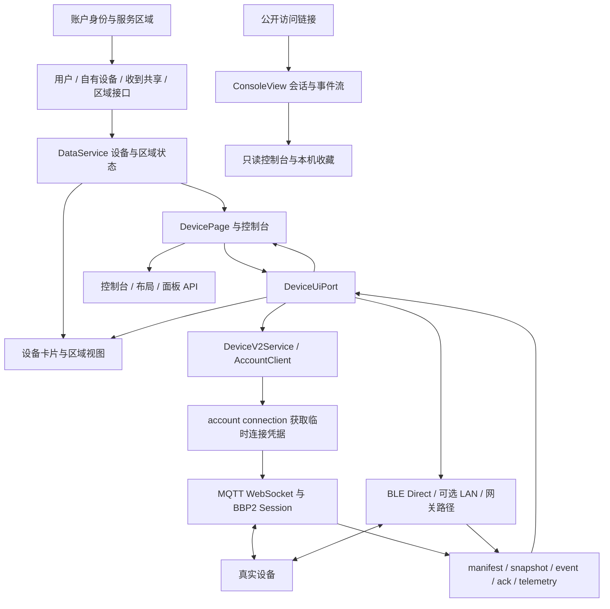
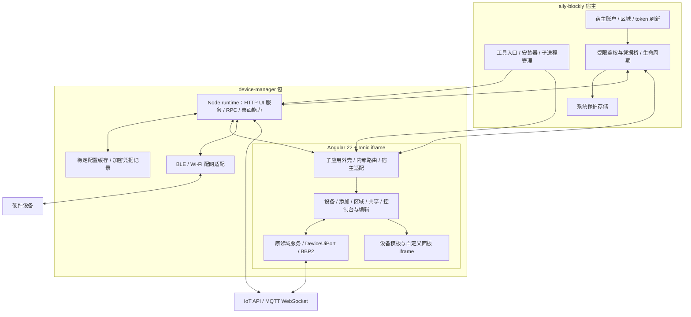

# 设备管理子应用迁移调查报告

> 日期：2026-10-15。状态：调查完成，等待方案审阅；尚未创建目标分支或实现迁移。
> 目标目录：`/Users/xiewendao/Documents/aily/aily-subapp/packages/device-manager`。
> 配套文件：[执行计划](设备管理子应用迁移执行计划.md)、[调查执行记录](设备管理子应用调查执行记录.md)。

## I — Intent：最终目标

把 blinker-app 中设备页、添加设备、添加区域、设备共享和设备控制面板，迁移成可由 aily-blockly 安装、打开和管理的独立 Angular subapp。

“一比一”建议按三个层次验收：

1. **界面一致**：同一视口、主题、语言、设备能力和权限下，沿用原模板、SCSS、图标、字体、文案、布局及交互状态。
2. **行为一致**：保留添加、排序、分区、共享、控制、面板编辑、保存、返回、失败提示和恢复流程；设备命令和权限不因迁移发生变化。
3. **数据一致**：使用同一服务区域与账户下的真实设备、区域和控制台配置；缓存、凭据和连接具有正确的账户边界。

仅复制页面文件不能达到这个目标。源应用的页面依赖账户状态、协议会话、权限模型、本地凭据、Ionic 生命周期和二级 iframe。迁移工作的主体是保留业务实现并替换平台边界。

用户已补充确认：**aily-blockly 宿主代码可以修改，以支持 device-manager 登录接入。** 因此方案以复用宿主登录为优先方向，不再默认增加一套独立登录。

## D — Data：可用证据

### 1. 调查基线与证据强度

| 项目 | 调查时分支 / 提交 | 用途 |
| --- | --- | --- |
| blinker-app | `xwd` / `0d9091e` | 迁移源；Angular 22.1.1、Ionic 8.8.17、TypeScript 6.0.3 |
| aily-subapp | `main` / `ac50a90` | 目标仓库；尚不存在本地 `xwd` 分支 |
| aily-blockly | `xwd-lex` / `7a306913a` | 宿主与 subapp 接入参考 |

以上三个仓库在调查开始时工作区均干净。后续实施必须重新记录 HEAD，防止调查之后的提交使迁移基线漂移。

证据来自本地源码、配置、现有模板及协议边界：先定位文件，再使用 `ast-outline` 查看具体文件结构，使用 `ast-grep` 检索 AST。没有访问真实账号、请求生产业务接口、操作真实设备或进行浏览器 UI 确认。

对包含设备页及必要支撑页的 37 条候选路由记录进行静态 import 链遍历，得到 **225 个 TypeScript 文件、约 47,522 行**。该数字只表示当前抽样依赖规模：包含待裁剪的外围依赖，未完整展开 barrel re-export、动态引用、模板、样式和资源，**不是最终复制清单或完整代码量**。

### 2. 入口与功能边界

路由依据：[app.routes.ts](/Users/xiewendao/Documents/aily/blinker-app/src/app/app.routes.ts:5)。下表中的路径指 subapp 内部路由，建议保留其业务路径语义。

| 功能 | 原路由 / 主要文件 | 已确认行为 | 迁移判断 |
| --- | --- | --- | --- |
| 设备首页 | `/home/device`；`home/components/tab-device` | 设备卡片、区域切换、添加菜单、空状态、消息入口 | 必须迁移 |
| 卡片及区域视图 | `deviceblock`、`deviceblock-list`、`deviceblock-zone`、`room-list` | 数值、未知/离线/可达/就绪状态、排序、下拉刷新、区域滑动 | 必须整体保留相关交互 |
| 添加入口 | `/guide` | 密钥、Wi-Fi、蓝牙三种方式；重新配置的返回上下文 | 必须迁移 |
| 密钥添加 | `/guide/key` | 创建逻辑设备、幂等请求、broker 分配等待、密钥显示/复制、完成后进入设备 | 必须迁移，不能只做名称录入 |
| Wi-Fi 添加 | `/guide/wifi` → `/tools/esp32-provision` | BLE/SoftAP 配网、网络扫描、Security 1、身份分配与恢复 | 属于添加闭环，需桌面适配 |
| 蓝牙添加 | `/guide/ble` | 服务广播发现、注册、凭据保存、中断恢复 | 属于添加闭环，需桌面适配 |
| 添加和管理区域 | `/room-manager`、`/room-manager/:room` | 新增、重命名、删除、排序、设备归属、保存与冲突提示 | 必须迁移；不是纯本地分组 |
| 共享总览 | `/share-manager` | 发出的共享、收到的设备、待处理邀请、公开设备收藏 | 必须迁移 |
| 单设备共享 | `/share-manager/:id` | viewer/operator、控制字段限制、编辑权限、邀请管理、撤销、公开访问 | 必须迁移 |
| 接受邀请 | `/share-invitation`、`/share-invitation/:code` | 导入链接、预览、登录返回、接受、进入设备 | 必须迁移 |
| 公开控制台 | `/s/:token` | 匿名只读会话、实时状态、主题/模式、加入本机列表、登录后判断权限 | 必须迁移 |
| 控制面板 | `/device/:id` | 动态选择 BBP2、旧设备面板、Customizer、预览面板；连接与心跳 | 必须迁移真实可达实现 |
| 设备设置 | `/device/:id/settings`、`/device-manager/:id` | 名称、图片、区域、密钥、重配、共享、解绑、显示模式 | 为面板和管理闭环必需 |
| 网关接入 | `/device/:id/gateway-enrollment` | BLE 子设备接入、恢复检查点 | 属于现有设备设置闭环 |
| 面板编辑 | `/device/:id/edit`、`.../edit/widget/:widgetId` | 部件库、布局/属性、撤销、实时预览、保存、离开保护 | 必须迁移 |
| 自定义面板 | `/device/:id/edit/custom` | HTML 编辑、预览、应用、未保存保护 | 必须迁移 |
| 界面配置 | `/device-manager/:id/uic` 与 `custom/automatic/ai` | 自动适配、AI 生成/修改、主题、实时预览、应用 | 属于控制面板闭环 |
| 组件配置 | `.../components`、`.../component-preview` | 设备字段可见性、部件属性与效果预览 | 必须迁移其可达功能 |
| 定时、位置、日志、存储、固件 | `/device-manager/:id/timer` 等 | 设置页现有入口 | 建议纳入；现状限制见第 9 节 |
| 登录、设置、消息、第三方服务配置 | `/login`、`/settings`、`/message`、`/third-party-services` | 登录返回、主题语言区域、邀请通知、天气/地图密钥配置 | 只迁移设备功能实际需要的部分 |

不建议搬入：社区、完整个人中心、反馈、关于、独立场景编辑器、完整工具箱、Android/iOS 工程、APK 更新器、应用商店和移动系统外壳。它们不因 import 可达就自动成为产品范围；必要依赖应在平台边界处拆开。

### 3. 应直接复用的代码

| 源范围 | 复用方式 | 注意事项 |
| --- | --- | --- |
| `home/components` 中设备与区域组件 | 保留 TS/HTML/SCSS | 原底部四标签外壳不等于设备子应用导航 |
| `sections/guide`、`sections/room`、`sections/device` | 按可达路由迁移 | 同步复制模板、共享 SCSS、弹窗和辅助函数 |
| `device/v2`、`device/legacy-panel`、`device/custom-panel`、`device/customizer` | 保留面板与部件实现 | 区分普通/自定义/调试模式及旧配置兼容 |
| `core/protocol/device-v2` | 原样复用纯协议逻辑 | 不能重新实现简化版 BBP2 |
| `core/device-v2` | 保留状态、布局、路由、权限、连接需求模型 | 只替换平台 I/O 和存储实现 |
| `DeviceService`、`DeviceUiPort`、领域服务 | 保留业务语义 | 避免额外引入第二套设备状态源 |
| 通用组件、模型、翻译和主题 | 随实际依赖迁移 | 不把所有 core 服务机械复制过去 |
| `device-template`、`src/custom-panel` | 保留独立构建链 | 都是运行功能所需产物，并非开发演示附件 |

关键事实：[components.config.ts](/Users/xiewendao/Documents/aily/blinker-app/src/app/configs/components.config.ts:7) 中 `Layouter2` 和 `Layouter2Component` 已映射到 `LegacyPanelComponent`。不能因历史目录名就把整套旧 `layouter2` 编辑器当作当前主实现搬入；应保留实际引用的兼容文件和 guard。

当前通用控件词汇共 7 类、23 个变体，也属于一比一范围：switch 的 tile/toggle/slide/hold；button 的 action/keys/dpad；slider 的 level/gradient/dial/levels/stepper/timer；select 的 mode；input 的 text；value 的 number/trend/ring/status/log/uptime/memory；color 的 picker。还需保留独立视频、天气等附加组件，以及尺寸规则、附属读数、字段裁剪、长按/确认/瞬时操作和数值动画。依据：[page-widget.ts](/Users/xiewendao/Documents/aily/blinker-app/src/app/core/device-v2/page-widget.ts:5)、[widget-presets.ts](/Users/xiewendao/Documents/aily/blinker-app/src/app/core/device-v2/widget-presets.ts:14)。不能只迁最常见的开关和滑块。

### 4. UI 与资源的一致性要求

- 保持 Angular 22.1.x / Ionic 8.8.x 这组源版本，避免为了套用 Angular 21.1 模板而降级。独立 iframe 不要求与宿主 Angular 版本相同。
- 保留 `provideIonicAngular({ mode: 'ios' })`、`IonicRouteStrategy`、`ion-router-outlet` 和页面 `ionView...` 生命周期。只留下一个普通 `router-outlet` 可能改变页面缓存和连接释放行为。
- 保留应用浅色/深色与面板 `natural/electronic/dark` 两套主题语义。宿主主题只用于默认值或显式同步，不覆盖用户的单设备选择。
- 同时迁移 `global.scss`、`blinker.scss`、`theme`、页头/滚动遮罩等共享样式；Ionic 弹窗、popover、modal 样式也在验收范围。
- 资源包括设备图片索引及图片、Font Awesome、本地字体、11 种语言翻译、必要音频、地图/视频相关资源。
- 当前 `public/fontawesome6` 约 11.69 MiB，`public/devices` 约 5.99 MiB。首轮优先完整性，不进行可能改变字形和图标的资源瘦身。
- `custom-panel-runtime/runtime.json` 是构建生成物；不能仅复制旧产物而遗漏重新生成能力。

依据：[app.config.ts](/Users/xiewendao/Documents/aily/blinker-app/src/app/app.config.ts:40)、[global.scss](/Users/xiewendao/Documents/aily/blinker-app/src/global.scss:13)、[ui-theme.ts](/Users/xiewendao/Documents/aily/blinker-app/src/app/core/device-v2/ui-theme.ts:1)、[angular.json](/Users/xiewendao/Documents/aily/blinker-app/angular.json:20)、[pack.mjs](/Users/xiewendao/Documents/aily/blinker-app/tools/custom-panel/pack.mjs:1)。

### 5. 设备与服务端数据流

当前业务使用 `https://iot.yiyu.pro`，区域由 `x-region` 传递，支持 `China`、`Global`、`Development`。生产与默认开发配置均关闭 BBP2 LAN 功能。设置中的服务区域与设备分组“区域”是两种不同概念，迁移时不能混用。

| 数据类别 | 已有接口/机制 | 必须保留的约束 |
| --- | --- | --- |
| 用户与设备清单 | `/api/v1/auth/me`、`/api/v2/devices`、`/api/v2/shares/received` | 部分请求失败的处理、会话代次、旧响应不得写入新账户 |
| 用户设备区域 | `/api/v2/account/regions` | `expectedRevision` 乐观并发；冲突提示；保留设备归属和排序 |
| BBP2 连接 | `/api/v2/account/connection?wire=bbp2&pv=2&transport=websocket` | 按服务端凭据连接 MQTT WebSocket，不能把设备在线状态等同于 socket 在线 |
| 设备控制台 | `/api/v2/devices/:id/console`、page-layout、ui-config | 版本、能力、可编辑权限、布局与设备字段关系 |
| 旧设备面板 | `/api/v2/device-panels/:panelId` 及旧配置接口 | 旧协议映射与面板 revision |
| 共享 | share-invitations、shares、received shares | viewer/operator、字段限制、`canEditConsole`、撤销与 presence key 更新 |
| 公开浏览 | console-links、console-view-sessions、流式 events | 匿名 `ConsoleView` 会话与普通 Bearer 鉴权分离；只读 |
| 界面生成 | `/api/v1/interface/workflow`、generate、refine | NDJSON 增量进度、取消、错误、完整结果校验；不改为宿主聊天消息 |
| 设备管理 | 创建/密钥 reveal/rotate、BLE enrollment、edge gateway | 幂等键、检查点、设备身份验证、会话切换后废弃结果 |

依据：[api.config.ts](/Users/xiewendao/Documents/aily/blinker-app/src/app/configs/api.config.ts:10)、[UserService.getAllInfo](/Users/xiewendao/Documents/aily/blinker-app/src/app/core/services/user.service.ts:47)、[RoomService](/Users/xiewendao/Documents/aily/blinker-app/src/app/sections/room/room.service.ts:17)、[DeviceV2Service](/Users/xiewendao/Documents/aily/blinker-app/src/app/core/services/device-v2.service.ts:30)、[ServerInterceptor](/Users/xiewendao/Documents/aily/blinker-app/src/app/core/injectable/server.interceptor.ts:100)、[InterfaceGenerationService](/Users/xiewendao/Documents/aily/blinker-app/src/app/sections/device/device-uic/interface-generation.service.ts:31)。

### 6. 原生能力不能直接搬入 iframe

| 能力 | 源端现状 | 桌面迁移判断 |
| --- | --- | --- |
| BLE 发现 | `bleScanner` + 原生扫描，读取 serviceData/厂商广播 | 必须提供真实广播数据；普通设备 chooser 不等价 |
| BLE 控制 | `BleDirectRecordLink`、分片重组、GATT notify/write、身份握手 | 保留协议，只替换底层链路；可参考 ble-debugger 的 Node BLE 实现 |
| BLE 凭据 | Capacitor SecureStorage + 账户隔离 | 需要桌面受保护存储，不能静默降级为 localStorage |
| Wi-Fi 配网 | sibling `capacitor-wifiprov` 的 Android/iOS 实现 | Web 实现明确不支持 BLE/SoftAP/custom endpoint；需要桌面实现 |
| BBP2 LAN | `deviceV2LanEnabled=false`，且限制 Android + 原生 `BlinkerLocalWebSocket` | 保留默认关闭；不把默认未启用功能算成已支持桌面 LAN |
| 旧设备 LAN | `DeviceService` 的旧路径，部分扫描代码历史遗留 | 单独核对真实可用性，不能与 BBP2 LAN 混为一个能力 |
| App 前后台 | Capacitor App 事件；不可用时默认 active | 需对接 subapp 实际显示/隐藏/关闭；CSS 隐藏 iframe 不等于 document hidden |
| 网络 | 原生 Network，携带连接类型和代次 | 浏览器 online 不能替代“确证 Wi-Fi 可用” |
| 剪贴板 | Capacitor Clipboard | 使用已验证的宿主接口或 Web API，保留失败提示 |
| Android 快捷方式、系统返回键、状态栏、振动 | 移动平台特有 | 单列平台差异，不伪造桌面成功 |

依据：[scan.ts](/Users/xiewendao/Documents/aily/blinker-app/src/app/core/bluetooth/scan.ts:26)、[BLE transport](/Users/xiewendao/Documents/aily/blinker-app/src/app/core/device-v2/ble-direct/transport.ts:60)、[credential-store.ts](/Users/xiewendao/Documents/aily/blinker-app/src/app/core/device-v2/ble-direct/credential-store.ts:89)、[LAN supported](/Users/xiewendao/Documents/aily/blinker-app/src/app/core/services/device-v2-lan.service.ts:66)、[WiFiProv Web](/Users/xiewendao/Documents/aily/capacitor-wifiprov/src/web.ts:20)、[AppVisibilityService](/Users/xiewendao/Documents/aily/blinker-app/src/app/core/services/app-visibility.service.ts:24)。

这意味着：如果“一比一”以手机原生功能为基线，BLE 和 Wi-Fi 配网必须完成桌面适配；仅保留“不支持”提示只能称为 Web 功能迁移，不能称为完整原生功能迁移。

### 7. subapp 与宿主约束

- 已有 Angular subapp 模板，以及 serial-debugger、video-converter 可参考；模板的 Angular 21.1 版本不作为迁移版本基准。
- 当前宿主通过子进程提供 loopback HTTP UI 服务，在 iframe 内载入，UI 与父窗口使用 Penpal，业务请求可经 WebSocket RPC 到 Node runtime。
- 宿主不会把自己的 Angular injector、路由、样式和登录服务自动注入 iframe。
- 普通 UI 进程以 `--port 0` 启动。端口会变化，因此 localStorage/IndexedDB 的 origin 不能作为跨启动的稳定身份与存储依据。
- 现有登录能力不是所有 subapp 都可用：UI `requestLogin` 和进程鉴权桥存在 aily-chat 专用限制。用户已授权修改这部分，但仍须保留明确的调用方范围。
- Electron 已有 safeStorage 实现；普通 subapp Penpal 方法表未提供相同能力。需要补最小凭据桥，不能直接假定 iframe 能访问父窗口 preload。
- ble-debugger 已有扫描、GATT、read/write/notify 的实现参考，但其广播序列化不完整提供 BBP2 所需 serviceData；不是直接调用一下就完成迁移。
- mqtt-debugger 的 UI 有 MQTT 客户端，Node core 主要是基础壳；不应把它当作通用设备后端。源端 MQTT WebSocket 实现更适合保留。
- `resourceLifecycle` 的声明不等于所有资源已实现自动暂停。现有宿主适配主要覆盖串口；BLE、MQTT、配网的退出和资源释放需要明确实现。

可核对的宿主入口：[child-tool-host.component.ts](/Users/xiewendao/Documents/aily/aily-blockly/src/app/tools/child-tool-host/child-tool-host.component.ts:1131)、[鉴权进程桥](/Users/xiewendao/Documents/aily/aily-blockly/electron/aily-host-auth-process-bridge.js:3)、[safe-storage-ipc.js](/Users/xiewendao/Documents/aily/aily-blockly/electron/safe-storage-ipc.js:15)、[资源生命周期适配](/Users/xiewendao/Documents/aily/aily-blockly/src/app/services/integrations/subapps/adapters/subapp-resource-lifecycle-adapter.ts:6)。构建和 manifest 的具体落地见执行计划。

**统一登录的后端依据**：进一步只读核对 sibling 设备网关 `aily-blinker-services`，其配置将 China 请求转至 `https://api.yiyu.pro`，Global 请求转至 `https://api.aily.pro`，且通过 `/api/v1/auth/me` 原样转发传入 Bearer token。与 aily-blockly 的 cn/eu 账户服务一致。这为复用宿主账号提供了源码依据，不只是 token 字段外形相似。依据：[网关区域配置](/Users/xiewendao/Documents/aily/aily-blinker-services/services/gateway/src/config.js:255)、[上游鉴权转发](/Users/xiewendao/Documents/aily/aily-blinker-services/services/gateway/src/aily-client.js:151)、[用户查询](/Users/xiewendao/Documents/aily/aily-blinker-services/services/gateway/src/aily-client.js:395)、[宿主区域配置](/Users/xiewendao/Documents/aily/aily-blockly/electron/config/config.json:42)。

现有进程桥可返回 `{ accessToken, apiServer, generation }`，刷新接受 `rejectedGeneration`，因此优先复用其刷新协调机制，扩展 device-manager 调用资格即可避免复制 refresh token 到 UI。但宿主 `cn/eu/localhost` 与设备服务 `China/Global/Development` 不同：cn→China、eu→Global 有明确映射，宿主 localhost 的账户地址仍指向正式账户服务，不能自动映射为 Development。生产部署是否与上述源码一致仍需联调确认。

另外，源公开控制台允许匿名访问，不能简单把整个 device-manager 加到宿主的“打开前必须登录”列表中。设备管理操作需认证，与匿名公开浏览应分别判断。宿主的独立窗口目前也有 aily-chat 专用的无 token 外壳识别，需同步适配，避免弹出设备窗口再开启一套账户刷新。依据：[auth-required-tool.ts](/Users/xiewendao/Documents/aily/aily-blockly/src/app/services/core/auth/policies/auth-required-tool.ts:1)、[detached-aily-chat-auth.ts](/Users/xiewendao/Documents/aily/aily-blockly/src/app/services/core/auth/policies/detached-aily-chat-auth.ts:11)。

### 8. 存储、路由与嵌套 iframe

**需要稳定存储的状态**不止登录：语言、应用主题、单设备主题、共享设备面板模式、服务区域、设备目录缓存、manifest 缓存、公开控制台收藏、第三方服务配置、历史读数、Wi-Fi 记忆及配网/BLE/网关检查点。

建议普通配置和缓存写到 subapp 稳定用户数据目录；敏感凭据使用宿主提供的受保护存储。延续现有作用域，并核对是否需要加入 `authority + region + accountId`，不能只用逻辑设备 ID，也不能把用户数据写到版本安装目录。

源端认证持久化明确区分原生与开发 Web，生产 Web 不持久化 token。移植时不可开启“开发 Web 会话”开关来冒充桌面持久登录。依据：[DataService.loadAuthData](/Users/xiewendao/Documents/aily/blinker-app/src/app/core/services/data.service.ts:188)、[persistAuthData](/Users/xiewendao/Documents/aily/blinker-app/src/app/core/services/data.service.ts:549)。

路由方案优先采用 subapp 内部 hash 路由，资源 base 固定为 UI 根目录；保留 `/device/:id` 等路由的逻辑路径。须改掉 [app.component.ts:150](/Users/xiewendao/Documents/aily/blinker-app/src/app/app.component.ts:150) 根据 `window.location.pathname` 判断匿名入口的代码，改为 Angular Router 的业务路由判断。

另外两层 iframe 仍需保留：

1. `Customizer` 使用 Penpal 加载 `device-template`，有 origin、握手、命令与历史查询校验。
2. `CustomPanelFrameComponent` 加载打包 runtime，以 `sandbox="allow-scripts"` 的 `srcdoc` 运行自定义 HTML，并对动作进行校验。

不能将这两层桥误合并到宿主桥，也不能为快速跑通而放宽自定义 HTML 的宿主权限。依据：[Customizer.prepareFrame](/Users/xiewendao/Documents/aily/blinker-app/src/app/device/customizer/customizer.component.ts:169)、[CustomPanelFrame](/Users/xiewendao/Documents/aily/blinker-app/src/app/device/custom-panel/custom-panel-frame.component.ts:8)。

### 9. 源应用已有的限制与需要审阅的偏差

| 现状 | 证据 | 迁移应如何表述 |
| --- | --- | --- |
| 日志为空时会生成演示日志 | [device-log.component.ts:189](/Users/xiewendao/Documents/aily/blinker-app/src/app/sections/device/device-log/device-log.component.ts:189) | 页面可复刻，但不能据此声称后端日志读取已实现 |
| 存储无数据时使用演示曲线，初始配额/用量为固定值 | [device-storage.page.ts:152](/Users/xiewendao/Documents/aily/blinker-app/src/app/sections/device/device-storage/device-storage.page.ts:152) | 不用演示值充当设备联调成功证据；是否改为空状态需单列确认 |
| 公开网页基础地址为空 | [environment.prod.ts](/Users/xiewendao/Documents/aily/blinker-app/src/environments/environment.prod.ts:1) | 当前不能凭空承诺可分享的公网 HTTPS 控制台 |
| 邀请与公开链接为 `diandeng://share/...` / `diandeng://console/...` | [invitation-link.ts](/Users/xiewendao/Documents/aily/blinker-app/src/app/core/device-v2/sharing/invitation-link.ts:1)、[device-console.service.ts:63](/Users/xiewendao/Documents/aily/blinker-app/src/app/core/services/device-console.service.ts:63) | 保留链接解析；由桌面系统点击自动打开 subapp 需要宿主路由适配 |
| 部分全局服务静态导入移动插件 | DataService、AuthService、ViewService、DeviceUiPort 的依赖链 | 仅“不调用 init”仍可能引入不适用依赖，需真实拆除平台依赖 |
| AI 生成和公开控制台使用流式响应 | InterfaceGenerationService、DeviceConsoleService | 普通 JSON 请求代理不足以一比一替换 |

## E — Edges：边界与限制

1. 本轮交付仅调查和计划，不创建 `xwd`、不新建包、不改宿主业务代码。
2. 后续目标分支按用户指定使用 `xwd`，不擅自改为 `codex/xwd`；宿主分支安排另行纳入实施基线。
3. 不搬运移动安装工程，也不连接原 app 的本地登录库来读取现有凭据。
4. 不新造协议、设备 ID、API 返回或在线状态；沿用现有协议与能力判断。
5. 不默认新增测试用例，不调用浏览器进行 UI 确认。构建、类型、打包、静态差异检查与用户审阅属于计划内验证；真实 UI/硬件证据不足时明确记录。
6. 目前没有生产接口兼容性、CORS、宿主 token 对 IoT 接口可用性、桌面 BLE 平台兼容性的实测证据。它们是实施前段的验证门槛，不是已验证结论。
7. 不把阶段性云端功能上线当作完整迁移完成；若需分阶段发布，必须明确哪些 native 功能还未交付。

## A — Answer：交付格式与成功标准

推荐交付一个 `device-manager` 包，包含 Angular/Ionic UI、最小 Node runtime、原设备模板/自定义面板构建链、必要平台适配，以及 aily-blockly 的最小宿主接入修改。使用现有账户、HTTP、设备协议、UI 模型，避免另建通用插件框架或完整平台模拟层。

图中 API 的 UI/runtime 分工须按执行计划冻结：协议和设备状态优先保留在 UI；受保护 HTTP 请求由宿主鉴权能力支持，流式请求必须保留取消与增量语义。不是在两层各实现一套设备状态机。

成功标准：包可构建/打包/安装并通过宿主打开；五类核心功能及确认纳入的子流程完整；状态与权限真实；原模板和资源可追溯；账户、区域、关闭/重开和异常路径不串状态；所有与原生 App 的差异逐项列出并得到认可。

静态证据足以支持上述架构判断，但不足以证明视觉一比一或硬件链路完全可用。最终完成声明必须与实际验证范围一致。
