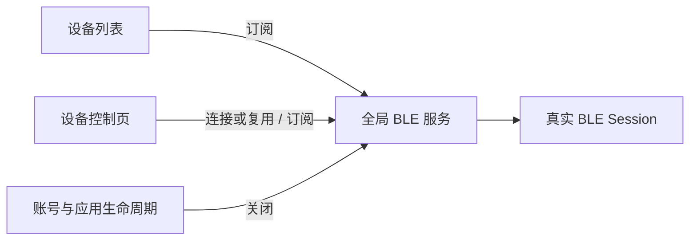
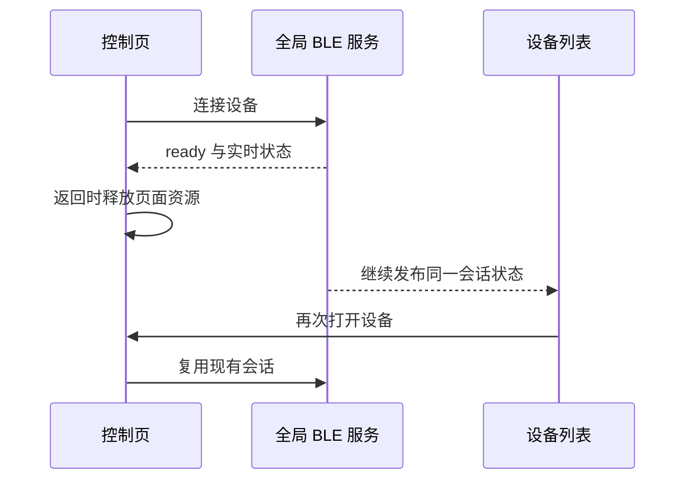

# 蓝牙全局会话复用执行计划

## Intent：最终目标

把普通 BLE 直连会话与路由页面解耦。控制页返回列表后保留真实连接和状态，再进入同一设备时复用会话。同步到 blinker-app 与设备管理子应用。

## Data：可用证据

- 用户反馈前轮修正后返回列表仍显示“正在连接蓝牙”，明确希望全局持久状态。
- BLE 服务已经是 root 单例，持有 active/opening 和全局状态；当前 DeviceUiPort 仍在最后页面 scope 退出时主动断开 BLE。
- 前轮只修正晚到连接与异常残留，没有调整页面退出即断开的产品策略。

## Edges：边界与限制

- 持久指当前应用会话跨页面复用，不能在进程退出后保存假的“已连接”。
- 不新增另一套连接池、状态缓存或连接代理，复用现有 root BLE 服务。
- 保留当前单活动 BLE 设备约束；不扩展为多设备同时直连。
- 网关子设备的受限离线 Direct 许可继续按原生命周期释放。
- 核对应用后台、退出账号、设备删除/禁用、蓝牙关闭、真实断线的清理边界。
- 不新增测试用例，不使用浏览器进行 UI 确认。

## Answer：交付格式与成功标准

- 两端一致：普通 BLE 已建立会话不会因页面关闭而被 disconnect。
- 控制页只释放页面自己的云端兴趣、遥测和订阅；全局会话继续发布真实状态。
- 全局边界仍能关闭真实连接，无永久假的 ready 状态。
- 完成构建、现有检查和自我复核，交付执行记录。

## 架构图

## 数据流图

## 完成结果

已实现并同步两端：普通 BLE 会话由现有 root 服务跨页面持有，页面仅释放自己的资源；后台、蓝牙关闭、账号及目录清理仍有效。构建通过，现有测试失败集合未新增。具体证据和验收边界见同目录《蓝牙全局会话复用执行记录.md》。
