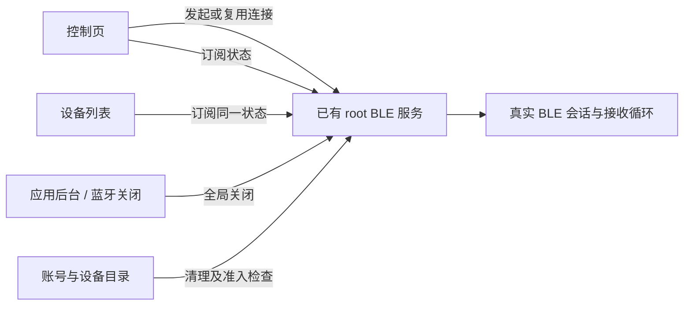
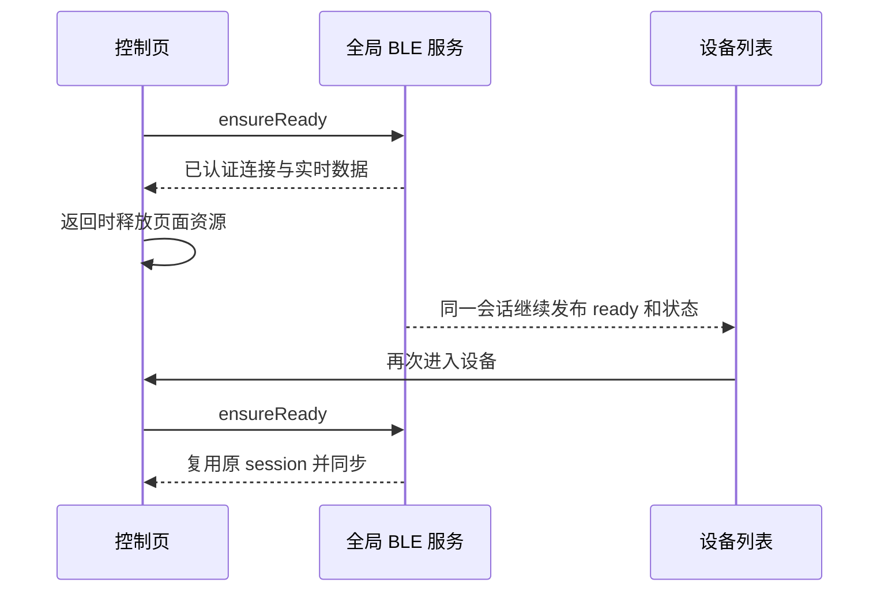

# 蓝牙全局会话复用执行记录

## Intent：最终目标

按用户补充要求，把普通 BLE 连接作为全局会话保留：设备控制页返回列表时继续连接，再进入同一设备时复用真实会话。所有改动同步到 blinker-app 和设备管理子应用。

## Data：根因与实现证据

### 根因

`DeviceV2BleService` 已经是 Angular root 单例，内部已有 active、opening、closing 和连接状态。此前 DeviceUiPort 在最后一个页面 scope 关闭后仍主动调用 BLE disconnect，导致全局服务里的会话被路由生命周期切断。

前轮处理了晚到重连和连接状态残留，却保留了“退出页面释放 BLE”的产品策略。这没有对齐用户希望跨页面持续连接的真实目标。

### 本轮改动

1. 删除普通页面组的 `disconnectOnIdle`，页面退出只清理页面自己的 Cloud interest、LAN 和受限网关 Direct scope。
2. 普通 Direct BLE 的已建立及已经发起的连接继续由现有 root BLE 服务持有；页面无需另建连接缓存或连接池。
3. 再次打开同一设备时，原 `ensureReady` 直接同步现有 ready session，不重新扫描和建立 GATT。
4. 列表与控制页共用 `updateBleTransport`，根据真实 BLE 状态选择 BLE 或 Cloud，控制页不在场时也能更新列表。
5. 普通全局请求不再使用页面 AbortSignal 决定排队寿命；全局取消改用现有 generation 门禁，防止后台清理后排队请求复活。
6. 全局服务监听应用活动状态、蓝牙适配器和设备目录，在没有任何页面 scope 时也能清理会话。
7. `ensureReady` 每次入口和递归均检查应用/适配器及已加载的权威设备目录；已移除、禁用的设备不可通过残留本地凭据重新连接。
8. 蓝牙初始化或监听建立失败标记为未知状态，清除失败的监控任务，使后续请求可重试；确认蓝牙关闭时仍立即取消连接。

## Edges：生命周期边界

| 情况 | 最终行为 |
| --- | --- |
| 控制页返回列表、普通路由切换 | 保留普通 BLE 会话和实时状态 |
| 再次打开同一设备 | 复用已有连接 |
| 已发起连接期间返回列表 | 已启动的全局操作可在原超时预算内完成；不启动无限重试 |
| 切换另一台 BLE 设备 | 保留既有单活动连接约束，不扩展并发连接池 |
| 应用进入后台、蓝牙关闭 | 全局关闭连接与扫描，并阻止原排队请求复活 |
| 退出或切换账号 | 使用原有账号清理流程关闭会话、清空状态 |
| 设备被移除或禁用 | 关闭现有目标，并在新连接入口拒绝目标 |
| 真实断线或协议错误 | 按原服务错误处理更新状态，不保留假的 ready |
| 网关子设备受限 Direct、临时管理连接 | 保留既有许可释放和显式断开规则 |
| 应用重载、进程退出 | 原物理会话不能序列化为已连接状态；重新加载后按真实连接状态工作 |

## Answer：交付与验证

- 两端仅修改共用的 `device-ui.port.ts` 和 `device-v2-ble.service.ts` 连接逻辑。
- 两端实现保持一致，只保留 Capacitor 与宿主 Bluetooth import 差异。
- 上轮为页面 signal 增加的现有测试参数断言已恢复，测试文件不再有本轮改动；未新增测试用例。
- 两端 TypeScript 检查通过。
- 现有相关测试仍为 6 项通过、9 项失败，失败集合与前轮修改前基线相同。
- 已核对宿主实际使用的开发包 UI 为软链接，指向本轮子应用构建目录，不是另一份旧输出目录。
- 最终构建结果见下方补记；未使用浏览器进行 UI 操作，也未宣称完成真机页面切换复现。

## 自我复核

- 重新确认需求是跨页面保留连接，不能只修补“离页后不重连”，也不能用缓存文案掩盖物理断线。
- 复用现有 root 服务，没有增加另一套全局连接管理器或设备专用分支。
- 只移除页面对普通 BLE 的释放权，不放宽网关子设备的受限 Direct 许可。
- 检查了没有页面 group 时的后台、目录和适配器清理，避免仅删除 disconnect 留下全局资源泄漏。
- 只读复核指出的“已移除排队目标仍能连接”和“初始化失败被永久当作关闭”两处遗漏均已处理。

## 架构图

## 路由与连接数据流

### 最终构建结果

- blinker-app：`npm run build` 成功，最新产物为 `www`。
- 设备管理子应用：`pnpm --filter @aily-project/subapp-device-manager run build:ui` 成功，最新产物为 `packages/device-manager/dist/device-manager/ui`。
- 最终两端连接代码比对一致（平台 Bluetooth import 除外），`git diff --check` 均通过。
- 最终现有测试仍为同一组 9 项原有失败、6 项通过。
- 加载新版 UI 后，已经建立的普通 BLE 会话不会因返回列表而被页面清理；真实断线仍会反映为断开状态。
