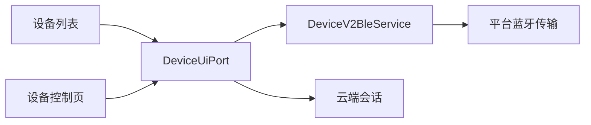
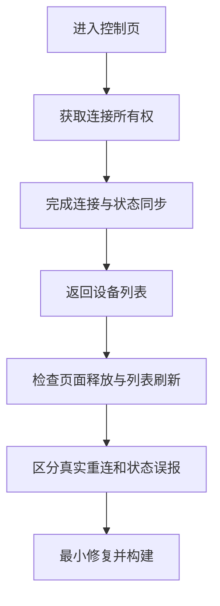

# 设备卡片布局与蓝牙返回行为执行计划

> 后续用户明确要求跨页面保留 BLE，会话生命周期已进一步调整。当前行为以 [蓝牙全局会话复用执行记录](./蓝牙全局会话复用执行记录.md) 为准。

## Intent：最终目标

- 在线设备的图片与左侧名称、状态按顶部对齐，图片进一步缩小。
- blinker-app 与设备管理子应用采用一致的设备卡片样式，包括移除毛玻璃。
- 查明控制页返回列表后出现“正在连接蓝牙”的原因，修正不必要的连接操作或错误状态。

## Data：可用证据

- 用户提供的 2026-10-16 17:22 截图显示：ee 图片与左侧内容垂直居中，状态为“正在连接蓝牙”。
- 子应用当前图片容器为 64 × 64 px，顶部区域使用 `align-items: center`。
- blinker-app 卡片仍使用此前图片覆盖内容和毛玻璃布局。
- 蓝牙连接涉及页面生命周期、DeviceUiPort 连接所有权、DeviceV2BleService 和列表刷新；先明确调用链再修改。

## Edges：边界与限制

- 仅调整卡片布局和已证实的连接生命周期问题，不改固件、设备绑定或账号数据。
- 保持云端与 BLE 的既有权限和回退规则。
- 不新增测试用例，不使用浏览器进行 UI 确认。
- 最多使用一个只读分析子代理；所有实现由主代理完成。

## Answer：交付格式与成功标准

1. 两端卡片使用一致的顶部对齐布局，图片缩小为 48 × 48 px。
2. 根据调用链修复返回列表时不必要的蓝牙重连，说明实际连接生命周期。
3. 完成必要构建和现有相关检查，记录验证边界与自我复核。
4. 交付代码及同目录执行记录。

## 架构关系

## 调查数据流

## 完成结果

已同步两端 48 px 顶部对齐样式，并修复排队连接离页后复活、自动密钥维护重新连接、凭据读取异常残留连接状态三处缺口。两端构建成功，既有测试失败集合与基线一致。详见同目录《设备卡片布局与蓝牙返回行为执行记录.md》。
