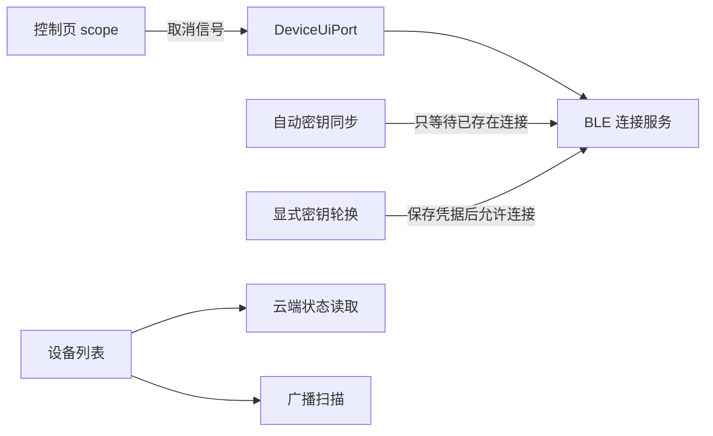
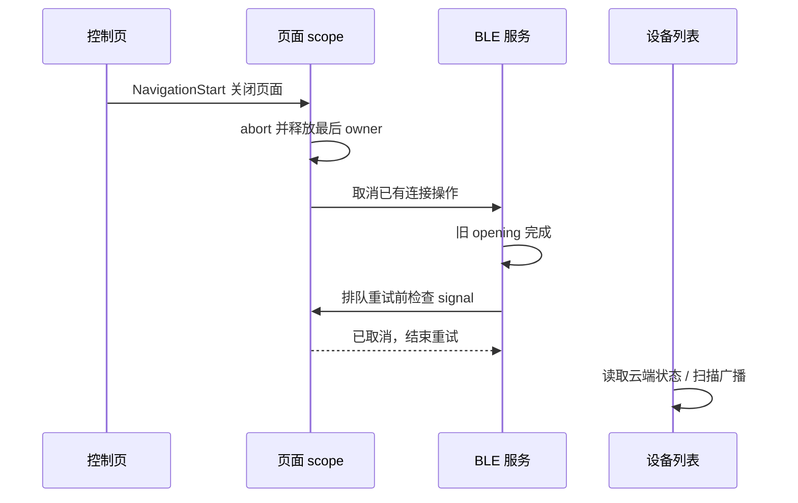

# 设备卡片布局与蓝牙返回行为执行记录

> 后续用户明确要求跨页面保留 BLE，会话生命周期已进一步调整。当前行为以 [蓝牙全局会话复用执行记录](./蓝牙全局会话复用执行记录.md) 为准。

## Intent：最终目标

两端卡片顶部对齐并缩小图片；修正返回设备列表后仍可能显示“正在连接蓝牙”的连接生命周期缺口。

## Data：可用证据

### 布局

- 设备管理子应用原顶部使用 `align-items: center`，图片为 64 × 64 px。
- blinker-app 仍为旧版图片覆盖内容、毛玻璃背景布局。
- 两端现在使用相同 HTML/SCSS：图片 48 × 48 px，顶部 `align-items: flex-start`；图片与文字同处顶部布局，不覆盖下方数据。
- 在线卡片和宽卡采用右侧小图；离线无数据卡保留上图下文，移除毛玻璃。

### 连接调用链与发现

1. 控制页在 NavigationStart 即关闭可见性，取消同步及前台重连计时器。
2. 最后一个页面 scope 关闭后，DeviceUiPort 释放 BLE。
3. 列表只读取云端缓存和扫描广播，不主动建立 GATT；广播扫描与“正在连接蓝牙”的状态不同。
4. `ensureReady` 等待已取消的 opening 完成后会递归重试，原实现未检查等待方页面是否已退出，可在旧任务结束后发起晚到连接。
5. 自动 PresenceKey 同步经过网络/安全存储等待后，原实现可以自行调用 `ensureReady`；页面退出也无法阻止这项后台维护重新连接。
6. 凭据读取原本位于 `open` 的异常处理之外；读取失败可能留下 `connecting` 状态。

这些是代码中可达的缺口。截图无法区分实际重连与残留状态；本次未宣称抓到了该次截图对应的完整运行轨迹。ee 此前已完成 PresenceKey 确认，因此不能把待安装密钥分支认定为本次现象的唯一原因。

## Edges：边界与限制

- 未改固件、Wi-Fi 配置、BLE 绑定、列表刷新策略或前台有限重试规则。
- 调用方取消信号只限制排队重试，不绑定到共享原生连接，避免一个页面退出误断另一个页面仍在使用的连接。
- 自动密钥维护只等待同设备、同账号、未取消的已有 opening，并在完成后重新检查 active session 为 ready。没有连接时保留待安装密钥，等待后续明确连接。
- 显式密钥轮换仍可主动连接，保持“云端轮换 → 本地保存 current/previous → 连接 → 安装确认”的原顺序。
- 没有新增测试用例，也没有使用浏览器或操作真机复现此次页面切换。

## Answer：实现与验证

### 最小实现范围

- 两端 `deviceblock.html`、`deviceblock.scss`：一致的无毛玻璃、顶部对齐布局。
- 两端 `device-ui.port.ts`：普通纯 BLE 和混合连接转交页面 scope 的 AbortSignal。
- 两端 `device-v2-ble.service.ts`：排队连接检查取消；自动密钥维护只复用现有连接；凭据异常进入既有状态复位和清理流程。
- blinker-app 现有 `device-ui.port.spec.ts`：只更新受新参数影响的既有调用断言，没有增加测试用例。
- 两端业务实现一致，仅保留 Capacitor 与宿主 Bluetooth import 的平台差异。

### 验证结果

- TypeScript 检查通过。
- blinker-app 与子应用 UI 完整构建通过；最终构建状态在下方补记。
- 现有相关测试在修改前为 6 项通过、9 项失败。更新参数断言后仍为相同 6 项通过、9 项失败，失败用例集合完全一致。
- 原失败主要涉及旧 `ensureReady` mock 与当前 `waitUntilReady` 接口不一致，以及旧 `BleDirectProtocolError` 导出预期；本次不扩大修复这些原有测试。
- 构建保留既有样式预算等警告，不能把构建成功当作页面切换实测通过。

### 执行过程自我复核

- 曾误用 pnpm 运行 npm 项目的现有测试，触发自动安装。已删除本次生成的两个 pnpm 配置文件，并用原 package-lock.json 执行 `npm ci` 恢复依赖；未修改 package.json 或 package-lock.json。
- 首版显式轮换调整把连接放到凭据保存之前，经只读复核发现会影响 pending key 恢复。最终改为在安装函数内部显式允许轮换连接，恢复原保存顺序。
- 不用长期保持所有 BLE 连接来掩盖问题，不把状态文案改为成功来掩盖真实状态。
- 目前结论是已消除上述可达缺口，并完成构建与基线对照；尚未做真实页面操作验收。

## 架构关系

## 返回列表的数据流

### 最终构建补记

- blinker-app：`npm run build` 成功，产物更新至 `www`。
- 设备管理子应用：`pnpm --filter @aily-project/subapp-device-manager run build:ui` 成功，产物更新至 `packages/device-manager/dist/device-manager/ui`。
- 最终代码两端逐项比对一致（Bluetooth 平台 import 除外）；两仓库 `git diff --check` 通过。
- 页面重新加载后生效；需实际再次进入 ee 控制页并返回，确认用户环境中的表现。
