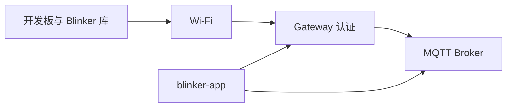
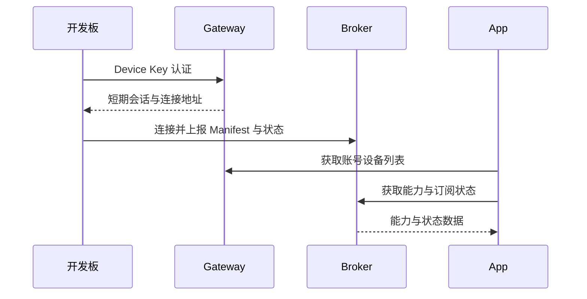

# Blinker 硬件上线

## 执行前必填：Wi-Fi 与 Device Key

先获取本次设备使用的三项配置，缺少任何一项时先请用户补充，再开始接入：

```text
Wi-Fi 名称（SSID）：<填写网络名称>
Wi-Fi 密码：<填写网络密码；开放网络需明确说明>

Device Key：<填写目标设备的 Device Key>
```

以上是输入模板。实际值由用户在执行时提供，或从用户指定的本地配置读取，写入固件工作副本的 secrets.h，不回填到此 skill 文件。

## 目标

让真实硬件使用目标账号的 Device Key，连接 App 正在使用的 Gateway，完成 MQTT 上线、能力描述（Manifest）和初始状态上报。根据实际证据判断是否需要修改代码，优先复用现有例程。

## 输入与证据

从本次会话和本机环境获取以下信息，不沿用历史设备参数：

| 输入 | 获取方式 |
| --- | --- |
| 开发板型号、连接方式 | 用户说明、USB 枚举、芯片工具探测 |
| 芯片、Flash 容量、串口 | 对目标串口执行 esptool 等平台工具的识别命令 |
| App 仓库与库仓库 | 优先使用用户指定路径，其次检查相邻的 blinker-library |
| App 当前服务环境 | 实际启动命令、构建配置及 environment 文件 |
| 设备认证与 MQTT 地址 | 库配置、Gateway 的实际运行配置与公告地址 |
| 编译与烧录工具链 | 库的构建脚本、本机已安装 SDK 和工具版本 |

## 执行边界

- 用户只要求整理文档或诊断时，不执行烧录。用户已要求烧录、让已连接硬件上线且目标明确时，在该授权范围内继续。
- 不把 Device Key 写入 App，不伪造在线状态或 Manifest，不创建针对某设备 ID 的识别分支。
- 凭据写入 Git 忽略的本地文件，例如工作副本的 secrets.h；先确认忽略规则，文件权限设为 600。含凭据的固件与工作目录也应隔离，禁用远程构建缓存和产物上传。
- 不将凭据、连接令牌或完整敏感配置输出到日志和文档；不得通过解密其他设备的凭据来寻找目标。
- 不整片擦除 Flash；按实际分区和现有固件布局判断写入范围。分区变化会覆盖已有数据时，先说明具体影响并取得相应授权。
- 多块板、未知芯片、服务环境不明或凭据不匹配时，暂停相关写入并澄清，不轮流向多个环境试用密钥。

## 执行流程

### 1. 定位现有接入路径

优先检查：

- blinker-library 的 examples/WiFiQuickStart/WiFiQuickStart.ino。
- 需要丰富界面能力时，再检查 examples/Esp32S3InterfaceDemo 及其 build.sh。
- 库的 src/BlinkerV2/arduino/config/OfficialConfig.h。
- App 的 src/environments、启动配置和 Device V2 设备列表、能力读取流程。

上述路径是已知入口，文件缺失或 API 变化时以当前源码为准。历史 README 和执行记录只能作为线索。

WiFiQuickStart 的基本调用顺序是 Device Key、SSID、密码、端点声明。它提供软件开关 power、计数 buttonPresses 和动作 button；不要将这些能力描述为物理 GPIO 控制。驱动板载 LED 前需确认板型、引脚与用户需求。

### 2. 确认硬件与服务属于同一次接入

列出串口并识别目标设备。例如，确认工具路径和端口后执行：

```sh
"$ESPTOOL" --port "$DEVICE_PORT" flash-id
```

记录芯片、Flash 容量、USB 模式和端口。不能从“ESP32-S3”推导出 16 MB Flash，也不能照搬历史例程的 CDC 或 PSRAM 参数。

确认 App 实际使用本地还是远程 Gateway。设备侧不能使用指向自身的 127.0.0.1；本地开发时应使用设备可达的主机局域网地址，并核对 Gateway 返回的 MQTT 地址。

优先用现有管理接口核对设备记录。已具备本地开发数据库访问权限时，可以根据当前实现派生 Device Key locator，只读匹配目标设备并输出设备名、ID 与状态；核对密钥状态，不输出密钥或加密字段。不要仅凭显示名称认定匹配成功。

核对认证入口、端口、TLS 与证书配置，以及 MQTT 公告地址。主机健康检查成功仅证明主机可达，不能替代开发板入网证据；不得通过关闭 TLS 来修复生产接入。

### 3. 在隔离工作副本中构建

将合适的例程复制到库中被 Git 忽略的构建工作目录。将网络与 Device Key 参数改为引用本地 secrets.h；必要时增加串口诊断，例如发送 d 调用 Blinker.printDiagnostics(Serial)。诊断不得输出凭据。

优先复用本机已验证的工具链。以下为 Aily Builder 的 ESP32-S3 命令结构，所有变量必须先由当前环境解析并校验；凭据不作为命令行参数：

```sh
"$AILY_BUILDER" compile "$SKETCH_FILE" \
    --board esp32:esp32:esp32s3 \
    --sdk-path "$SDK_DIR" \
    --tools-path "$TOOLS_DIR" \
    --build-path "$BUILD_DIR" \
    --libraries-path "$LIBRARY_DIR" \
    --libraries-path "$DEPENDENCY_DIR" \
    --build-macros "BLINKER_OFFICIAL_CONTROL_HOST=\"$GATEWAY_HOST\"" \
    --build-macros "BLINKER_OFFICIAL_CONTROL_PORT=$GATEWAY_PORT" \
    --board-options "CDCOnBoot=$CDC_MODE" \
    --board-options "FlashSize=$FLASH_SIZE" \
    --board-options "PSRAM=$PSRAM_MODE" \
    --tool-versions "$TOOL_VERSIONS" \
    --no-archive-cloud-cache \
    --no-fetch-archive-cloud-cache
```

Gateway 等影响库实现的宏必须应用到所有编译单元，不能只写在 ino 中。远程环境还需按当前库实现配置 TLS 与可信 CA；上面的命令结构不包含完整生产配置。

编译成功后记录程序和静态内存占用，检查生成的分区表与固件头。编译失败时定位第一条实质错误，不通过随意更换凭据、分区或服务环境反复尝试。

### 4. 按实际布局烧录

在烧录前再次确认端口仍对应目标芯片，关闭占用该端口的监视程序。

从构建输出和平台配置确定 bootloader、分区表、OTA 数据及应用的偏移。不要将一次任务中的 0x0、0x8000、0xe000、0x10000 当作所有开发板的固定布局。

兼容的既有布局可能只需要更新应用；首次写入或更新完整固件时按所需区域分别写入。不要用 merged.bin 代替对 NVS 和已有数据区域的判断。检查每个写入区域的校验结果，再复位进入应用。

烧录失败或设备无法启动时，先读取错误和启动日志；重新识别芯片、检查分区、USB/CDC 配置及供电连接。未获得新证据前不重复同一失败操作，不自动扩大到整片擦除。

### 5. 分层验证真实上线

按链路顺序验证，保留时间和目标设备标识：

| 层级 | 成功证据 | 不足以证明成功的现象 |
| --- | --- | --- |
| 固件 | 编译完成、写入校验通过、应用启动 | 只有构建产物 |
| 网络与认证 | 设备诊断中网络和云端连接正常，认证错误已排除 | Mac 能访问 Gateway |
| MQTT | 对应设备的实时连接状态在线 | 数据库中存在设备记录 |
| 能力 | 后端收到与固件声明一致的 Manifest、字段数量和类型 | 旧设备的缓存 Manifest |
| 状态 | 初始状态与本次启动相符 | 只有历史状态记录 |
| 独立运行 | 关闭监视后再次采样，结合连接存活机制确认仍在线 | 一次在线标记或静态时间戳 |
| App UI | 用户明确要求后实际验证，或由用户确认 | 仅凭后端在线推断已看见 UI |

默认只读核对目标设备，查询时选择所需列，不输出整个凭据表或完整会话记录。记录常见诊断项 state、network、cloud、lastOperationError 和传输错误数，以当前库的真实输出为准。

无周期上报的例程在空闲时 revision 不增长是正常现象，不能伪称已验证持续遥测。确需验证控制链路时，选择已知副作用且在用户授权范围内的动作，检查 ACK 和实际状态回报。

### 6. 按故障所在层最小修复

- 无 USB 枚举：解决连接与板型识别，不改 App。
- 未入网：检查设备侧 Wi-Fi 状态与网络可达性。
- 认证失败：核对服务环境、密钥状态、认证协议和时间要求。
- MQTT 失败：核对 Gateway 返回地址、端口、TLS、会话与 Broker 状态。
- 在线但无能力：检查 Manifest 发送与协议协商。
- 后端能力正常但 App 不显示：再检查账号归属、列表刷新、环境、能力解析与缓存。

仅在获得实现缺陷证据后修改对应模块；每次修改后重新验证受影响的链路。

## 交付与成功标准





完成时说明设备名、目标服务环境、实际通过的验证、修改范围和仍未验证的项目。只有真实设备已认证、上线、上报能力与初始状态，并完成独立运行复核，才宣称硬件上线完成；UI 未验证时明确区分。

